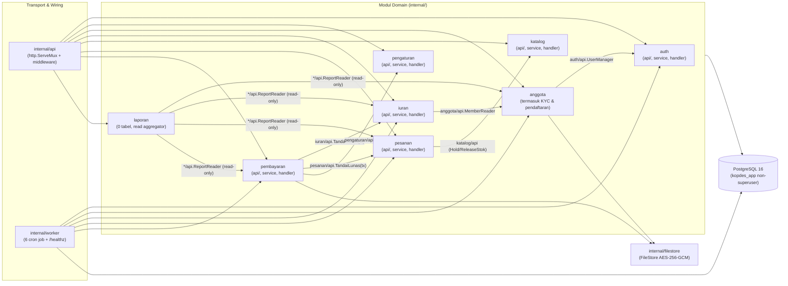
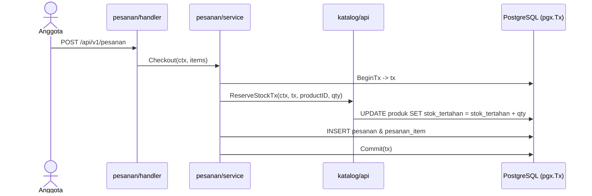
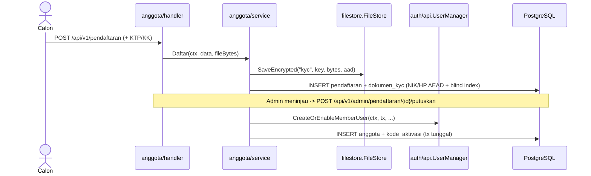

# Arsitektur Backend Kopdes Merah Putih (Modular Monolith)

Dokumen ini mendeskripsikan arsitektur **Modular Monolith** hasil **Fase 1 Prompt v9** sesuai keputusan [ADR-0001](adr/0001-modular-monolith.md).

---

## 1. Bentuk Proses Runtime & Satu Sumber `.env`

Seluruh backend dikompilasi menjadi **satu biner `kopdes`** (`cmd/kopdes`) yang dijalankan sebagai proses terpisah dari satu `docker-compose.yml` dan satu berkas `.env`:

| Subperintah | Peran Runtime | Profil Compose | Port Env |
| :--- | :--- | :--- | :--- |
| `kopdes serve` | Server HTTP API utama + router modular | `app` | `API_PORT` |
| `kopdes worker` | Penjadwal berkala + endpoint health `/healthz` (`pg_try_advisory_lock`) | `worker` | `WORKER_PORT` |
| `kopdes uiserve` | Server statis referensi UI + runtime `/config.json` (zero hardcoded port) | `tester` | `UI_PORT` |
| `kopdes admin` / `bootstrap-admin` / `migrate-storage` | Utilitas CLI operasional satu kali jalan | Manual / one-off | — |

Konfigurasi 51 variabel lingkungan divalidasi penuh oleh `go run ./cmd/envcheck --strict --ports --no-listen` dan dipetakan otomatis ke `docs/ENV_REFERENCE.md`.

---

## 2. Peta Modul & Kepemilikan Tabel (21 Tabel)



### Tabel Kepemilikan Data (Dikunci oleh `internal/arch_test.go`)

| Modul | Tabel Milik Eksklusif | Kontrak Publik (`internal/<modul>/api`) |
| :--- | :--- | :--- |
| `auth` | `users`, `sesi`, `kode_aktivasi`, `rate_limits` | `UserManager`, `BreakglassTOTPVerifier`, `MaintenanceCleaner` |
| `pengaturan` | `pengaturan`, `audit_log` | `SettingsReader`, `AuditWriter` |
| `anggota` | `anggota`, `pendaftaran`, `dokumen_kyc` | `MemberReader`, `RegistrationCleaner`, `ReportReader` |
| `iuran` | `jenis_iuran`, `tagihan_iuran` | `Service` (`TandaiLunas`), `BillingGenerator`, `ReportReader` |
| `katalog` | `kategori`, `produk`, `promo` | `ProductReader`, `StockManager` (`Hold`/`Release`/`Restore`) |
| `pesanan` | `pesanan`, `pesanan_item` | `Service` (`TandaiLunas`, `ExpirePending`), `ReportReader` |
| `pembayaran` | `rekening_qris`, `pembayaran`, `pembayaran_alokasi`, `pengembalian_dana` | `ActiveQRISReader`, `LifecycleManager`, `ReportReader` |
| `laporan` | *(0 tabel)* | Agregasi paralel read-only dari `*/api.ReportReader` |
| `worker` | `worker_runs` | Mencatat eksekusi lock `pg_try_advisory_lock` per jadwal |

---

## 3. Aturan Batas Modul & Pengujian Otomatis

Seluruh batas dijaga oleh empat tes pada `internal/arch_test.go`:

1. **`TestArchitecture_NoLegacyPendaftaranPackage`**: Paket legacy `internal/pendaftaran` telah digabung ke `internal/anggota` dan dilarang muncul kembali.
2. **`TestArchitecture_ModuleImportBoundaries`**: Modul A hanya boleh mengimpor paket domain bersama (`config`, `security`, `filestore`, `api/middleware`, `api/response`, `db` untuk query modul sendiri) dan subpaket kontrak `internal/<modulB>/api`, **dilarang** mengimpor paket implementasi modul lain.
3. **`TestArchitecture_SQLTableOwnership`**: Memindai seluruh berkas `internal/<modul>/queries/*.sql` (termasuk pernyataan `JOIN`, `INSERT`, `UPDATE`, `DELETE`, `CTE`) dan menggagalkan build bila modul A menyentuh tabel milik modul B (`laporan` juga wajib 0 kueri SQL).
4. **`TestArchitecture_DBQueriesMethodOwnership`**: Memeriksa AST Go untuk memastikan setiap metode `*db.Queries` hanya dipanggil oleh modul pemilik berkas SQL asalnya.

---

## 4. Diagram Alur Inti (Unit of Work `pgx.Tx`)

### 4.1 Alur Pembayaran & Pelunasan Tagihan/Pesanan

```mermaid
sequenceDiagram
  actor Admin
  participant PH as pembayaran/handler
  participant PS as pembayaran/service
  participant DB as PostgreSQL (pgx.Tx)
  participant IUR as iuran/api
  participant PES as pesanan/api
  participant AUD as pengaturan/api

  Admin->>PH: POST /api/v1/admin/pembayaran/{id}/verifikasi
  PH->>PS: Verifikasi(ctx, pembayaranID, aksi, adminID)
  PS->>DB: BeginTx(ctx) -> tx
  PS->>DB: SELECT pembayaran FOR UPDATE (milik pembayaran)
  PS->>IUR: UpdateBillStatusTx(ctx, tx, billID, "lunas")
  IUR->>DB: UPDATE tagihan_iuran (tx sama)
  PS->>PES: ConfirmPaidOrderTx(ctx, tx, orderID)
  PES->>DB: UPDATE pesanan -> dibayar (tx sama)
  PS->>AUD: LogTx(ctx, tx, entry)
  PS->>DB: Commit(tx)
  PS-->>Admin: 200 OK (atomic; rollback total jika salah satu gagal)
```

### 4.2 Alur Checkout Pesanan & Penahanan Stok



### 4.3 Alur Pendaftaran Anggota, Enkripsi KYC & Aktivasi



---

## 5. Worker Terjadwal & Pencegahan Duplikasi

`kopdes worker` menjalankan **6 tugas terjadwal** (`WORKER_TICK_INTERVAL`) dari satu proses atau beberapa replika kontainer:
1. `pesanan_expire` (pembatalan pesanan unpaid melewati batas & pelepasan `STOCK_HOLD_MINUTES` via `katalog/api`)
2. `iuran_generate` (pembuatan tagihan iuran bulanan idempoten per periode)
3. `pdp_purge` (retensi dokumen KYC pendaftaran ditolak sesuai `PDP_REJECTED_RETENTION_DAYS`)
4. `bukti_purge` (retensi berkas bukti bayar non-lunas sesuai `BUKTI_RETENTION_DAYS`, termasuk pembersihan kedaluwarsa `PAYMENT_EXPIRY_DURATION`)
5. `rate_limits_cleanup` (pembersihan bucket `rate_limits` kedaluwarsa)
6. `session_cleanup` (pembersihan baris `sesi` yang sudah kedaluwarsa/dicabut)

Setiap eksekusi mengambil `pg_try_advisory_lock(lockID)` pada PostgreSQL sehingga **dua proses worker yang berjalan serentak tidak pernah mengeksekusi jadwal yang sama secara ganda** (teruji otomatis oleh `TestWorker_ConcurrentTwoInstancesNoDuplicate`). Endpoint HTTP `GET /healthz` tersedia pada `WORKER_PORT` apabila `WORKER_PORT > 0`.

---

## 6. Panduan Menambah & Mengekstrak Modul

### 6.1 Menambah Modul Baru (`internal/<baru>/`)
1. Buat paket kontrak publik `internal/<baru>/api/types.go` berisi antarmuka dan DTO saja (dilarang mengimpor `internal/db` atau paket implementasi lain).
2. Buat skema migrasi tabel baru di `db/migrations/`, kueri `sqlc` di `internal/<baru>/queries/*.sql`, tambahkan ke `sqlc.yaml`, lalu jalankan `sqlc generate`.
3. Daftarkan modul dan kepemilikan tabelnya di `internal/arch_test.go` (`tableOwnership` & `domainModules`).
4. Implementasikan `service.go` (hanya memakai tabel milik sendiri; lintas modul gunakan `*pgx.Tx` + `*/api`) dan `handler.go` (<= 400 baris/file, <= 60 baris/fungsi).
5. Daftarkan rute di `internal/api/routes.go` dan jalankan `go test -v ./internal -run TestArchitecture` beserta `go test -race ./...`.

### 6.2 Mengekstrak Modul ke Microservice Mandiri di Masa Depan
Karena tidak ada kueri lintas tabel maupun impor paket internal langsung antarmodul:
1. Ganti implementasi lokal `internal/<modul>/api.Service` di modul pemanggil menjadi klien HTTP/gRPC (mis. pola `RemoteFileStore` yang diukur pada Fase 3 untuk `filestore`).
2. Pindahkan skema/tabel milik modul tersebut ke database terpisah jika batas transaksi lintas tabel sudah diganti outbox/idempotent API.
3. Tambahkan port & token layanan pada `.env.example`, `.env.test`, `.env.test.alt`, serta `cmd/envcheck` sebelum memecah container di `docker-compose.yml`.
