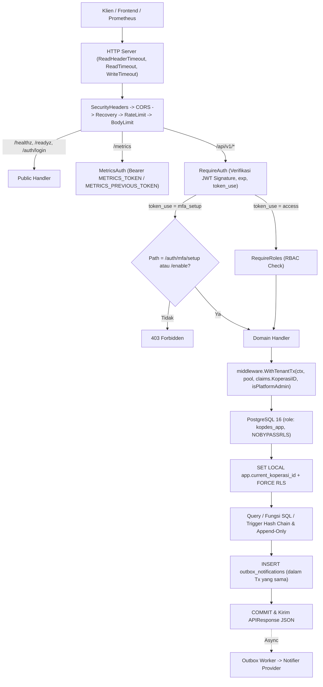
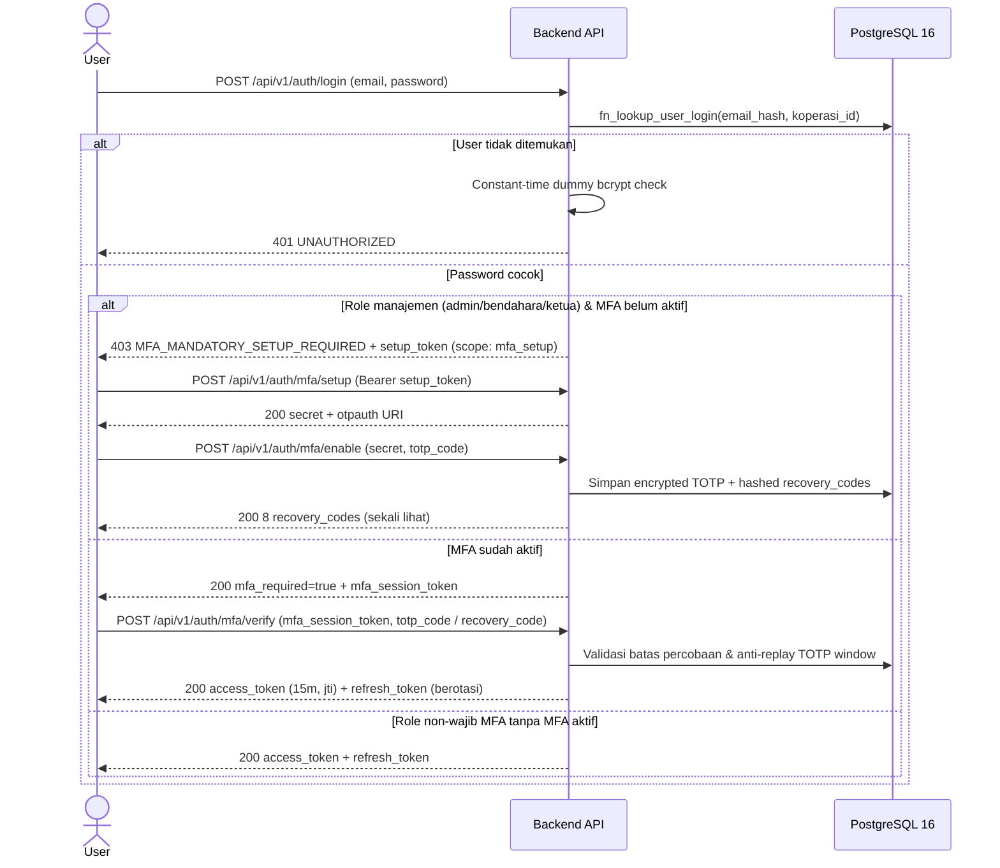
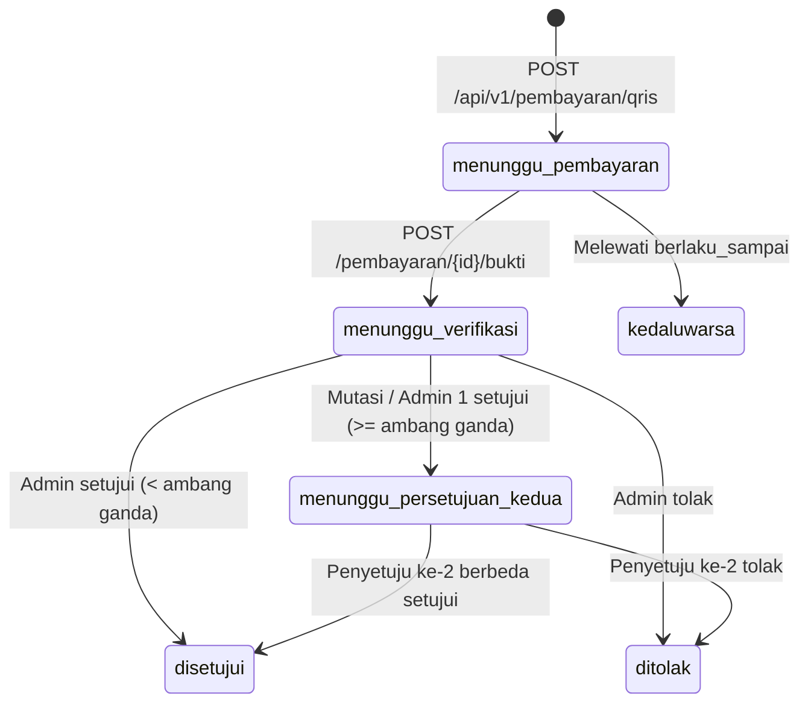

# Panduan Developer Backend — Kopdes Merah Putih

Versi Dokumen: `1.1.0` | Tanggal: `2026-11-13` | Target Runtime: `Go 1.25+ / PostgreSQL 16`

> Dokumen ini menjelaskan arsitektur, alur keamanan, kontrak basis data, dan runbook operasional kode backend Kopdes Merah Putih secara faktual berdasarkan kode sumber terverifikasi di repositori ini. Tidak ada klaim kepatuhan hukum otomatis pada dokumen ini; parameter retensi dan akuntansi yang memerlukan peninjauan ditandai secara eksplisit (`PERLU VERIFIKASI HUKUM` / `KEPUTUSAN AKUNTAN`).

---

## 1. Gambaran Arsitektur & Peta Direktori

Aplikasi menggunakan arsitektur **modular monolith** berbasis Go `net/http` standard library router (Go 1.22+ method-path pattern) yang terhubung ke PostgreSQL 16 menggunakan `pgx/v5`. Keamanan multi-tenant ditegakkan di dua lapisan: middleware aplikasi dan PostgreSQL `FORCE ROW LEVEL SECURITY`.

| Direktori / Paket | Tanggung Jawab Utama |
|---|---|
| `cmd/server` | Entrypoint binary server API & endpoint internal `/metrics`, inisialisasi pool `pgxpool`, guard role non-superuser, worker partisi & purge PDP. |
| `cmd/envcheck` | CLI validasi `.env` (`--strict`, `--compare`, `--ports`), validasi aturan produksi, tanpa pernah mencetak nilai rahasia. |
| `cmd/loadtest` | Alat uji beban HTTP konkuren untuk simulasi ribuan permintaan anggota dan pengukuran p50/p95/p99 serta error rate. |
| `.` (`package kopdes`, [service.go](../service.go)) | Logika domain inti berisiko tinggi: alokasi QRIS + linear probing kode unik, pembuatan tagihan iuran idempoten, verifikasi pembayaran atomik. |
| `internal/api` | Perakitan router HTTP (`server.go`), mapping `AppConfig` -> `api.Config`, batas timeout HTTP, dan test suite integrasi. |
| `internal/api/handlers` | Handler HTTP per domain (`auth`, `pendaftaran`, `anggota`, `user_management`, `iuran`, `katalog`, `toko`, `qris`, `kas`, `laporan`, `health`, `metrics`). |
| `internal/api/middleware` | Middleware OWASP headers, CORS tersanitasi, recovery, rate limiter berbasis IP + trusted proxy, `BodyLimit`, `RequireAuth`/`RequireRoles`, `WithTenantTx`. |
| `internal/api/response` | Envelope standar JSON `APIResponse` (`success`, `data`, `meta`, `error`) dan helper status HTTP (`400`–`500`). |
| `internal/auth` | Pembuatan & verifikasi JWT (`HS256`/`HS512`) dengan klaim `jti`, `koperasi_id`, `role`, `token_use`, serta rotasi/pengecekan key sebelumnya. *(Dilindungi aturan kunci `AGENTS.md`)*. |
| `internal/config` | Loader `.env` yang ketat, `AppConfig` terstruktur (79 variabel), katalog dokumentasi otomatis [ENV_REFERENCE.md](ENV_REFERENCE.md), dan audit hardcoded port. |
| `internal/db` | Helper `AcquireOrderedAdvisoryLocks`, `CheckDatabaseRole` (tolak superuser), partisi bulanan (`partition_manager.go`), `idempotency_keys`, dan worker `pdp_worker.go`. |
| `internal/outbox` | Antrean notifikasi transaksional (`outbox_notifications`) dan worker pengirim beserta interface mock/SMS/WhatsApp adapter. |
| `internal/qris` | Parser EMVCo QRIS ketat (CRC16 Tag 63, validasi Tag 00 `'01'`, tolak duplikasi tag, hapus Tag 55–57 saat Tag 54 dipasang). |
| `internal/security` | Enkripsi AES-256-GCM dengan AAD, HKDF-SHA256 blind index per tenant, TOTP RFC 6238, recovery codes hash, redaksi DSN/log. *(Dilindungi aturan kunci `AGENTS.md`)*. |
| `internal/simkopdes` | Adapter stub pelaporan rekap (dipulihkan dalam bentuk stub non-aktif agar kompatibilitas kontrak terjaga untuk kopdes cabang tunggal). |
| `db/docker-init` | Skrip inisialisasi role PostgreSQL (`01_roles.sql`) berbasis environment variable tanpa password default di profil `production`. |
| `db/migrations` | Migrasi SQL (`000001` s.d. `000018`) mencakup tabel bisnis, `FORCE RLS`, trigger append-only, partisi, idempotency, dan trigger hash chain. *(Dilindungi aturan kunci `AGENTS.md`)*. |
| `scripts` | Skrip operasional: `backup.sh`, `restore_test.sh`, `restore_drill.sh`, `port_check.sh`/`.ps1`, `promote_env.sh`/`.ps1`, generator dokumen. |

---

## 2. Alur Permintaan End-to-End

Setiap permintaan HTTP melewati pipeline middleware global di `internal/api/server.go` sebelum menyentuh transaksi database terisolasi tenant:



---

## 3. Model Multi-Tenant & Row Level Security (RLS)

### Mekanisme Isolasi Tenant

1. **Ekstraksi Koperasi murni dari JWT**: Nilai `koperasi_id` hanya diambil dari klaim `claims.KoperasiID` token JWT yang sudah diverifikasi signature-nya—**dilarang** mengambil `koperasi_id` dari URL parameter, body JSON, atau header HTTP klien seperti `X-Koperasi-ID` (mitigasi BOLA OWASP API1:2023).
2. **Role Database Non-Superuser**: Server aplikasi wajib terkoneksi sebagai role `kopdes_app` (`NOSUPERUSER NOCREATEDB NOCREATEROLE NOBYPASSRLS`). Pada saat startup (`cmd/server/main.go`), `db.CheckDatabaseRole` memeriksa `pg_roles` dan menolak menyalakan server apabila `rolsuper = true` atau `rolbypassrls = true`.
3. **Transaksi Terikat Tenant**: Wrapper `middleware.WithTenantTx` memulai transaksi `pgx.Tx` dan mengeksekusi `SELECT set_config('app.current_koperasi_id', $1, true)` (`is_local = true` sehingga hanya berlaku untuk transaksi tersebut dan aman saat connection pooling).
4. **Lookup Pra-Autentikasi**: Sebelum login menghasilkan JWT, `HandleLogin` memanggil fungsi `SECURITY DEFINER` terkunci `fn_lookup_user_login(p_email_hash, p_koperasi_id)` untuk mencari user lintas tenant secara terbatas tanpa menyalakan bypass platform admin.

### Batasan: Apa yang TIDAK Dilindungi RLS

RLS memfilter baris di level PostgreSQL, tetapi **tidak melindungi** dari:
- **SQL Injection** melalui konkatenasi string di query SQL (selalu gunakan parameterized query `$1, $2, ...`; contoh variabel SQL seperti nama role di `cmd/server/main.go` divalidasi dengan regex `^[a-zA-Z_][a-zA-Z0-9_]*$`).
- **Lupa membungkus query dengan `WithTenantTx`**: koneksi pool dapat mewarisi sesi kosong (`app.current_koperasi_id` kosong) sehingga query mengembalikan 0 baris atau ditolak `WITH CHECK`.
- **Fungsi `SECURITY DEFINER` yang bocor**: fungsi `SECURITY DEFINER` berjalan dengan hak pembuatnya; karena itu fungsi seperti `fn_purge_rejected_pendaftaran_pdp` dan `fn_lookup_user_login` wajib memvalidasi parameter terhadap `app_current_koperasi_id()` dan dicabut izinnya dari `PUBLIC` (`REVOKE ALL ... FROM PUBLIC; GRANT EXECUTE ... TO kopdes_app`).

### Checklist Menambah Tabel Baru Multi-Tenant

Setiap tabel baru yang menyimpan data tenant wajib memenuhi daftar ini di migrasi SQL:
1. Tambahkan kolom `koperasi_id UUID NOT NULL REFERENCES koperasi(id)` (dan `id UUID PRIMARY KEY DEFAULT uuid_generate_v7()`).
2. Gunakan `NUMERIC(18,2)` untuk seluruh kolom nilai uang (dilarang `FLOAT`/`DOUBLE PRECISION`).
3. Aktifkan `ALTER TABLE nama_tabel ENABLE ROW LEVEL SECURITY;` dan `ALTER TABLE nama_tabel FORCE ROW LEVEL SECURITY;`.
4. Definisikan policy `USING (app_is_platform_admin() OR koperasi_id = app_current_koperasi_id())` serta klausa `WITH CHECK` yang identik.
5. Berikan `GRANT SELECT, INSERT, UPDATE` (tanpa `DELETE` bila append-only) secara eksplisit ke `kopdes_app`.
6. Tambahkan indeks komposit berawalan `koperasi_id` (misalnya `(koperasi_id, created_at DESC)`).

---

## 4. Autentikasi, Refresh Rotation, MFA Wajib & RBAC

### Alur Autentikasi & MFA (Diagram Urutan)



### Deteksi Refresh Token Reuse & Hierarki RBAC

- **Rotasi Refresh Token**: Setiap `POST /api/v1/auth/refresh` menandai `refresh_tokens` lama telah terpakai (`revoked_at`) dalam satu transaksi dan menerbitkan pasangan baru. Bila token yang sudah pernah berotasi dikirim ulang (**token reuse**), server menganggap sesi dikompromikan dan mencabut seluruh refresh token aktif pengguna tersebut.
- **Anti-Eskalasi Peran**: Pada `PATCH /api/v1/users/{id}/role`, `user_management_handler.go` menetapkan peringkat `roleRank` (`anggota:10`, `operator:40`, `pengawas:50`, `pengurus:60`, `bendahara:70`, `ketua:100`, `admin:80` kecuali aturan platform): pengguna dilarang mengubah perannya sendiri maupun memberikan peran lebih tinggi daripada peringkatnya.
- **Pemisahan Read-Only vs Mutasi**: `pengawas` dan `operator` hanya diperbolehkan mengakses endpoint GET baca-saja (antrean, anggota, kas, laporan), sedangkan mutasi verifikasi pembayaran dan generate tagihan dibatasi ke peran pengurus berwenang.

---

## 5. Pembayaran QRIS, Kode Unik & Rekonsiliasi

### Diagram Status Pembayaran



### Algoritma Kode Unik & Kapasitas Slot

1. **`HitungKodeUnikAwalWithSlots`** (`service.go`) menurunkan angka awal `1..maxSlots` secara deterministik per kombinasi `(secret, anggota_id, koperasi_id)` menggunakan HMAC-SHA256. Default `maxSlots = 999` (3 digit), atau `9999` bila `KodeUnikDigits = 4`.
2. Jika `(koperasi_id, rekening_qris_id, nominal_dasar, kode_unik)` bentrok pada transaksi aktif (`idx_pembayaran_qris_nominal_aktif`), server melakukan **linear probing** menggunakan `SAVEPOINT sp_qris_unik` sampai menemukan slot kosong, atau mengembalikan HTTP `409 CONFLICT` jika seluruh slot penuh.
3. Metrik Prometheus `kopdes_pembayaran_slot_kode_unik_aktif` memantau okupansi, dan log peringatan kapasitas dicatat bila penggunaan slot mencapai `>= 70%`.

### QRIS Statis vs Dinamis (`QRIS_DYNAMIC_ENABLED`)

- Saat `QRIS_DYNAMIC_ENABLED=false` (default saat ini), sistem mengembalikan `qris_payload_statis` apa adanya (`is_autolock_nominal: false`) dan mengandalkan transfer tepat hingga `nominal_total = nominal_dasar + kode_unik`.
- Saat `QRIS_DYNAMIC_ENABLED=true`, parser `internal/qris` mengonversi payload EMVCo statis menjadi dinamis: memvalidasi Tag 00 == `'01'`, menolak tag duplikat, menghapus Tag 55–57, menyuntikkan Tag 54 (`nominal_total`), dan menghitung ulang CRC16 CCITT-FALSE (Tag 63).

### Mutasi Bank CSV, Persetujuan Ganda & Mode Pilot Rekening Pribadi

- **Impor Mutasi CSV** (`POST /api/v1/pembayaran/mutasi-bank/impor`): Menghitung hash unik per baris CSV agar impor ulang tidak menggandakan pencocokan, mencocokkan `nominal_total` transaksi aktif (`satu mutasi = satu pembayaran`), serta menjalankan deteksi anomali (jam luar kerja `22:00–05:00` WIB, transaksi beruntun cepat, hash bukti ganda).
- **Segregasi Tugas & Auto-Approve**: `auto_approve_mutasi_enabled` pada `konfigurasi_aturan` bernilai **`false` secara default**. Pengimpor CSV **dilarang** menyetujui pembayaran yang terkait dengan mutasi yang diimpornya, dan pembayaran `>= ambang_persetujuan_ganda_rp` wajib disetujui dua orang berbeda (`menunggu_persetujuan_kedua` -> `disetujui`).
- **Pilot Rekening Pribadi** (`ALLOW_PERSONAL_PAYMENT_PILOT=true`): Mengizinkan pendaftaran `jenis_pemilik = 'perorangan_pengurus'` dengan penjagaan ketat: batas maksimum per transaksi (`pilot_rekening_pribadi_max_per_transaksi`), akumulasi harian dihitung berdasarkan tanggal **`Asia/Jakarta`** (`date_trunc('day', CURRENT_TIMESTAMP AT TIME ZONE $3) AT TIME ZONE $3`) hanya atas status aktif/disetujui, banner peringatan pada respons admin, dan pencatatan `PILOT_REKENING_PRIBADI` ke `audit_log`.
- **Rekonsiliasi Harian**: `GET /api/v1/pembayaran/rekonsiliasi/harian?tanggal=YYYY-MM-DD` membandingkan total pembayaran disetujui sistem terhadap mutasi kredit (`CR`) bank dan mutasi yang telah `tercocokkan`.

### Tabel Kondisi Error Pembayaran

| HTTP Status | `error.code` | Kondisi Penyebab |
|---|---|---|
| `400` | `BAD_REQUEST` | Payload invalid, QRIS Tag 63 CRC16 rusak, melebihi batas per transaksi/harian pilot, atau rekening perorangan saat `ALLOW_PERSONAL_PAYMENT_PILOT=false`. |
| `401` | `UNAUTHORIZED` | Token JWT hilang/kedaluwarsa atau konteks koperasi tidak valid. |
| `403` | `FORBIDDEN` | Pelanggaran RBAC, Maker-Checker (verifikator = pembuat), penyetuju kedua sama, atau penyetuju = pengimpor mutasi CSV. |
| `404` | `NOT_FOUND` | ID pembayaran tidak ada atau milik anggota lain (Anti-IDOR). |
| `409` | `CONFLICT` | Seluruh slot kode unik penuh untuk nominal dasar tersebut. |
| `422` | `IDEMPOTENCY_CONFLICT` | Header `Idempotency-Key` sama dikirim ulang dengan isi body JSON yang berbeda. |

---

## 6. Domain Bisnis Lainnya: KYC, Iuran, Katalog, Promo & Toko

- **Pendaftaran Anggota & KYC** (`/api/v1/pendaftaran*`): Validasi NIK 16 digit, duplikasi dicek via HKDF blind index, upload dokumen memverifikasi **magic bytes** fisik file (`image/jpeg`, `image/png`, `application/pdf`; batas `MAX_KYC_UPLOAD_BYTES`), mencatat checksum SHA-256 ke `pendaftaran_dokumen`, serta menerbitkan `no_anggota` atomik `ANG/<tahun>/<urutan>` saat disetujui oleh checker berbeda.
- **Iuran** (`/api/v1/iuran*`): Penamaan kategori iuran memakai label netral (`pokok`/`wajib`/`sukarela`) dan setiap respons `/api/v1/iuran/jenis` menandai klasifikasi neraca sebagai **`KEPUTUSAN AKUNTAN`**. Generator tagihan (`POST /api/v1/iuran/generate`) bersifat idempoten terhadap `(koperasi_id, jenis_iuran_id, periode)`.
- **E-Katalog, Promo & Toko** (`/api/v1/katalog/*`, `/api/v1/toko/*`): `HandleCheckout` mengunci baris stok dan kuota promo dengan `SELECT ... FOR UPDATE`, menolak stok minus, memotong stok lewat entri append-only di `stok_mutasi`, serta mengosongkan keranjang dalam satu transaksi. Endpoint `POST /api/v1/toko/pesanan/{id}/batal` dan `/expire` mengembalikan stok melalui entri reversal di `stok_mutasi` dan memulihkan kuota promo melalui helper `ReleasePesananStockAndPromoTx`.

---

## 7. Data Pribadi, Kriptografi & Retensi (UU 27/2022 PDP)

1. **Enkripsi AES-256-GCM + AAD**: Kolom NIK, nomor HP, tanggal lahir, alamat, dan secret TOTP dienkripsi AES-256-GCM dengan AAD deterministik `<table>:<column>:<record_id>` serta prefix versi kunci (`AES_KEY_VERSION:AES_KEY_ID:...`). Kunci lama didefinisikan di `AES_PREVIOUS_KEYS` agar dekripsi data historis tetap berjalan saat rotasi.
2. **Blind Index Per Tenant**: Pencarian kesetaraan NIK/email memakai `DeriveTenantBlindIndexKey` (HKDF-SHA256) sehingga hash NIK milik satu koperasi tidak dapat dikorelasikan lintas koperasi atau disamakan dengan plaintext lookup global.
3. **Penyamaran & Redaksi**: `GET /api/v1/pendaftaran/{id}` mengembalikan `nik_tersamar` (contoh `3201********0001`). Logging server menggunakan `security.RedactDSN` untuk menyembunyikan kredensial DSN dan helper sanitasi CR/LF (`cmd/server/main.go`).
4. **Purge Pendaftaran Ditolak**: Worker berkala (`PDP_PURGE_INTERVAL`) dan endpoint admin `POST /api/v1/pendaftaran/purge-ditolak` memanggil `fn_purge_rejected_pendaftaran_pdp` memakai retensi dari `konfigurasi_aturan` (bawaan `PDP_REJECTED_RETENTION_DAYS=30`), menghapus berkas KYC fisik dari `STORAGE_KYC_DIR`, serta menulis log audit tanpa PII.
5. **Keputusan Hukum Terbuka (`PERLU VERIFIKASI HUKUM`)**: Penetapan durasi pasti retensi 30 hari untuk pendaftaran ditolak, retensi dokumen KTP anggota keluar/nonaktif, dan naskah persetujuan pemrosesan data masih **PERLU VERIFIKASI HUKUM** dari konsultan hukum/DPO pemilik sistem.

---

## 8. Hash Chain & Append-Only

- Enam tabel audit & mutasi bersifat append-only (dilindungi trigger penolak `UPDATE`/`DELETE`): `audit_log`, `pendaftaran_status_log`, `anggota_status_log`, `kas_mutasi`, `stok_mutasi`, dan `pembayaran_verifikasi_log`.
- Trigger `BEFORE INSERT` PostgreSQL (`000010_auto_populate_hash_chain_trigger.up.sql`) menghitung `prev_hash` dan `row_hash` secara atomik via ekstensi `pgcrypto` pada semua jalur `INSERT`.
- Untuk mencegah deadlock lintas tabel saat satu transaksi menulis lebih dari satu tabel append-only, gunakan selalu `db.AcquireOrderedAdvisoryLocks(ctx, tx, koperasiID, tableNames...)` yang mengurutkan nama tabel secara leksikografis sebelum mengambil `pg_advisory_xact_lock`. Rincian urutan lock dan skema hash terdokumentasi di [HASH_CHAIN_ADVISORY_LOCKS.md](HASH_CHAIN_ADVISORY_LOCKS.md).
- Verifikasi integritas rantai dilakukan melalui `VerifyHashChain` (diuji baik dalam suite Go konkuren 50 goroutine maupun di skrip `scripts/restore_drill.sh`).

---

## 9. Sistem Konfigurasi

Daftar lengkap **79 variabel environment** terdokumentasi secara otomatis di [ENV_REFERENCE.md](ENV_REFERENCE.md).

- **Pembagian .env vs `konfigurasi_aturan`**:
  - `.env` menyimpan konfigurasi tingkat infrastruktur, jaringan/port, DSN, rahasia kriptografi, TTL sesi, CORS, trusted proxy, dan nilai fallback global.
  - `konfigurasi_aturan` menyimpan parameter kebijakan spesifik tenant per `koperasi_id` (ambang persetujuan ganda `ambang_persetujuan_ganda_rp`, `auto_approve_mutasi_enabled`, batas pilot per transaksi/harian, retensi PDP).
- **Menambah Variabel Environment Baru**:
  1. Tambahkan field beserta struct tag `env:"NAMA_VAR"`, `default:"..."`, `scope:"..."`, `secret:"..."`, `desc:"..."`, dan `example:"..."` pada `AppConfig` di `internal/config/config.go`.
  2. Terapkan mapping ke komponen server/handler (`ConfigFromAppConfig` atau `cmd/server/main.go`).
  3. Tambahkan variabel tersebut ke `.env.example`, `.env.test`, `.env.test.alt` (dengan nilai distinct bila bukan sama-sama boolean/role standar), dan regenerasi [ENV_REFERENCE.md](ENV_REFERENCE.md).
  4. Jalankan `go test -race ./internal/config ./cmd/envcheck` dan `go run ./cmd/envcheck --compare .env.test .env.test.alt` untuk membuktikan sinkronisasi 100%.

---

## 10. Operasional & Runbook

### Deploy VPS & Pemilihan Port Bebas Bentrok

```bash
# 1. Buat .env dari template tervalidasi (isi rahasia & item manual)
bash scripts/promote_env.sh .env

# 2. Pastikan seluruh 79 variabel terisi valid
go run ./cmd/envcheck --strict --env-file .env

# 3. Cek bentrokan port host pada VPS sebelum menyalakan Compose
bash scripts/port_check.sh .env

# 4. Nyalakan PostgreSQL 16 + API backend
docker compose --env-file .env up -d --build
```

Untuk mengganti port API (`API_PORT`/`API_HOST_PORT`), metrik (`METRICS_PORT`/`METRICS_HOST_PORT`), atau PostgreSQL (`DB_PORT`/`DB_HOST_PORT`), cukup ubah nilai di `.env`, validasi dengan `port_check.sh .env`, lalu jalankan ulang `docker compose --env-file .env up -d`.

### Rotasi Rahasia Tanpa Downtime Panjang

1. **JWT Secret**: Salin `JWT_SECRET` aktif ke `JWT_PREVIOUS_SECRET`, pasang rahasia baru di `JWT_SECRET`, restart API. Token yang ditandatangani dengan rahasia lama tetap lolos verifikasi selama masa hidup akses token (`<= 15 menit`), lalu hapus `JWT_PREVIOUS_SECRET` setelah jendela TTL berlalu.
2. **AES Master Key**: Naikkan `AES_KEY_VERSION`/`AES_KEY_ID`, pindahkan pasangan lama ke format `AES_PREVIOUS_KEYS=v1:k1:<kunci_lama>`, isi kunci baru pada `AES_MASTER_KEY`. Dekripsi data PII lama otomatis memakai kunci di `AES_PREVIOUS_KEYS`, sedangkan enkripsi baru memakai kunci terbaru.
3. **Metrics Token**: Pindahkan `METRICS_TOKEN` lama ke `METRICS_PREVIOUS_TOKEN`, pasang token baru (`>= 32 byte`) di `METRICS_TOKEN`, restart API, perbarui target scrape Prometheus ([prometheus.example.yml](prometheus.example.yml)), lalu kosongkan `METRICS_PREVIOUS_TOKEN`.

### Backup, PITR & Restore Drill

- **Backup Terenkripsi**: `ENV_FILE=.env bash scripts/backup.sh` membuat dump terenkripsi AES-256-CBC/PBKDF2 (`*.dump.enc`) beserta checksum `.sha256` menggunakan role berhak akses penuh (`POSTGRES_USER`) agar tabel `FORCE RLS` ikut terbaca utuh.
- **Uji Pemulihan & DR Drill**:
  - `ENV_FILE=.env bash scripts/restore_test.sh <file.dump.enc>` menguji restore penuh ke database sementara.
  - `ENV_FILE=.env bash scripts/restore_drill.sh` membuat WAL checkpoint, menyisipkan marker `audit_log`, memulihkan snapshot ke database drill terpisah, lalu memverifikasi `broken links = 0` pada hash chain `audit_log` serta seluruh policy `FORCE RLS` aktif.

### Partisi Bulanan, Monitoring & Alerting

- Worker `db.StartPartitionMaintenanceJob` berjalan periodik (`PARTITION_JOB_INTERVAL`) memastikan partisi `PARTITION_MONTHS_AHEAD` (default `3` bulan) tersedia untuk seluruh tabel berpartisi. Untuk pemeliharaan manual, jalankan fungsi SQL pembuat partisi langsung via `psql` sebagai `kopdes_migrator`.
- Endpoint `/metrics` (membutuhkan `Authorization: Bearer <METRICS_TOKEN>`) mengekspor metrik `kopdes_partisi_bulan_tersedia`, `kopdes_partisi_default_rows` (wajib selalu `0`; jika `> 0`, partisi bulan berjalan terlambat dibuat), serta kapasitas slot kode unik QRIS (`kopdes_pembayaran_slot_kode_unik_aktif`).

### Pembuatan & Rollback Migrasi SQL

- Letakkan file berpasangan `<urut>_nama_deskriptif.up.sql` dan `<urut>_nama_deskriptif.down.sql` di `db/migrations/`. *(Catatan: Agen AI terikat aturan kunci `AGENTS.md` — tidak menyentuh `db/migrations/`, `internal/security/`, atau `internal/auth/` tanpa instruksi eksplisit pemilik).*
- Uji eksekusi `up` lalu `down` pada database tes sintetis (`kopdes_test`) sebelum menerapkan ke produksi. Selalu buat backup terlebih dahulu sebelum menjalankan migrasi di produksi.

### Penanganan Insiden & Pemecahan Masalah

| Gejala | Penyebab Umum | Langkah Perbaikan |
|---|---|---|
| API menolak start: role database terdeteksi superuser | `DB_USER` / `DATABASE_URL` memakai `postgres` | Pastikan aplikasi menggunakan `kopdes_app` (`NOSUPERUSER NOBYPASSRLS`) dan `ALLOW_SUPERUSER_DB=false`. |
| Login admin ditolak `403 MFA_MANDATORY_SETUP_REQUIRED` | Akun peran manajemen belum mengaktifkan MFA TOTP | Gunakan `setup_token` dari respons 403 untuk memanggil `/api/v1/auth/mfa/setup` lalu `/enable`. |
| `429 Too Many Requests` massal di balik Nginx / Docker | `TRUSTED_PROXIES` belum memuat CIDR proxy/bridge | Tambahkan CIDR proxy (mis. subnet bridge Docker/Nginx) ke `TRUSTED_PROXIES` agar `X-Forwarded-For` terbaca. |
| `422 IDEMPOTENCY_CONFLICT` saat retry QRIS | `Idempotency-Key` lama dipakai ulang dengan nominal/body berbeda | Hasilkan UUIDv4 baru sebagai `Idempotency-Key` untuk setiap maksud pembayaran baru. |
| `kopdes_partisi_default_rows > 0` | Partisi bulan baru belum dibuat sebelum pergantian bulan | Periksa job `partition_manager`, buat partisi bulan aktif, dan pindahkan baris dari partisi default secara aman. |
| `Error pgx`: query `0 rows` tak terduga | Query dijalankan langsung pada `pool` tanpa `WithTenantTx` | Bungkus seluruh query bisnis dalam `middleware.WithTenantTx` agar `app.current_koperasi_id` terpasang. |

---

## 11. Panduan Kontribusi, Utang Teknis & Keputusan Manusia

- **Aturan Pengembangan & Commit**: Setiap perubahan handler wajib memiliki tes integrasi `-race` (termasuk tes isolasi tenant/anti-IDOR), lulus `go test -count=1 -race -p 1 ./...`, `govulncheck ./...`, `staticcheck ./...`, `gosec`, dan `gitleaks`. Gunakan commit kecil yang terfokus.
- **Keterbatasan & Utang Teknis yang Diketahui (Jujur)**:
  1. `internal/simkopdes` dipertahankan sebagai adapter stub pasif atas permintaan pemilik proyek yang memfokuskan fase ini untuk satu kopdes cabang tunggal lokal; bila integrasi nasional dibutuhkan di masa depan, adapter ini perlu diimplementasikan dengan klien HTTP sebenarnya.
  2. Notifier WhatsApp/SMS pada `internal/outbox` saat ini berjalan memakai provider antrean & mock adapter — integrasi ke vendor gateway produksi masih menunggu kredensial pemilik.
  3. Penyimpanan KYC saat ini menulis ke direktori lokal terikat `STORAGE_KYC_DIR` (bukan object storage S3 terdistribusi); backup folder `STORAGE_KYC_DIR` wajib disertakan dalam jadwal backup VPS.
- **Keputusan di Tangan Manusia**: Lihat daftar tugas manual lengkap di [TUGAS_MANUAL_PEMILIK.md](TUGAS_MANUAL_PEMILIK.md) (penandatanganan legal retensi PDP `PERLU VERIFIKASI HUKUM`, klasifikasi akuntansi iuran `KEPUTUSAN AKUNTAN`, pengadaan akun QRIS resmi badan hukum, penyedia WhatsApp/SMS, dan sertifikat TLS/domain produksi).
