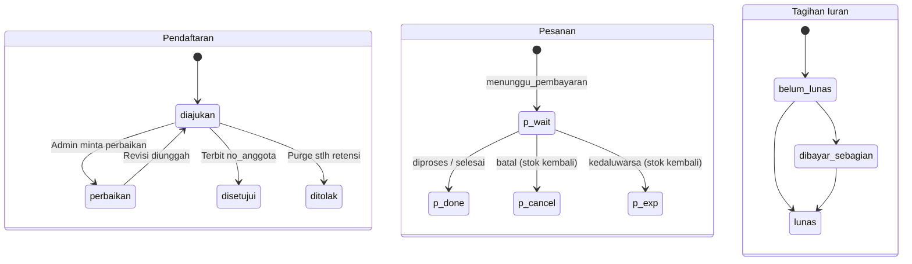

# Panduan Developer Frontend — Kopdes Merah Putih

Versi Dokumen: `1.1.0` | Tanggal: `2026-11-13` | Target Kontrak API: `v1.1.0` ([openapi.yaml](openapi.yaml))

> Panduan ini disusun langsung dari kontrak endpoint dan respons backend di `internal/api/`. Semua contoh payload, kode error, serta nama field JSON telah disesuaikan dengan implementasi server terverifikasi dan divalidasi lewat doc test otomatis.

---

## 1. Cara Mulai & Artefak Klien API

### Konfigurasi Base URL (Dilarang Hardcode)

Port backend dikendalikan sepenuhnya oleh `.env` (`API_PORT` / `API_HOST_PORT`), sehingga aplikasi frontend **dilarang keras menanamkan** URL atau nomor port secara tetap di kode sumber. Gunakan variabel environment frontend:

```bash
# .env.local (Frontend — Vite atau Next.js; sesuaikan port dengan API_HOST_PORT di backend .env)
VITE_API_BASE_URL=http://127.0.0.1:<API_HOST_PORT>
# atau untuk Next.js:
NEXT_PUBLIC_API_BASE_URL=http://127.0.0.1:<API_HOST_PORT>
```

### Menjalankan Stack Tes Backend Lokal

1. Pastikan PostgreSQL 16 test berjalan dan gunakan konfigurasi sintetis `.env.test` (Set A) atau `.env.test.alt` (Set B — port alternatif), atau Docker Compose test:
   ```bash
   docker compose -f docker-compose.test.yml --env-file .env.test up -d --build
   ```
2. Akun uji sintetis hanya dibuat di dalam fixture database tes (`setupAPITestEnv` atau seed lokal `kopdes_test`)—**tidak pernah** menggunakan akun produksi maupun kata sandi tetap di dalam repositori.
3. Impor artefak klien yang dihasilkan langsung dari [openapi.yaml](openapi.yaml):
   - Koleksi Postman v2.1: [kopdes.postman_collection.json](kopdes.postman_collection.json) (gunakan environment variable Postman `{{baseUrl}}`, `{{accessToken}}`, `{{refreshToken}}`).
   - Klien TypeScript bertipe: [kopdesClient.ts](kopdesClient.ts) (dihasilkan ulang kapan saja via `python scripts/generate_api_artifacts.py`).

---

## 2. Autentikasi, MFA Wajib & Manajemen Sesi Aman

### Alur Token & MFA

1. **`POST /api/v1/auth/login`**:
   - **Anggota biasa (tanpa MFA)**: mengembalikan HTTP `200` dengan `access_token` (15 menit), `refresh_token` (rotasi), `expires_in`, dan profil user.
   - **User dengan MFA aktif**: mengembalikan HTTP `200` berisi `mfa_required: true` dan `mfa_session_token` berumur pendek (`MFA_SESSION_TTL`, default 5 menit). Lanjutkan dengan `POST /api/v1/auth/mfa/verify`.
   - **Peran manajemen (`admin`, `bendahara`, `ketua`) yang belum mengaktifkan MFA**: mengembalikan HTTP `403` dengan `error.code = "MFA_MANDATORY_SETUP_REQUIRED"`, `data.mfa_required = true`, `data.mfa_setup_required = true`, dan `data.setup_token` (JWT dengan klaim `role: "mfa_setup"`). **Token ini hanya boleh dipakai memanggil `/api/v1/auth/mfa/setup` dan `/api/v1/auth/mfa/enable`**—ditolak `403` pada seluruh endpoint lain.
2. **`POST /api/v1/auth/refresh`**:
   - Mengirim `refresh_token` aktif untuk mendapatkan pasangan `access_token` dan `refresh_token` baru.
   - **Deteksi Reuse**: Mengirim ulang `refresh_token` lama yang sudah pernah ditukar menyebabkan seluruh refresh token aktif user dicabut seketika; frontend wajib segera memaksa logout dan mengarahkan user ke halaman login.
3. **`POST /api/v1/auth/revoke`**:
   - Mencabut sesi saat user menekan tombol Logout.

### Strategi Penyimpanan Token & Risiko Keamanan

- **Access Token**: Simpan **hanya di memori JavaScript** (variabel state/closure modul), **jangan pernah** di `localStorage` atau `sessionStorage` agar skrip XSS pihak ketiga tidak dapat mencuri bearer token secara persisten.
- **Refresh Token**:
  - Pilihan paling aman adalah menempatkannya di **HttpOnly, Secure, SameSite=Strict/Lax cookie** melalui Backend-for-Frontend (BFF) atau reverse proxy. Dalam mode cookie, seluruh request mutasi wajib dilindungi terhadap **CSRF** (verifikasi `SameSite` + header/token anti-CSRF).
  - Bila aplikasi SPA berkomunikasi langsung tanpa BFF dengan body `refresh_token`, hindari `localStorage` bila memungkinkan; pahami bahwa penyimpanan sisi klien apa pun yang terbaca JS rentan terhadap **XSS** sehingga CSP ketat + sanitasi input wajib diterapkan.

### Pembungkus `fetch` TypeScript (Single-Flight Refresh + Antrean Permintaan + Logout)

```typescript
// apiClient.ts
const API_BASE_URL = import.meta.env.VITE_API_BASE_URL;
if (!API_BASE_URL) {
  throw new Error("VITE_API_BASE_URL wajib dikonfigurasi melalui environment frontend.");
}

export interface TokenBundle {
  accessToken: string;
  refreshToken: string;
}

class AuthSessionManager {
  private accessToken: string | null = null;
  private refreshToken: string | null = null;
  private refreshInFlight: Promise<string | null> | null = null;
  private onForceLogout?: () => void;

  setLogoutHandler(cb: () => void) {
    this.onForceLogout = cb;
  }

  setTokens(tokens: TokenBundle) {
    this.accessToken = tokens.accessToken;
    this.refreshToken = tokens.refreshToken;
  }

  getAccessToken(): string | null {
    return this.accessToken;
  }

  clear() {
    this.accessToken = null;
    this.refreshToken = null;
  }

  async logout() {
    const rt = this.refreshToken;
    this.clear();
    if (rt) {
      await fetch(`${API_BASE_URL}/api/v1/auth/revoke`, {
        method: "POST",
        headers: { "Content-Type": "application/json" },
        body: JSON.stringify({ refresh_token: rt }),
      }).catch(() => {});
    }
    this.onForceLogout?.();
  }

  // Single-flight refresh: permintaan konkuren yang mendapat 401 mengantre pada Promise yang sama
  async refreshAccessTokenSingleFlight(): Promise<string | null> {
    if (this.refreshInFlight) {
      return this.refreshInFlight;
    }
    if (!this.refreshToken) {
      this.clear();
      this.onForceLogout?.();
      return null;
    }

    this.refreshInFlight = (async () => {
      try {
        const res = await fetch(`${API_BASE_URL}/api/v1/auth/refresh`, {
          method: "POST",
          headers: { "Content-Type": "application/json" },
          body: JSON.stringify({ refresh_token: this.refreshToken }),
        });
        if (!res.ok) {
          this.clear();
          this.onForceLogout?.();
          return null;
        }
        const json = await res.json();
        const data = json?.data;
        if (!data?.access_token || !data?.refresh_token) {
          this.clear();
          this.onForceLogout?.();
          return null;
        }
        this.accessToken = data.access_token;
        this.refreshToken = data.refresh_token;
        return this.accessToken;
      } finally {
        this.refreshInFlight = null;
      }
    })();

    return this.refreshInFlight;
  }
}

export const sessionManager = new AuthSessionManager();

export async function apiFetch(path: string, init: RequestInit = {}): Promise<Response> {
  const buildHeaders = (token: string | null) => {
    const h = new Headers(init.headers || {});
    if (token) h.set("Authorization", `Bearer ${token}`);
    if (!(init.body instanceof FormData) && init.body && !h.has("Content-Type")) {
      h.set("Content-Type", "application/json");
    }
    return h;
  };

  let res = await fetch(`${API_BASE_URL}${path}`, {
    ...init,
    headers: buildHeaders(sessionManager.getAccessToken()),
  });

  if (res.status === 401 && !path.startsWith("/api/v1/auth/refresh") && !path.startsWith("/api/v1/auth/login")) {
    const newToken = await sessionManager.refreshAccessTokenSingleFlight();
    if (!newToken) {
      return res;
    }
    res = await fetch(`${API_BASE_URL}${path}`, {
      ...init,
      headers: buildHeaders(newToken),
    });
  }
  return res;
}
```

---

## 3. Format Envelope Respons & Tabel Kode Error

Seluruh endpoint JSON API mengembalikan struktur envelope seragam:

```json
{
  "success": true,
  "data": {},
  "meta": {},
  "error": null
}
```

| HTTP | `error.code` | Arti Teknis | Tindakan UI yang Disarankan |
|---|---|---|---|
| `400` | `BAD_REQUEST` | Validasi input gagal / melampaui batas pilot / QRIS CRC salah | Tampilkan `error.message` pada field atau alert form; jangan retry otomatis. |
| `401` | `UNAUTHORIZED` | Token hilang, kedaluwarsa, MFA kode salah, atau refresh token tidak sah | Jalankan single-flight refresh satu kali; jika tetap gagal, hapus sesi & ke halaman Login. |
| `403` | `MFA_MANDATORY_SETUP_REQUIRED` | Akun `admin`/`bendahara`/`ketua` belum mengaktifkan MFA TOTP | Simpan `data.setup_token` sementara di memori dan arahkan ke Wizard Aktivasi MFA (`/auth/mfa/setup` -> `/enable`). |
| `403` | `FORBIDDEN` | Peran tidak diizinkan atau pelanggaran Maker-Checker / anti-eskalasi | Tampilkan pesan izin ditolak dan sembunyikan aksi mutasi tersebut dari tampilan pengguna. |
| `404` | `NOT_FOUND` | Sumber daya tidak ada atau akses anggota ke pembayaran/pendaftaran milik orang lain | Tampilkan state kosong/tidak ditemukan tanpa membocorkan status kepemilikan pihak lain. |
| `409` | `CONFLICT` | Seluruh slot kode unik penuh (999/9999) atau duplikasi NIK pendaftaran | Sarankan menunggu transaksi lain kedaluwarsa atau periksa nomor NIK yang diajukan. |
| `413` | `PAYLOAD_TOO_LARGE` / JSON 413 | Ukuran request melebihi `MAX_BODY_BYTES` atau upload KYC melebihi batas | Kompres gambar di browser sebelum kirim dan beri pesan batas maksimal berkas. |
| `422` | `IDEMPOTENCY_CONFLICT` | `Idempotency-Key` yang sama dipakai ulang dengan isi body JSON berbeda | Hasilkan `crypto.randomUUID()` baru apabila user mengubah item/nominal pembayaran. |
| `429` | `TOO_MANY_REQUESTS` | Melebihi rate limit IP atau lockout gagal login (`LoginMaxAttempts`) | Nonaktifkan tombol kirim sementara & tampilkan hitung mundur (exponential backoff). |
| `500` | `INTERNAL_SERVER_ERROR` | Gangguan sistem/database sementara | Tampilkan pesan ramah dengan nomor rujukan umum tanpa stack trace; tawarkan tombol Coba Lagi aman. |

---

## 4. `Idempotency-Key` & Pencegahan Kirim Ganda

- **`POST /api/v1/pembayaran/qris`** mendukung header `Idempotency-Key: <UUIDv4>` yang disimpan di tabel database `idempotency_keys`.
  - Buat **satu** `Idempotency-Key` saat modal/halaman bayar dibuka. Jika koneksi terputus atau user mengklik "Bayar" dua kali dengan payload yang identik, backend mengembalikan respons `201` terdahulu beserta `pembayaran_id` dan `kode_unik` yang sama (tidak memesan slot ganda).
  - Jika user kembali ke keranjang/tagihan dan mengubah nominal atau daftar tagihan, frontend **wajib membuat `Idempotency-Key` baru** agar terhindar dari `422 IDEMPOTENCY_CONFLICT`.
- **`POST /api/v1/toko/checkout`** mengunci stok & mengosongkan keranjang dalam satu transaksi DB (`FOR UPDATE`). Pada sisi UI, kunci tombol submit (`isSubmitting = true`) sampai respons selesai agar klik ganda tidak memunculkan error keranjang kosong.

---

## 5. Paginasi, Filter, Mata Uang & Zona Waktu

- **Paginasi & Filter**: Daftar seperti `/api/v1/anggota?status=aktif&page=1&limit=20` dan `/api/v1/toko/pesanan` mendukung parameter query standar serta mengembalikan ringkasan di `meta`.
- **Angka Rupiah**: Backend mengirim nominal dalam Rupiah utuh (`int64` / `NUMERIC(18,2)`). Gunakan `Intl.NumberFormat("id-ID", { style: "currency", currency: "IDR", maximumFractionDigits: 0 })` di frontend; hindari aritmetika float pecahan untuk nominal.
- **Tanggal & Zona Waktu**: Server menyimpan stempel waktu UTC (`RFC3339`) dan menghitung batas harian operasional memakai **`Asia/Jakarta`** (`APP_TIMEZONE`). Saat memanggil `/api/v1/pembayaran/rekonsiliasi/harian?tanggal=YYYY-MM-DD`, pastikan `tanggal` diformat berdasarkan zona waktu `Asia/Jakarta`.

---

## 6. Matriks Peran -> Menu & Aksi UI

> **Penting**: Penyembunyian menu di frontend semata-mata untuk kenyamanan UX (**hanya kosmetik**). Validasi RBAC, isolasi tenant RLS, dan kontrol Maker-Checker selalu ditegakkan secara mutlak oleh server backend.

| Menu / Fitur UI | `anggota` | `operator` | `pengawas` | `bendahara` | `pengurus` | `ketua` | `admin` |
|---|---|---|---|---|---|---|---|
| Profil & Status Iuran Saya | Ya | Ya | Ya | Ya | Ya | Ya | Ya |
| Belanja Toko, Keranjang, Checkout & QRIS | Ya | Ya | Ya | Ya | Ya | Ya | Ya |
| Pendaftaran Anggota & Upload KYC | Ya | Ya | Ya | Ya | Ya | Ya | Ya |
| Daftar Anggota / Antrean / Kas / Laporan (Baca) | Tidak | Ya | Ya | Ya | Ya | Ya | Ya |
| Verifikasi Pendaftaran (`POST .../verifikasi`) | Tidak | Tidak | Tidak | Tidak | Ya* | Ya* | Ya* |
| Ubah Status Anggota (`PATCH /anggota/{id}/status`) | Tidak | Tidak | Tidak | Tidak | Ya | Ya | Ya |
| Generate Tagihan & Buat Jenis Iuran | Tidak | Tidak | Tidak | Ya | Ya | Tidak | Ya |
| CRUD Produk Katalog & Promo | Tidak | Tidak | Tidak | Tidak | Ya | Tidak | Ya |
| Verifikasi Pembayaran & Impor Mutasi Bank CSV | Tidak | Tidak | Tidak | Ya* | Ya* | Ya* | Ya* |
| Rekening QRIS Koperasi (`POST`/`DELETE`) | Tidak | Tidak | Tidak | Tidak | Ya | Tidak | Ya |
| Manajemen Pengguna & Peran (`PATCH /users/{id}/role`) | Tidak | Tidak | Tidak | Tidak | Ya** | Ya** | Ya** |
| Wajib Aktivasi MFA Saat Login (`403`) | Opsional | Opsional | Opsional | **Wajib** | Opsional | **Wajib** | **Wajib** |

*\*Terikat aturan Maker-Checker & anti-duplikasi: penyetuju wajib berbeda dari pembuat pembayaran, pengimpor mutasi CSV, dan penyetuju pertama (pada persetujuan ganda).*
*\*\*Anti-eskalasi: dilarang mengubah peran sendiri atau memberi peran di atas peringkatnya.*

### Matriks Otorisasi Lengkap 54 Operasi API (`roles_matrix.json`)

<!-- BEGIN_ROLES_MATRIX -->

| Method | Path | admin | pengurus | bendahara | ketua | pengawas | operator | anggota | Unauth | Cross-Tenant | Catatan |
|---|---|---|---|---|---|---|---|---|---|---|---|
| `GET` | `/healthz` | Ya | Ya | Ya | Ya | Ya | Ya | Ya | 200 | N/A (public) | Liveness probe publik tanpa JWT; dikecualikan dari rate limiter. |
| `GET` | `/readyz` | Ya | Ya | Ya | Ya | Ya | Ya | Ya | 200 | N/A (public) | Readiness probe PostgreSQL tanpa JWT; dikecualikan dari rate limiter. |
| `GET` | `/metrics` | 401 | 401 | 401 | 401 | 401 | 401 | 401 | 401 | N/A (Bearer METRICS_TOKEN) | Wajib Bearer METRICS_TOKEN / METRICS_PREVIOUS_TOKEN (>=32 byte). JWT user/unauth ditolak 401. |
| `POST` | `/api/v1/auth/login` | Ya | Ya | Ya | Ya | Ya | Ya | Ya | [400, 401] | N/A (fn_lookup_user_login) | Publik; email/password wajib. Role admin/bendahara/ketua wajib MFA (403 setup jika belum aktif). |
| `POST` | `/api/v1/auth/mfa/setup` | Ya | Ya | Ya | Ya | Ya | Ya | Ya | 401 | N/A (self JWT) | Diizinkan untuk seluruh user terautentikasi termasuk token terbatas scope mfa_setup. |
| `POST` | `/api/v1/auth/mfa/enable` | Ya | Ya | Ya | Ya | Ya | Ya | Ya | 401 | N/A (self JWT) | Mengaktifkan TOTP + menerbitkan 8 recovery code; probe {} mengembalikan 400 (tidak mengubah DB). |
| `POST` | `/api/v1/auth/mfa/verify` | Ya | Ya | Ya | Ya | Ya | Ya | Ya | [400, 401] | N/A (mfa_session_token) | Publik tahap 2 MFA menggunakan mfa_session_token + totp_code/recovery_code. |
| `POST` | `/api/v1/auth/refresh` | Ya | Ya | Ya | Ya | Ya | Ya | Ya | [400, 401] | N/A (refresh_token) | Publik dengan refresh_token rotasi; token reuse mencabut seluruh sesi user. |
| `POST` | `/api/v1/auth/revoke` | Ya | Ya | Ya | Ya | Ya | Ya | Ya | [400, 200] | N/A (refresh_token) | Logout eksplisit mencabut refresh token. |
| `GET` | `/api/v1/auth/me` | Ya | Ya | Ya | Ya | Ya | Ya | Ya | 401 | N/A (self JWT) | Mengembalikan profil identitas & koperasi_id dari JWT aktif. |
| `POST` | `/api/v1/pendaftaran` | Ya | Ya | Ya | Ya | Ya | Ya | Ya | 401 | Terikat koperasi_id JWT + blind index NIK per tenant | Mengajukan pendaftaran calon anggota baru. |
| `GET` | `/api/v1/pendaftaran/{id}` | Ya | Ya | Ya | Ya | Ya | Ya | Ya | 401 | 404 (RLS + anti-IDOR pemilik pendaftaran) | Privileged lihat tenant aktif; anggota hanya lihat pendaftaran miliknya (404 jika milik orang lain). |
| `POST` | `/api/v1/pendaftaran/{id}/dokumen` | Ya | Ya | Ya | Ya | Ya | Ya | Ya | 401 | 400/404 (RLS + validasi multipart) | Upload berkas KYC JPEG/PNG/PDF maksimal MAX_KYC_UPLOAD_BYTES. |
| `POST` | `/api/v1/pendaftaran/{id}/verifikasi` | Ya | Ya | Tidak (403) | Ya | Tidak (403) | Tidak (403) | Tidak (403) | 401 | 400/404 (RLS koperasi_id) | RequireRoles(admin, pengurus, ketua, sekretaris) + Maker-Checker pengaju != verifikator. |
| `POST` | `/api/v1/pendaftaran/purge-ditolak` | Ya | Ya | Tidak (403) | Ya | Tidak (403) | Tidak (403) | Tidak (403) | 401 | Hanya membersihkan pendaftaran ditolak milik tenant JWT | RequireRoles(admin, pengurus, ketua, sekretaris); menghapus PII & berkas KYC > retensi. |
| `GET` | `/api/v1/anggota` | Ya | Ya | Ya | Ya | Ya | Ya | Tidak (403) | 401 | 200 (RLS hanya anggota tenant aktif) | Daftar anggota tenant untuk peran admin/pengurus/bendahara/ketua/pengawas/operator. |
| `GET` | `/api/v1/anggota/{id}` | Ya | Ya | Ya | Ya | Ya | Ya | Tidak (403) | 401 | 404 (RLS anggota Kop B ditolak) | Detail anggota tenant aktif; anggota biasa dilarang mengakses indeks seluruh anggota. |
| `PATCH` | `/api/v1/anggota/{id}/status` | Ya | Ya | Tidak (403) | Ya | Tidak (403) | Tidak (403) | Tidak (403) | 401 | 400/404 (RLS) | RequireRoles(admin, pengurus, ketua); mencatat perubahan status ke anggota_status_log. |
| `GET` | `/api/v1/users` | Ya | Ya | Tidak (403) | Ya | Tidak (403) | Tidak (403) | Tidak (403) | 401 | 200 (hanya user pada koperasi aktif) | RequireRoles(admin, pengurus, ketua). |
| `GET` | `/api/v1/users/{id}` | Ya | Ya | Tidak (403) | Ya | Tidak (403) | Tidak (403) | Tidak (403) | 401 | 404 (RLS pol_isolasi_users_select) | RequireRoles(admin, pengurus, ketua); detail user Kop B diblokir RLS -> 404. |
| `PATCH` | `/api/v1/users/{id}/role` | Ya | Ya | Tidak (403) | Ya | Tidak (403) | Tidak (403) | Tidak (403) | 401 | 400/404 (DISC-02 fix) | RequireRoles(admin, pengurus, ketua); anti-self-escalation & anti-privilege-escalation. |
| `GET` | `/api/v1/iuran/jenis` | Ya | Ya | Ya | Ya | Ya | Ya | Ya | 401 | 200 (hanya jenis iuran tenant JWT) | Daftar jenis iuran netral + penanda klasifikasi KEPUTUSAN AKUNTAN. |
| `POST` | `/api/v1/iuran/jenis` | Ya | Ya | Ya | Tidak (403) | Tidak (403) | Tidak (403) | Tidak (403) | 401 | Terikat koperasi_id JWT | RequireRoles(admin, pengurus, bendahara). |
| `GET` | `/api/v1/iuran/tagihan/saya` | Ya | Ya | Ya | Ya | Ya | Ya | Ya | 401 | 200 (hanya tagihan user sendiri) | Menampilkan tagihan iuran milik user yang login. |
| `POST` | `/api/v1/iuran/generate` | Ya | Ya | Ya | Tidak (403) | Tidak (403) | Tidak (403) | Tidak (403) | 401 | Terikat koperasi_id JWT | RequireRoles(admin, pengurus, bendahara); generate tagihan idempoten per periode. |
| `GET` | `/api/v1/iuran/menunggak` | Ya | Ya | Ya | Ya | Ya | Ya | Tidak (403) | 401 | 200 (hanya tunggakan tenant aktif) | Read-only admin roles. |
| `GET` | `/api/v1/katalog/stok` | Ya | Ya | Ya | Ya | Ya | Ya | Ya | 401 | 200 (hanya stok gudang tenant aktif) | Saldo stok katalog koperasi aktif. |
| `GET` | `/api/v1/katalog/harga` | Ya | Ya | Ya | Ya | Ya | Ya | Ya | 401 | 404 (produk/anggota Kop B tidak ditemukan via RLS) | Wajib query produk_id dan anggota_id (UUID). |
| `GET` | `/api/v1/katalog/produk` | Ya | Ya | Ya | Ya | Ya | Ya | Ya | 401 | 200 (hanya produk tenant aktif) | Daftar produk koperasi aktif. |
| `POST` | `/api/v1/katalog/produk` | Ya | Ya | Tidak (403) | Tidak (403) | Tidak (403) | Tidak (403) | Tidak (403) | 401 | Terikat koperasi_id JWT | RequireRoles(admin, pengurus). |
| `PUT` | `/api/v1/katalog/produk/{id}` | Ya | Ya | Tidak (403) | Tidak (403) | Tidak (403) | Tidak (403) | Tidak (403) | 401 | 200 (0 baris terupdate karena filter koperasi_id & RLS) | RequireRoles(admin, pengurus). |
| `DELETE` | `/api/v1/katalog/produk/{id}` | Ya | Ya | Tidak (403) | Tidak (403) | Tidak (403) | Tidak (403) | Tidak (403) | 401 | 200 (0 baris terupdate karena RLS) | RequireRoles(admin, pengurus). |
| `GET` | `/api/v1/katalog/promo` | Ya | Ya | Ya | Ya | Ya | Ya | Ya | 401 | 200 (hanya promo tenant aktif) | Daftar promo aktif tenant. |
| `POST` | `/api/v1/katalog/promo` | Ya | Ya | Tidak (403) | Tidak (403) | Tidak (403) | Tidak (403) | Tidak (403) | 401 | Terikat koperasi_id JWT | RequireRoles(admin, pengurus). |
| `GET` | `/api/v1/toko/keranjang` | Ya | Ya | Ya | Ya | Ya | Ya | Ya | 401 | 200 (hanya keranjang user sendiri) | Isi keranjang belanja user aktif. |
| `POST` | `/api/v1/toko/keranjang` | Ya | Ya | Ya | Ya | Ya | Ya | Ya | 401 | FK/RLS menolak produk_id Kop B | Menambahkan/mengubah qty item keranjang user aktif. |
| `DELETE` | `/api/v1/toko/keranjang/{produk_id}` | Ya | Ya | Ya | Ya | Ya | Ya | Ya | 401 | 200 (0 baris dihapus) | Menghapus produk dari keranjang user aktif. |
| `POST` | `/api/v1/toko/checkout` | Ya | Ya | Ya | Ya | Ya | Ya | Ya | 401 | Terikat keranjang & stok koperasi aktif | Checkout dengan kunci stok FOR UPDATE & mutasi append-only stok_mutasi. |
| `GET` | `/api/v1/toko/pesanan` | Ya | Ya | Ya | Ya | Ya | Ya | Ya | 401 | 200 (RLS koperasi aktif) | Anggota melihat pesanannya sendiri; privileged melihat pesanan koperasi. |
| `POST` | `/api/v1/toko/pesanan/{id}/batal` | Ya | Ya | Ya | Ya | Ya | Ya | Ya | 401 | 400 (pesanan Kop B tidak ditemukan via RLS) | Membatalkan pesanan & memulihkan stok + kuota promo; anggota dibatasi pesanannya sendiri. |
| `POST` | `/api/v1/toko/pesanan/{id}/expire` | Ya | Ya | Ya | Ya | Tidak (403) | Ya | Tidak (403) | 401 | 400 (pesanan Kop B tidak ditemukan via RLS) | RequireRoles(admin, pengurus, bendahara, ketua, operator); operator boleh memproses pesanan kedaluwarsa. |
| `POST` | `/api/v1/pembayaran/qris` | Ya | Ya | Ya | Ya | Ya | Ya | Ya | 401 | 400 (tagihan/rekening Kop B tidak ditemukan via RLS) | Wajib terikat tagihan/pesanan + mendukung Idempotency-Key DB + kode unik anti-tabrakan. |
| `GET` | `/api/v1/pembayaran/{id}` | Ya | Ya | Ya | Ya | Ya | Ya | Ya | 401 | 404 (RLS + anti-IDOR anggota) | Anggota biasa hanya dapat mengakses pembayaran miliknya sendiri (404 jika milik pihak lain). |
| `POST` | `/api/v1/pembayaran/{id}/bukti` | Ya | Ya | Ya | Ya | Ya | Ya | Ya | 401 | 404 (fn_klaim_bukti_pembayaran + RLS) | Klaim RRN bukti transfer oleh pembayar -> status menunggu_verifikasi. |
| `GET` | `/api/v1/pembayaran/antrean` | Ya | Ya | Ya | Ya | Ya | Ya | Tidak (403) | 401 | 200 (hanya antrean koperasi aktif) | Read-only admin roles. |
| `POST` | `/api/v1/pembayaran/{id}/verifikasi` | Ya | Ya | Ya | Ya | Tidak (403) | Tidak (403) | Tidak (403) | 401 | 400 (pembayaran Kop B tidak terlihat RLS) | RequireRoles(admin, pengurus, bendahara, ketua); Maker-Checker + dual approval > ambang. |
| `POST` | `/api/v1/pembayaran/mutasi-bank/impor` | Ya | Ya | Ya | Ya | Tidak (403) | Tidak (403) | Tidak (403) | 401 | Hanya mencocokkan pembayaran koperasi JWT aktif | RequireRoles(admin, pengurus, bendahara, ketua); CSV col: tgl,keterangan,tipe(CR),nominal,no_rek. |
| `GET` | `/api/v1/pembayaran/rekonsiliasi/harian` | Ya | Ya | Ya | Ya | Ya | Ya | Tidak (403) | 401 | 200 (agregat khusus koperasi aktif) | Read-only admin roles; batas hari memakai Asia/Jakarta. |
| `GET` | `/api/v1/koperasi/rekening-qris` | Ya | Ya | Tidak (403) | Tidak (403) | Tidak (403) | Tidak (403) | Tidak (403) | 401 | 200 (hanya rekening QRIS tenant aktif) | RequireRoles(admin, pengurus). |
| `POST` | `/api/v1/koperasi/rekening-qris` | Ya | Ya | Tidak (403) | Tidak (403) | Tidak (403) | Tidak (403) | Tidak (403) | 401 | Terikat koperasi_id JWT | RequireRoles(admin, pengurus); validasi EMVCo CRC16 + blokir perorangan kecuali pilot. |
| `DELETE` | `/api/v1/koperasi/rekening-qris/{id}` | Ya | Ya | Tidak (403) | Tidak (403) | Tidak (403) | Tidak (403) | Tidak (403) | 401 | 400 (rekening Kop B tidak ditemukan via RLS) | RequireRoles(admin, pengurus). |
| `GET` | `/api/v1/kas/mutasi` | Ya | Ya | Ya | Ya | Ya | Ya | Tidak (403) | 401 | 200 (hanya ledger kas koperasi aktif) | Read-only admin roles; tabel append-only berantai hash. |
| `GET` | `/api/v1/laporan/keuangan` | Ya | Ya | Ya | Ya | Ya | Ya | Tidak (403) | 401 | 200 (agregat khusus koperasi aktif) | Read-only admin roles. |
| `GET` | `/api/v1/laporan/anggota` | Ya | Ya | Ya | Ya | Ya | Ya | Tidak (403) | 401 | 200 (agregat khusus koperasi aktif) | Read-only admin roles. |

<!-- END_ROLES_MATRIX -->

---

## 7. Alur Layar End-to-End & Contoh Payload Nyata

### 7.1 Pendaftaran Anggota & Upload KYC + Cek Status Tersamar

1. `POST /api/v1/pendaftaran` -> mengembalikan `data.pendaftaran_id` dan `data.no_registrasi` dengan status `diajukan`.
   ```json
   {
     "nik": "3201010101900001",
     "nama_lengkap": "Siti Aminah",
     "tempat_lahir": "Bogor",
     "tanggal_lahir": "1990-01-01",
     "jenis_kelamin": "P",
     "pekerjaan": "Petani",
     "alamat_ktp": "Jl. Desa Makmur No. 10",
     "wilayah_desa_id": "<UUID_WILAYAH_DESA>"
   }
   ```
2. `POST /api/v1/pendaftaran/{id}/dokumen` (`multipart/form-data`: `dokumen` + `jenis_dokumen=ktp`) -> backend memeriksa magic bytes asli (JPEG/PNG/PDF, max 5MB).
3. `GET /api/v1/pendaftaran/{id}` -> respons memakai penyamaran PII:
   ```json
   {
     "success": true,
     "data": {
       "id": "01a1d3...",
       "nama_lengkap": "Siti Aminah",
       "nik_tersamar": "3201********0001",
       "status": "diajukan"
     }
   }
   ```

### 7.2 Tagihan Iuran, Katalog, Promo, Keranjang & Checkout

- `GET /api/v1/iuran/tagihan/saya` -> tampilkan daftar tagihan iuran aktif yang belum lunas.
- `GET /api/v1/katalog/produk`, `GET /api/v1/katalog/harga?produk_id=<id>`, `GET /api/v1/katalog/promo` -> tampilkan badge harga anggota lebih hemat serta kode promo aktif.
- `POST /api/v1/toko/keranjang` `{ "produk_id": "<UUID>", "qty": 2 }` -> tambah/perbarui qty; `DELETE /api/v1/toko/keranjang/{produk_id}` untuk menghapus.
- `POST /api/v1/toko/checkout` `{ "metode_serah_terima": "ambil_di_koperasi", "kode_promo": "HEMAT10" }` -> mengembalikan `201` berisi `pesanan_id`, `total_akhir`, dan `batas_waktu_bayar`.
- `POST /api/v1/toko/pesanan/{id}/batal` -> membatalkan pesanan belum dibayar sekaligus memulihkan stok & kuota promo.

### 7.3 Pembayaran QRIS Statis + Kode Unik + Klaim Bukti + Polling

1. Kirim `POST /api/v1/pembayaran/qris` dengan header `Idempotency-Key: <UUIDv4>`:
   ```json
   {
     "jenis_transaksi": "iuran_bulanan",
     "tagihan_iuran_id": ["<UUID_TAGIHAN>"]
   }
   ```
2. Contoh respons nyata (`201 Created` dari suite terverifikasi):
   ```json
   {
     "success": true,
     "data": {
       "pembayaran_id": "01a1d313-c3aa-7f9e-80d1-d65742ce42cc",
       "no_pembayaran": "PAY-f6da1059-3727",
       "kode_unik": 356,
       "nominal_dasar": 600000,
       "nominal_total": 600356,
       "qris_payload": "00020101021126660011ID.CO.QRIS.WWW01189360052300000123450215ID10203040506070303UMI5204541153033605802ID5914Pilot Pengurus6007Jakarta630432C2",
       "qris_payload_statis": "00020101021126660011ID.CO.QRIS.WWW...",
       "is_autolock_nominal": false,
       "nama_merchant": "Pilot Pengurus Budi",
       "nmid": "ID2650218851083",
       "berlaku_sampai": "2026-11-13T05:04:10.280721416Z",
       "sisa_waktu_detik": 3599,
       "warning_banner": "PERINGATAN: Pembayaran ini menggunakan rekening perorangan pengurus (Pilot Mode)...",
       "is_rekening_pribadi": true
     }
   }
   ```
3. **Panduan Tampilan Layar Pembayaran**:
   - Render QR code dari `qris_payload`. Jika `is_autolock_nominal === false`, sorot **Nominal Total (`Rp 600.356`)** berukuran besar dengan badge kode unik (`+356`) dan tombol **Salin Nominal** satu sentuhan agar anggota tidak salah ketik.
   - Tampilkan hitung mundur dari `sisa_waktu_detik` / `berlaku_sampai`. Jika `warning_banner` ada pada tampilan admin, tampilkan alert kuning/merah permanen.
   - Setelah transfer, panggil `POST /api/v1/pembayaran/{id}/bukti` `{ "referensi_rrn": "...", "catatan": "Sudah transfer" }` dan lakukan polling `GET /api/v1/pembayaran/{id}` setiap 10–15 detik sampai status menjadi `disetujui` atau `ditolak`.

### 7.4 Alur Backoffice Pengurus, Rekonsiliasi & MFA

- **Antrean & Persetujuan Ganda**: `GET /api/v1/pembayaran/antrean` -> tampilkan badge transaksi `menunggu_persetujuan_kedua` atau memiliki `is_anomali = true`. Panggil `POST /api/v1/pembayaran/{id}/verifikasi` `{ "disetujui": true, "nominal_aktual": 600356 }`.
- **Impor Mutasi CSV & Rekonsiliasi Harian**: Upload file CSV via `POST /api/v1/pembayaran/mutasi-bank/impor`, lalu tampilkan ringkasan `GET /api/v1/pembayaran/rekonsiliasi/harian?tanggal=YYYY-MM-DD` (`total_pembayaran_sistem`, `total_mutasi_bank_cr`, `total_tercocokkan`).
- **Laporan, Users & Pengaturan MFA**: `GET /api/v1/laporan/keuangan`, `GET /api/v1/laporan/anggota`, `GET /api/v1/users`, `PATCH /api/v1/users/{id}/role`, serta wizard MFA (`/api/v1/auth/mfa/setup` & `/enable`).

---

## 8. Diagram Status Domain Utama



Makna tampilan UI:
- **`menunggu_pembayaran`**: Menunggu scan QRIS & transfer dari anggota (tampilkan QR + countdown).
- **`menunggu_verifikasi`**: Bukti sudah diklaim anggota, sedang diperiksa bendahara/admin.
- **`menunggu_persetujuan_kedua`**: Pembayaran >= ambang ganda sudah disetujui orang pertama, menunggu verifikator kedua yang berbeda.
- **`disetujui` / `lunas` / `aktif`**: Transaksi atau keanggotaan sah tercatat di ledger.
- **`ditolak` / `batal` / `kedaluwarsa`**: Transaksi berakhir tanpa pencatatan lunas (alasan penolakan ditampilkan jelas ke user).

---

## 9. Perlindungan Data Pribadi di Sisi Klien

1. **Jangan pernah** menyimpan NIK, alamat KTP, token autentikasi, atau foto KTP ke dalam `localStorage`, `sessionStorage`, state URL/query string, console log produksi, maupun tool analytics pihak ketiga (Sentry replay tanpa masking, Google Analytics, dsb.).
2. Tampilkan hanya `nik_tersamar` (`3201********0001`) di UI setelah pendaftaran diajukan.
3. **Unggah Berkas KYC**: Lakukan pengecekan ekstensi (`image/jpeg`, `image/png`, `application/pdf`) serta kompresi gambar (`canvas.toBlob` ke JPEG kualitas ~0.8, lebar maks 1600px) sebelum dikirim agar ukuran berkas tetap di bawah batas 5MB (`MAX_KYC_UPLOAD_BYTES`) sekaligus ramah kuota seluler anggota desa.

---

## 10. Contoh Kode React + TypeScript & Referensi cURL

### Hook `useAuth` (React + TypeScript)

```tsx
import { useState, useCallback, useEffect } from "react";
import { apiFetch, sessionManager } from "./apiClient";

export type AuthStep = "anonymous" | "mfa_challenge" | "mfa_setup_required" | "authenticated";

export function useAuth() {
  const [step, setStep] = useState<AuthStep>("anonymous");
  const [user, setUser] = useState<{ user_id: string; nama_lengkap: string; role: string } | null>(null);
  const [mfaSessionToken, setMfaSessionToken] = useState<string>("");
  const [setupToken, setSetupToken] = useState<string>("");

  useEffect(() => {
    sessionManager.setLogoutHandler(() => {
      setUser(null);
      setStep("anonymous");
    });
  }, []);

  const login = useCallback(async (email: string, password: string) => {
    const res = await apiFetch("/api/v1/auth/login", {
      method: "POST",
      body: JSON.stringify({ email, password }),
    });
    const json = await res.json();

    if (res.status === 403 && json?.error?.code === "MFA_MANDATORY_SETUP_REQUIRED") {
      setSetupToken(json.data.setup_token);
      setStep("mfa_setup_required");
      return { ok: false as const, next: "mfa_setup" as const };
    }
    if (!res.ok) {
      return { ok: false as const, error: json?.error?.message || "Login gagal" };
    }
    if (json.data?.mfa_required) {
      setMfaSessionToken(json.data.mfa_session_token);
      setStep("mfa_challenge");
      return { ok: false as const, next: "mfa_verify" as const };
    }

    sessionManager.setTokens({
      accessToken: json.data.access_token,
      refreshToken: json.data.refresh_token,
    });
    setUser(json.data);
    setStep("authenticated");
    return { ok: true as const };
  }, []);

  const verifyMfa = useCallback(async (totpCode: string) => {
    const res = await apiFetch("/api/v1/auth/mfa/verify", {
      method: "POST",
      body: JSON.stringify({ mfa_session_token: mfaSessionToken, totp_code: totpCode }),
    });
    const json = await res.json();
    if (!res.ok) throw new Error(json?.error?.message || "Kode MFA tidak valid");

    sessionManager.setTokens({
      accessToken: json.data.access_token,
      refreshToken: json.data.refresh_token,
    });
    setUser(json.data);
    setStep("authenticated");
  }, [mfaSessionToken]);

  const logout = useCallback(() => sessionManager.logout(), []);

  return { step, user, setupToken, login, verifyMfa, logout };
}
```

### Komponen Halaman Pembayaran QRIS & Form Pendaftaran KYC

```tsx
import { useState, useMemo } from "react";
import { apiFetch } from "./apiClient";

export function QrisPaymentPage({ tagihanIds }: { tagihanIds: string[] }) {
  const [idempKey] = useState(() => crypto.randomUUID());
  const [loading, setLoading] = useState(false);
  const [payment, setPayment] = useState<any>(null);
  const [error, setError] = useState<string>("");

  const createPayment = async () => {
    setLoading(true);
    setError("");
    try {
      const res = await apiFetch("/api/v1/pembayaran/qris", {
        method: "POST",
        headers: { "Idempotency-Key": idempKey },
        body: JSON.stringify({ jenis_transaksi: "iuran_bulanan", tagihan_iuran_id: tagihanIds }),
      });
      const json = await res.json();
      if (!res.ok) {
        setError(json?.error?.message || "Gagal membuat kode pembayaran");
        return;
      }
      setPayment(json.data);
    } finally {
      setLoading(false);
    }
  };

  return (
    <section aria-label="Pembayaran QRIS">
      {!payment ? (
        <button type="button" onClick={createPayment} disabled={loading}>
          {loading ? "Menyiapkan QRIS..." : "Bayar Sekarang"}
        </button>
      ) : (
        <div>
          <h2>Total Transfer Tepat</h2>
          <p style={{ fontSize: "2rem", fontWeight: 700 }}>
            Rp {Number(payment.nominal_total).toLocaleString("id-ID")}
          </p>
          <p>Termasuk kode unik: {payment.kode_unik}</p>
          <button type="button" onClick={() => navigator.clipboard.writeText(String(payment.nominal_total))}>
            Salin Nominal Total
          </button>
          <pre>{payment.qris_payload}</pre>
        </div>
      )}
      {error && <p role="alert">{error}</p>}
    </section>
  );
}

export function PendaftaranKycForm({ wilayahDesaId }: { wilayahDesaId: string }) {
  const [statusMsg, setStatusMsg] = useState("");
  const onSubmit = async (e: React.FormEvent<HTMLFormElement>) => {
    e.preventDefault();
    const form = new FormData(e.currentTarget);
    const regRes = await apiFetch("/api/v1/pendaftaran", {
      method: "POST",
      body: JSON.stringify({
        nik: form.get("nik"),
        nama_lengkap: form.get("nama_lengkap"),
        tempat_lahir: form.get("tempat_lahir"),
        tanggal_lahir: form.get("tanggal_lahir"),
        jenis_kelamin: form.get("jenis_kelamin"),
        pekerjaan: form.get("pekerjaan"),
        alamat_ktp: form.get("alamat_ktp"),
        wilayah_desa_id: wilayahDesaId,
      }),
    });
    const regJson = await regRes.json();
    if (!regRes.ok) {
      setStatusMsg(regJson?.error?.message || "Gagal mengajukan pendaftaran");
      return;
    }
    const file = form.get("ktp_file") as File | null;
    if (file && regJson.data?.id) {
      const up = new FormData();
      up.append("dokumen", file);
      up.append("jenis_dokumen", "ktp");
      await apiFetch(`/api/v1/pendaftaran/${regJson.data.id}/dokumen`, { method: "POST", body: up });
    }
    setStatusMsg("Pendaftaran berhasil dikirim.");
  };

  return (
    <form onSubmit={onSubmit}>
      <input name="nik" required minLength={16} maxLength={16} aria-label="NIK 16 Digit" />
      <input name="nama_lengkap" required aria-label="Nama Lengkap" />
      <input name="tempat_lahir" required aria-label="Tempat Lahir" />
      <input name="tanggal_lahir" type="date" required aria-label="Tanggal Lahir" />
      <select name="jenis_kelamin" defaultValue="L"><option value="L">Laki-laki</option><option value="P">Perempuan</option></select>
      <input name="pekerjaan" aria-label="Pekerjaan" />
      <input name="alamat_ktp" required aria-label="Alamat KTP" />
      <input name="ktp_file" type="file" accept="image/jpeg,image/png,application/pdf" required />
      <button type="submit">Ajukan Pendaftaran</button>
      {statusMsg && <p role="status">{statusMsg}</p>}
    </form>
  );
}
```

### Checklist UX Frontend

- Desain **mobile-first** (ukuran target tombol minimal 44x44px untuk anggota desa pengguna smartphone).
- Semua tombol mutasi menampilkan state loading & nonaktif saat request berlangsung.
- Pesan error selalu diterjemahkan menjadi instruksi yang dapat ditindaklanjuti pengguna.
- Aksesibilitas: atribut `aria-label`, `role="alert"` untuk error, `role="status"` untuk notifikasi, kontras warna memadai.

### Referensi cURL Seluruh Kelompok Endpoint

*(Gunakan variabel shell `API_BASE_URL`, `TOKEN`, `REFRESH_TOKEN`, `METRICS_TOKEN` — tanpa hardcode port atau token).*

```bash
# Kesehatan & Metrik
curl -s "${API_BASE_URL}/healthz"
curl -s "${API_BASE_URL}/readyz"
curl -s -H "Authorization: Bearer ${METRICS_TOKEN}" "${API_BASE_URL}/metrics"

# Autentikasi, MFA & Profil
curl -s -X POST "${API_BASE_URL}/api/v1/auth/login" -H "Content-Type: application/json" -d '{"email":"user@kopdes.local","password":"<PASSWORD>"}'
curl -s -X POST "${API_BASE_URL}/api/v1/auth/mfa/setup" -H "Authorization: Bearer ${SETUP_OR_ACCESS_TOKEN}"
curl -s -X POST "${API_BASE_URL}/api/v1/auth/mfa/enable" -H "Authorization: Bearer ${SETUP_OR_ACCESS_TOKEN}" -H "Content-Type: application/json" -d '{"secret":"...","totp_code":"123456"}'
curl -s -X POST "${API_BASE_URL}/api/v1/auth/mfa/verify" -H "Content-Type: application/json" -d '{"mfa_session_token":"...","totp_code":"123456"}'
curl -s -X POST "${API_BASE_URL}/api/v1/auth/refresh" -H "Content-Type: application/json" -d "{\"refresh_token\":\"${REFRESH_TOKEN}\"}"
curl -s -X POST "${API_BASE_URL}/api/v1/auth/revoke" -H "Content-Type: application/json" -d "{\"refresh_token\":\"${REFRESH_TOKEN}\"}"
curl -s -H "Authorization: Bearer ${TOKEN}" "${API_BASE_URL}/api/v1/auth/me"

# Pendaftaran, Anggota & Users
curl -s -X POST "${API_BASE_URL}/api/v1/pendaftaran" -H "Authorization: Bearer ${TOKEN}" -H "Content-Type: application/json" -d '{"nik":"3201010101900001","nama_lengkap":"Budi","tempat_lahir":"Bogor","tanggal_lahir":"1990-01-01","jenis_kelamin":"L","alamat_ktp":"Desa Sukamaju","wilayah_desa_id":"<UUID>"}'
curl -s -H "Authorization: Bearer ${TOKEN}" "${API_BASE_URL}/api/v1/pendaftaran/${PENDAFTARAN_ID}"
curl -s -X POST "${API_BASE_URL}/api/v1/pendaftaran/${PENDAFTARAN_ID}/dokumen" -H "Authorization: Bearer ${TOKEN}" -F "dokumen=@ktp.jpg" -F "jenis_dokumen=ktp"
curl -s -X POST "${API_BASE_URL}/api/v1/pendaftaran/${PENDAFTARAN_ID}/verifikasi" -H "Authorization: Bearer ${ADMIN_TOKEN}" -H "Content-Type: application/json" -d '{"status":"disetujui"}'
curl -s -X POST "${API_BASE_URL}/api/v1/pendaftaran/purge-ditolak" -H "Authorization: Bearer ${ADMIN_TOKEN}"
curl -s -H "Authorization: Bearer ${ADMIN_TOKEN}" "${API_BASE_URL}/api/v1/anggota"
curl -s -H "Authorization: Bearer ${ADMIN_TOKEN}" "${API_BASE_URL}/api/v1/anggota/${ANGGOTA_ID}"
curl -s -X PATCH "${API_BASE_URL}/api/v1/anggota/${ANGGOTA_ID}/status" -H "Authorization: Bearer ${ADMIN_TOKEN}" -H "Content-Type: application/json" -d '{"status":"nonaktif","alasan":"Pindah domisili"}'
curl -s -H "Authorization: Bearer ${ADMIN_TOKEN}" "${API_BASE_URL}/api/v1/users"
curl -s -H "Authorization: Bearer ${ADMIN_TOKEN}" "${API_BASE_URL}/api/v1/users/${USER_ID}"
curl -s -X PATCH "${API_BASE_URL}/api/v1/users/${USER_ID}/role" -H "Authorization: Bearer ${ADMIN_TOKEN}" -H "Content-Type: application/json" -d '{"role":"operator"}'

# Iuran, Katalog, Toko & Checkout
curl -s -H "Authorization: Bearer ${TOKEN}" "${API_BASE_URL}/api/v1/iuran/jenis"
curl -s -X POST "${API_BASE_URL}/api/v1/iuran/jenis" -H "Authorization: Bearer ${ADMIN_TOKEN}" -H "Content-Type: application/json" -d '{"kode":"IURAN_WAJIB","nama":"Iuran Bulanan","tipe":"wajib","nominal_standar":25000}'
curl -s -H "Authorization: Bearer ${TOKEN}" "${API_BASE_URL}/api/v1/iuran/tagihan/saya"
curl -s -X POST "${API_BASE_URL}/api/v1/iuran/generate" -H "Authorization: Bearer ${ADMIN_TOKEN}" -H "Content-Type: application/json" -d '{"jenis_iuran_id":"<UUID>","periode":"2026-11"}'
curl -s -H "Authorization: Bearer ${ADMIN_TOKEN}" "${API_BASE_URL}/api/v1/iuran/menunggak"
curl -s -H "Authorization: Bearer ${TOKEN}" "${API_BASE_URL}/api/v1/katalog/stok"
curl -s -H "Authorization: Bearer ${TOKEN}" "${API_BASE_URL}/api/v1/katalog/harga?produk_id=${PRODUK_ID}"
curl -s -H "Authorization: Bearer ${TOKEN}" "${API_BASE_URL}/api/v1/katalog/produk"
curl -s -X POST "${API_BASE_URL}/api/v1/katalog/produk" -H "Authorization: Bearer ${ADMIN_TOKEN}" -H "Content-Type: application/json" -d '{"nama":"Beras Premium 5kg","sku":"BRS-5KG","satuan_dasar":"sak","harga_umum":72000,"harga_anggota":68000,"stok_awal":50}'
curl -s -X PUT "${API_BASE_URL}/api/v1/katalog/produk/${PRODUK_ID}" -H "Authorization: Bearer ${ADMIN_TOKEN}" -H "Content-Type: application/json" -d '{"nama":"Beras Premium Super 5kg"}'
curl -s -X DELETE "${API_BASE_URL}/api/v1/katalog/produk/${PRODUK_ID}" -H "Authorization: Bearer ${ADMIN_TOKEN}"
curl -s -H "Authorization: Bearer ${TOKEN}" "${API_BASE_URL}/api/v1/katalog/promo"
curl -s -X POST "${API_BASE_URL}/api/v1/katalog/promo" -H "Authorization: Bearer ${ADMIN_TOKEN}" -H "Content-Type: application/json" -d '{"kode":"HEMAT5K","nama":"Diskon Anggota","tipe_promo":"nominal","nilai_diskon":5000,"minimal_belanja":50000,"durasi_hari":30}'
curl -s -H "Authorization: Bearer ${TOKEN}" "${API_BASE_URL}/api/v1/toko/keranjang"
curl -s -X POST "${API_BASE_URL}/api/v1/toko/keranjang" -H "Authorization: Bearer ${TOKEN}" -H "Content-Type: application/json" -d '{"produk_id":"<UUID>","qty":2}'
curl -s -X DELETE "${API_BASE_URL}/api/v1/toko/keranjang/${PRODUK_ID}" -H "Authorization: Bearer ${TOKEN}"
curl -s -X POST "${API_BASE_URL}/api/v1/toko/checkout" -H "Authorization: Bearer ${TOKEN}" -H "Content-Type: application/json" -d '{"metode_serah_terima":"ambil_di_koperasi","kode_promo":"HEMAT5K"}'
curl -s -H "Authorization: Bearer ${TOKEN}" "${API_BASE_URL}/api/v1/toko/pesanan"
curl -s -X POST "${API_BASE_URL}/api/v1/toko/pesanan/${PESANAN_ID}/batal" -H "Authorization: Bearer ${TOKEN}"
curl -s -X POST "${API_BASE_URL}/api/v1/toko/pesanan/${PESANAN_ID}/expire" -H "Authorization: Bearer ${ADMIN_TOKEN}"

# QRIS, Rekening Koperasi, Mutasi CSV, Kas & Laporan
curl -s -X POST "${API_BASE_URL}/api/v1/koperasi/rekening-qris" -H "Authorization: Bearer ${ADMIN_TOKEN}" -H "Content-Type: application/json" -d '{"nama_merchant":"Kopdes Makmur","nmid":"ID1234567890123","nama_bank_pjp":"BRI","no_rekening_settlement":"0011223344","nama_pemilik_rekening":"Koperasi Desa Makmur","is_atas_nama_badan_hukum":true,"jenis_pemilik":"badan_hukum_koperasi","qris_payload_statis":"<EMVCO_QRIS>"}'
curl -s -H "Authorization: Bearer ${ADMIN_TOKEN}" "${API_BASE_URL}/api/v1/koperasi/rekening-qris"
curl -s -X DELETE "${API_BASE_URL}/api/v1/koperasi/rekening-qris/${REKENING_ID}" -H "Authorization: Bearer ${ADMIN_TOKEN}"
curl -s -X POST "${API_BASE_URL}/api/v1/pembayaran/qris" -H "Authorization: Bearer ${TOKEN}" -H "Idempotency-Key: $(uuidgen)" -H "Content-Type: application/json" -d '{"jenis_transaksi":"iuran_bulanan","tagihan_iuran_id":["<UUID>"]}'
curl -s -H "Authorization: Bearer ${TOKEN}" "${API_BASE_URL}/api/v1/pembayaran/${PEMBAYARAN_ID}"
curl -s -X POST "${API_BASE_URL}/api/v1/pembayaran/${PEMBAYARAN_ID}/bukti" -H "Authorization: Bearer ${TOKEN}" -H "Content-Type: application/json" -d '{"referensi_rrn":"123456789012"}'
curl -s -H "Authorization: Bearer ${ADMIN_TOKEN}" "${API_BASE_URL}/api/v1/pembayaran/antrean"
curl -s -X POST "${API_BASE_URL}/api/v1/pembayaran/${PEMBAYARAN_ID}/verifikasi" -H "Authorization: Bearer ${ADMIN_VERIFIER_TOKEN}" -H "Content-Type: application/json" -d '{"disetujui":true}'
curl -s -X POST "${API_BASE_URL}/api/v1/pembayaran/mutasi-bank/impor" -H "Authorization: Bearer ${ADMIN_TOKEN}" -F "file=@mutasi.csv"
curl -s -H "Authorization: Bearer ${ADMIN_TOKEN}" "${API_BASE_URL}/api/v1/pembayaran/rekonsiliasi/harian?tanggal=2026-11-13"
curl -s -H "Authorization: Bearer ${ADMIN_TOKEN}" "${API_BASE_URL}/api/v1/kas/mutasi"
curl -s -H "Authorization: Bearer ${ADMIN_TOKEN}" "${API_BASE_URL}/api/v1/laporan/keuangan"
curl -s -H "Authorization: Bearer ${ADMIN_TOKEN}" "${API_BASE_URL}/api/v1/laporan/anggota"
```

---

## 11. CORS, Lingkungan & Debugging

- **Variabel Backend yang Mempengaruhi Frontend**:
  - `ALLOWED_ORIGINS`: harus mencantumkan origin persis frontend (skema + host + port, misalnya `http://127.0.0.1:3000` atau domain HTTPS produksi). Wildcard `*` **ditolak keras** oleh server saat `APP_ENV=production`.
  - `API_HOST_PORT` / `API_PORT`: port HTTP backend tujuan fetch frontend.
- **Debugging CORS**:
  1. Periksa header `Origin` browser pada DevTools Network apakah cocok persis dengan `ALLOWED_ORIGINS` (perhatikan perbedaan `localhost` vs `127.0.0.1` dan port!).
  2. Header kustom `X-Koperasi-ID` **sengaja tidak diizinkan** oleh kebijakan CORS; jangan pernah mengirimkannya dari frontend karena tenant diekstrak murni dari JWT.
- **Debugging `429 Too Many Requests`**:
  1. Pastikan frontend mengimplementasikan single-flight refresh dan menghindari polling lebih cepat dari interval 10 detik.
  2. Apabila `429` terjadi serentak pada banyak user di belakang reverse proxy / Docker, minta operator backend menambahkan CIDR proxy ke variabel `TRUSTED_PROXIES`.
