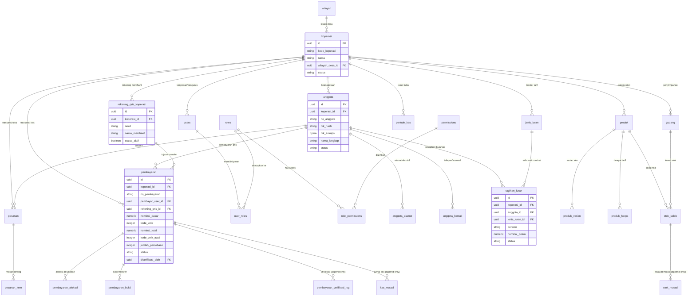

# Entity Relationship Diagram (ERD) — Kopdes Merah Putih

Dokumen ini memetakan arsitektur data relasional PostgreSQL 16 untuk aplikasi Koperasi Desa (Kopdes) Merah Putih.

## 1. Diagram ERD Inti (Mermaid)

## 2. Prinsip Arsitektur Database
1. **Multi-Tenant Row-Level Security (RLS)**:
   - Setiap tabel bisnis dilengkapi `koperasi_id uuid NOT NULL REFERENCES koperasi(id)`.
   - RLS diaktifkan (`FORCE ROW LEVEL SECURITY`) dengan kebijakan `koperasi_id = app_current_koperasi_id()`.
2. **Anti-Tabrakan QRIS Statis**:
   - Partial unique index `idx_pembayaran_qris_nominal_aktif` pada `(koperasi_id, rekening_qris_id, nominal_total)` untuk transaksi pending (`menunggu_pembayaran`, `menunggu_verifikasi`).
   - Algoritma pencarian kode unik (1..999) menggunakan HMAC-SHA256 deterministik + linear probing dengan PostgreSQL `SAVEPOINT`.
3. **Integritas Keuangan & Audit Append-Only**:
   - Dilarang `UPDATE` / `DELETE` pada tabel audit dan jurnal transaksi: `kas_mutasi`, `stok_mutasi`, `pembayaran_verifikasi_log`, `anggota_status_log`, `pendaftaran_status_log`, dan `audit_log`.
4. **Perlindungan Data Pribadi (Enkripsi AES-256-GCM)**:
   - Data sensitif seperti NIK, nomor HP, email, alamat disimpan terenkripsi (`*_enkripsi`, AES-256-GCM + AAD) dengan indeks blind-index HKDF-SHA256 (`*_hash`). Evaluasi kepatuhan hukum formal memerlukan peninjauan ahli hukum secara berkala.
