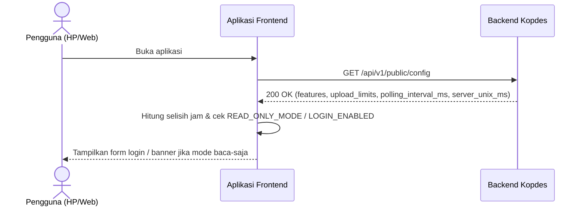
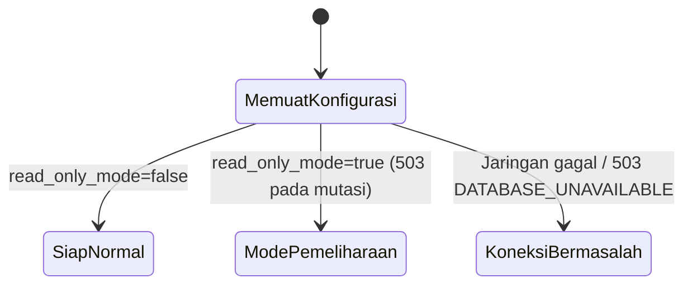

# 00. Mulai Cepat 5 Menit Integrasi Frontend

Dokumen ini memandu pengembang frontend yang baru bergabung agar dalam waktu singkat dapat menyambungkan aplikasi ke backend Kopdes Merah Putih secara aman, mengambil konfigurasi publik tanpa hardcode batas sistem, lalu melakukan login pertama.

---

## 1. Apa Fungsi Langkah Awal Ini (Bahasa Awam Desa)

Bayangkan petugas atau warga desa membuka aplikasi Kopdes dari HP di balai desa. Sebelum formulir pendaftaran atau tombol bayar QRIS muncul, aplikasi frontend wajib menyapa backend terlebih dahulu untuk bertanya: *"Apakah sistem sedang pemeliharaan (baca-saja)? Fitur pembayaran aktif? Batas ukuran foto KTP berapa MB? Jam server sekarang jam berapa?"* Dengan menanyakan hal ini ke endpoint konfigurasi publik sekali di awal, tampilan aplikasi tidak akan salah batas atau memaksa tombol yang sedang dimatikan.

## 2. Siapa yang Boleh Memakai

Seluruh pengguna (tamu sebelum login maupun anggota dan pengurus setelah login) boleh memanggil probe kesehatan (`/healthz`, `/readyz`) dan konfigurasi publik (`/api/v1/public/config`).

## 3. Endpoint Terkait

| Method | Path | Autentikasi | Tujuan |
|---|---|---|---|
| `GET` | `/healthz` | Publik | Memastikan proses API hidup (`UP`). <!-- claim:CLAIM-HEALTH-01 --> |
| `GET` | `/readyz` | Publik | Memastikan API siap melayani & terhubung ke PostgreSQL 16. |
| `GET` | `/api/v1/public/config` | Publik | Mengambil konfigurasi runtime non-rahasia untuk frontend. |
| `POST` | `/api/v1/auth/login` | Publik | Masuk dengan email + kata sandi sesuai alur peran. |

## 4. Alur Bootstrap Aplikasi (Mermaid)



## 5. Mesin Status Saat Aplikasi Dibuka



- **SiapNormal**: Semua fitur aktif (`payments_enabled`, `registration_enabled`, `login_enabled`) berjalan normal.
- **ModePemeliharaan (`read_only_mode=true`)**: Tampilkan banner kuning/merah; anggota masih bisa membaca data (`GET`) tetapi tombol simpan/bayar dinonaktifkan.

## 6. Contoh Permintaan & Respons Nyata

Permintaan:
```bash
curl -s "${API_BASE_URL}/healthz"
```

<!-- doc-test-response: id=RESP-HEALTHZ-200 method=GET path=/healthz auth=public status=200 -->
```json
{
  "success": true,
  "data": {
    "service": "kopdes-api",
    "status": "UP",
    "version": "1.1.0"
  }
}
```

## 7. Konfigurasi Minimum Frontend

Buat file `.env.local` pada proyek frontend Anda (jangan pernah mengisi URL/port tetap ke kode sumber):

```bash
# Untuk Vite / React / Vue
VITE_API_BASE_URL=http://127.0.0.1:<API_HOST_PORT>
# Untuk Next.js
NEXT_PUBLIC_API_BASE_URL=http://127.0.0.1:<API_HOST_PORT>
```

Baca detail lengkap tiap variabel di [01. Konfigurasi Frontend](01-konfigurasi-frontend.md).

## 8. Kode Contoh Siap Pakai (SDK TypeScript, React, Vanilla JS)

### TypeScript (`frontend-reference/`)

```typescript
import { createClient, fetchPublicConfig } from "../../frontend-reference/src/index";

const baseUrl = import.meta.env.VITE_API_BASE_URL;
const config = await fetchPublicConfig(baseUrl);

if (config.features.read_only_mode) {
  console.warn("Sistem dalam mode baca-saja sementara.");
}

const client = createClient({
  baseUrl,
  publicConfig: config,
});
```

### React

```tsx
import { useEffect, useState } from "react";
import { fetchPublicConfig, type PublicConfig } from "../../frontend-reference/src/index";

export function AppBootstrap({ baseUrl }: { baseUrl: string }) {
  const [cfg, setCfg] = useState<PublicConfig | null>(null);
  useEffect(() => {
    fetchPublicConfig(baseUrl).then(setCfg).catch(console.error);
  }, [baseUrl]);
  if (!cfg) return <p>Memuat konfigurasi koperasi...</p>;
  return <p>Versi API {cfg.api_version} ({cfg.timezone})</p>;
}
```

### JavaScript Polos

```javascript
async function bootstrap(apiBaseUrl) {
  const res = await fetch(`${apiBaseUrl}/api/v1/public/config`);
  const json = await res.json();
  if (!res.ok || !json.success) throw new Error(json?.error?.message || "Gagal memuat config");
  return json.data;
}
```

## 9. Penanganan Error Umum Awal

- `503 DATABASE_UNAVAILABLE`: Basis data sedang pulih -> tampilkan layar "Sistem sedang bersiap" dengan tombol Coba Lagi.
- `503 READ_ONLY_MODE`: Tampilkan banner pemeliharaan di bagian atas seluruh halaman.
- Gagal jaringan / CORS terblokir -> periksa `ALLOWED_ORIGINS` di backend sesuai [19. Deploy & Lingkungan](19-deploy-dan-lingkungan.md).

## 10. Kasus Tepi (`Edge Cases`)

- Browser cache menyimpan respons `/api/v1/public/config` maksimal 60 detik (`Cache-Control: public, max-age=60`). Saat mode pemeliharaan baru saja diaktifkan dan backend membalas `503 READ_ONLY_MODE` pada suatu mutasi, frontend harus langsung memaksa muat ulang `/api/v1/public/config` dengan `cache: "no-store"`.
- Bila perangkat warga HP desa jam sistemnya melenceng beberapa jam, gunakan `server_unix_ms` dari `/public/config` alih-alih `Date.now()` mentah saat menghitung sisa waktu bayar QRIS.

## 11. Keamanan & Privasi Klien

- Jangan pernah meminta atau menanamkan `METRICS_TOKEN`, `JWT_SECRET`, `AES_MASTER_KEY`, maupun kredensial test pada kode bundle frontend.
- Pastikan base URL tidak memakai wildcard atau domain tidak terpercaya.

## 12. Cara Menguji di Frontend Tester

1. Jalankan tester via `go run ./cmd/uitester` pada lingkungan tes yang aktif (`.env.test`).
2. Buka tab **Diagnostik Lingkungan** lalu klik **Periksa Koneksi & Config Publik**.
3. Pastikan status `/healthz`, `/readyz`, `/api/v1/public/config`, serta selisih jam muncul hijau.

## 13. Checklist Selesai Cepat

- [ ] Base URL dibaca murni dari `VITE_API_BASE_URL` / `NEXT_PUBLIC_API_BASE_URL` / `/config.json` (tanpa port tetap di kode).
- [ ] Aplikasi memanggil `GET /api/v1/public/config` saat startup dan menghormati seluruh `features.*`.
- [ ] Seluruh kode error diterjemahkan memakai [pesan-error-id.json](pesan-error-id.json).
