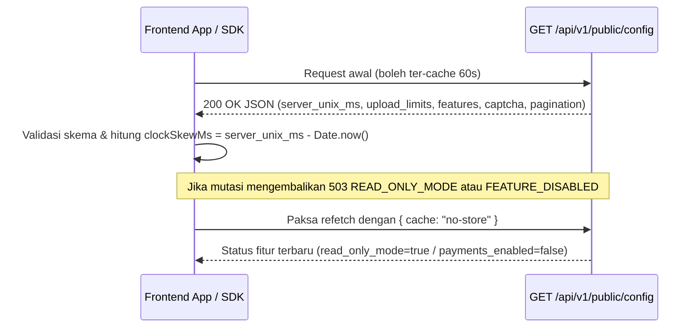
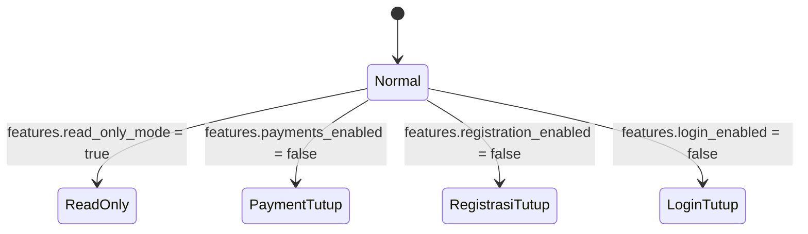

# 01. Konfigurasi Frontend Item demi Item

Halaman ini menjelaskan **seluruh item konfigurasi frontend satu per satu**—mulai dari variabel build-time sampai seluruh field yang disajikan secara otomatis oleh backend melalui `GET /api/v1/public/config`—lengkap dengan skema validasi di [frontend.config.schema.json](frontend.config.schema.json) dan contoh valid [config.example.json](config.example.json).

---

## 1. Apa Fungsi Bab Ini & Prinsip Tanpa Hardcode

Di lapangan, koperasi desa yang satu dengan koperasi lainnya atau antara lingkungan uji (`Set A` / `Set B`) dan produksi memiliki port API, batas unggahan, status pemeliharaan, atau mode QRIS yang berbeda. Oleh karena itu:
1. Frontend hanya menerima **satu** pintu masuk konfigurasi statis (`VITE_API_BASE_URL` / `NEXT_PUBLIC_API_BASE_URL` / `/config.json`).
2. Seluruh batas operasional (maksimal ukuran foto KTP, lama kadaluarsa QRIS, interval polling, paginasi, fitur yang boleh dibuka) dibaca dinamis dari `GET /api/v1/public/config`. <!-- claim:CLAIM-PUBLIC-CONFIG-01 -->

## 2. Siapa yang Menggunakan

- **Tech Lead / DevOps Frontend**: Menetapkan env build-time & CSP.
- **Frontend Developer**: Membaca `PublicConfig` via `fetchPublicConfig()` dari SDK dan menerapkannya ke validasi form, countdown, serta banner fitur.
- **QA**: Memverifikasi perubahan perilaku via **Config Playground** di `frontend-tester/`.

## 3. Endpoint Terkait

| Method | Path | Autentikasi | Header Cache | Tujuan |
|---|---|---|---|---|
| `GET` | `/api/v1/public/config` | Publik (tanpa token) | `Cache-Control: public, max-age=60` | Mengambil seluruh metadata runtime non-rahasia backend. |
| `GET` | `/config.json` *(hanya tester `cmd/uitester`)* | Publik | `no-store` | Memberikan `api_base_url` sintetis dari `API_PUBLIC_URL` kepada Frontend Tester polos. |

## 4. Alur Pengambilan & Penyegaran Konfigurasi



## 5. Mesin Status Mode Fitur & Pemeliharaan



- `read_only_mode = true`: Tampilkan banner pemeliharaan di atas seluruh layar; nonaktifkan seluruh tombol tambah/ubah/hapus/checkout/bayar.
- `payments_enabled = false`: Tombol "Bayar QRIS" & "Upload Bukti" tidak bisa ditekan disertai keterangan penutupan sementara.
- `registration_enabled = false`: Menu "Daftar Anggota Baru" diganti info pembukaan berikutnya.
- `login_enabled = false`: Form login diganti pengumuman penutupan akses login sementara.

## 6. Contoh Permintaan & Respons Nyata `GET /api/v1/public/config`

<!-- doc-test-response: id=RESP-PUBLIC-CONFIG-200 method=GET path=/api/v1/public/config auth=public status=200 -->
```json
{
  "success": true,
  "data": {
    "api_version": "1.1.0",
    "server_time": "2026-11-15T11:00:00+07:00",
    "server_unix_ms": 1794715200000,
    "timezone": "Asia/Jakarta",
    "upload_limits": {
      "max_body_bytes": 10485760,
      "max_kyc_upload_bytes": 5242880,
      "allowed_mime_types": ["image/jpeg", "image/png", "application/pdf"],
      "allowed_csv_mime_types": ["text/csv", "application/csv", "text/plain"]
    },
    "kyc_required_document_types": ["ktp"],
    "kyc_supported_document_types": ["ktp", "kk", "foto_diri", "surat_domisili"],
    "payment_expiry_seconds": 900,
    "polling_interval_ms": 3000,
    "features": {
      "payments_enabled": true,
      "registration_enabled": true,
      "login_enabled": true,
      "read_only_mode": false,
      "qris_dynamic_enabled": false,
      "personal_payment_pilot_enabled": false
    },
    "captcha": {
      "enabled": false,
      "provider": "turnstile",
      "site_key": ""
    },
    "mfa_mandatory_roles": ["admin", "bendahara", "ketua"],
    "access_token_ttl_seconds": 900,
    "pagination": {
      "default_limit": 20,
      "max_limit": 100
    }
  }
}
```

---

## 7. Daftar Konfigurasi Item demi Item (Lengkap)

### A. Variabel Environment Build-Time / Bootstrap

#### 1. `VITE_API_BASE_URL` / `NEXT_PUBLIC_API_BASE_URL` (atau `API_PUBLIC_URL` di tester)
- **Asal Nilai**: Environment build-time CI/CD atau host container (`API_PUBLIC_URL` di backend).
- **Tipe & Format**: `string` URL lengkap tanpa trailing slash (`https://...` atau `http://...`).
- **Contoh Nilai Sintetis**: `"https://api.kopdes-contoh.example"` atau `http://127.0.0.1:<API_HOST_PORT>`.
- **Cara Membaca di Kode**: `import.meta.env.VITE_API_BASE_URL` (Vite) atau `process.env.NEXT_PUBLIC_API_BASE_URL` (Next.js) diteruskan ke `createClient({ baseUrl })`.
- **Perilaku Jika Hilang / Invalid**: `createClient()` wajib langsung melempar Error konfigurasi sebelum render halaman utama ("URL dasar API belum dikonfigurasi").
- **Dampak Jika Salah**: Seluruh `fetch()` gagal (`ERR_CONNECTION_REFUSED` atau salah server) atau memicu error CORS bila skema/host/port tidak tercantum persis di `ALLOWED_ORIGINS` backend.

#### 2. `REQUEST_TIMEOUT_MS` (Sisi Frontend)
- **Asal Nilai**: Konfigurasi runtime default SDK `15000` ms (`1000`–`60000`), selaras dengan `statement_timeout = 15s` di PostgreSQL 16 dan `HTTP_READ_TIMEOUT`/`WRITE_TIMEOUT` backend.
- **Tipe & Satuan**: `integer` (milidetik).
- **Contoh Sintetis**: `15000` (disarankan `20000`–`30000` khusus request multipart upload KYC pada koneksi seluler desa lambat).
- **Cara Membaca di Kode**: Dipakai oleh `AbortSignal.timeout` / `AbortController` di `createClient({ requestTimeoutMs })`.
- **Perilaku Jika Hilang / Invalid**: Fallback aman SDK ke `15000` ms.
- **Dampak Jika Salah**: Terlalu kecil (<2000 ms) menyebabkan upload KTP dan checkout desa selalu putus sebelum selesai; terlalu besar membuat UI terkesan macet saat sinyal hilang.

---

### B. Field JSON `GET /api/v1/public/config` (Sumber Backend `.env`)

#### 3. `api_version`
- **Asal Nilai**: `API_VERSION` backend (bawaan `"1.1.0"`).
- **Tipe & Satuan**: `string` Semantic Versioning (`MAJOR.MINOR.PATCH`).
- **Contoh Sintetis**: `"1.1.0"`.
- **Cara Membaca di Kode**: `config.api_version` ditampilkan di footer/halaman Tentang Aplikasi untuk mempermudah dukungan teknis.
- **Jika Hilang / Invalid**: Anggap `"unknown"` tetapi tetap lanjutkan aplikasi sambil mencatat peringatan konsol.
- **Dampak Jika Salah**: Versi di footer tidak sesuai kontrak OpenAPI bila operator lupa memperbarui `API_VERSION`.

#### 4. `server_time` & `server_unix_ms`
- **Asal Nilai**: Jam sistem server saat merespons dalam zona waktu `APP_TIMEZONE` (`RFC3339` dan Unix epoch milidetik `int64`).
- **Tipe & Satuan**: `server_time` = `string` ISO-8601/RFC3339; `server_unix_ms` = `integer` (milidetik UTC epoch).
- **Contoh Sintetis**: `"2026-11-15T11:00:00+07:00"` dan `1794715200000`.
- **Cara Membaca di Kode**: `const skewMs = computeClockSkewMs(config.server_unix_ms);` -> dipakai menghitung sisa waktu QRIS: `(expiresAtMs - (Date.now() + skewMs))`.
- **Jika Hilang / Invalid**: Gunakan `skewMs = 0`.
- **Dampak Jika Salah**: Jika jam HP warga melenceng 30 menit ke depan tanpa kompensasi `skewMs`, UI keliru menganggap kode QRIS baru langsung kedaluwarsa (`00:00`) padahal masih berlaku.

#### 5. `timezone`
- **Asal Nilai**: `APP_TIMEZONE` backend (standar proyek: `"Asia/Jakarta"`).
- **Tipe & Satuan**: `string` nama zona waktu IANA.
- **Contoh Sintetis**: `"Asia/Jakarta"`.
- **Cara Membaca di Kode**: Disimpan di `config.timezone` dan dikirim ke `Intl.DateTimeFormat("id-ID", { timeZone: config.timezone })` saat memformat tanggal harian & parameter `?tanggal=YYYY-MM-DD` rekonsiliasi.
- **Jika Hilang / Invalid**: Fallback mutlak ke `"Asia/Jakarta"`.
- **Dampak Jika Salah**: Pengguna di WITA/WIT atau perangkat diset UTC dapat mengirim parameter `tanggal` bergeser 1 hari pada laporan rekonsiliasi harian atau batas pilot harian.

#### 6. `upload_limits.max_body_bytes` & `upload_limits.max_kyc_upload_bytes`
- **Asal Nilai**: `MAX_BODY_BYTES` (bawaan `10485760` = 10 MB) dan `MAX_KYC_UPLOAD_BYTES` (bawaan `5242880` = 5 MB).
- **Tipe & Satuan**: `integer` (byte).
- **Contoh Sintetis**: `max_body_bytes: 10485760`, `max_kyc_upload_bytes: 5242880`.
- **Cara Membaca di Kode**: Sebelum mengirim `FormData` berkas KTP/KK ke server, jalankan `validateUploadFile(file, config.upload_limits)` serta kompres otomatis ke JPEG bila melebihi batas.
- **Jika Hilang / Invalid**: Fallback ke `5 * 1024 * 1024` (5 MB) agar tidak memblokir pengguna namun tetap aman.
- **Dampak Jika Salah**: Jika frontend mengizinkan berkas > `max_kyc_upload_bytes`, upload lama lewat sinyal seluler desa baru ditolak oleh backend di akhir dengan `413 PAYLOAD_TOO_LARGE`.

#### 7. `upload_limits.allowed_mime_types` & `upload_limits.allowed_csv_mime_types`
- **Asal Nilai**: Daftar MIME resmi yang diterima `pendaftaran_handler.go` (`image/jpeg`, `image/png`, `application/pdf`) dan impor mutasi CSV (`text/csv`, `application/csv`, `text/plain`).
- **Tipe & Satuan**: `string[]`.
- **Contoh Sintetis**: `["image/jpeg", "image/png", "application/pdf"]`.
- **Cara Membaca di Kode**: Pasang langsung pada `<input type="file" accept={config.upload_limits.allowed_mime_types.join(",")} />` dan validasi pra-kirim SDK.
- **Jika Hilang / Invalid**: Gunakan default aman `["image/jpeg", "image/png", "application/pdf"]`.
- **Dampak Jika Salah**: Anggota HP Android baru bisa tidak sadar memilih format `.heic`/`.webp` yang langsung ditolak backend dengan `400 BAD_REQUEST`.

#### 8. `kyc_required_document_types` & `kyc_supported_document_types`
- **Asal Nilai**: Aturan dokumen verifikasi anggota (`ktp` wajib, didukung `ktp`, `kk`, `foto_diri`, `surat_domisili`).
- **Tipe & Satuan**: `string[]`.
- **Contoh Sintetis**: `required: ["ktp"]`, `supported: ["ktp", "kk", "foto_diri", "surat_domisili"]`.
- **Cara Membaca di Kode**: Tampilkan opsi dropdown `<select name="jenis_dokumen">` dari `kyc_supported_document_types` dan beri tanda bintang wajib (`*`) pada setiap tipe di `kyc_required_document_types`.
- **Jika Hilang / Invalid**: Wajibkan minimal `["ktp"]`.
- **Dampak Jika Salah**: Pengguna tidak tahu dokumen apa yang harus difoto atau mengirim kode tipe dokumen tak dikenal sehingga ditolak validasi server.

#### 9. `payment_expiry_seconds`
- **Asal Nilai**: `PAYMENT_EXPIRY_DURATION` backend dikonversi ke detik (bawaan `.env.example` `15m` = `900`, `.env.test.alt` Set B `10m` = `600`).
- **Tipe & Satuan**: `integer` (detik).
- **Contoh Sintetis**: `900` (15 menit).
- **Cara Membaca di Kode**: Indikasi default batas waktu pembayaran sebelum menerima respons `POST /pembayaran/qris` (yang membawa `berlaku_sampai` dan `sisa_waktu_detik` eksak).
- **Jika Hilang / Invalid**: Fallback UI indikatif `900`.
- **Dampak Jika Salah**: Countdown awal sebelum request QRIS tidak sesuai kebijakan koperasi setempat.

#### 10. `polling_interval_ms`
- **Asal Nilai**: `POLLING_INTERVAL_MS` backend (bawaan `3000` ms, Set B `2500` ms).
- **Tipe & Satuan**: `integer` (milidetik).
- **Contoh Sintetis**: `3000`.
- **Cara Membaca di Kode**: Diteruskan ke `createPaymentPoller({ intervalMs: config.polling_interval_ms })` (catatan: hindari polling di bawah 2500 ms agar tidak memicu Rate Limiter `RATE_LIMIT_RPS` terutama bila satu kantor desa memakai IP publik yang sama!).
- **Jika Hilang / Invalid**: SDK memaksa minimal aman `3000` ms.
- **Dampak Jika Salah**: Polling 200 ms terus-menerus membanjiri server dan memicu HTTP `429 TOO_MANY_REQUESTS` untuk seluruh warga di balik satu router desa.

#### 11. `features.payments_enabled`, `registration_enabled`, `login_enabled`, `read_only_mode`
- **Asal Nilai**: `PAYMENTS_ENABLED`, `REGISTRATION_ENABLED`, `LOGIN_ENABLED`, `READ_ONLY_MODE` di `.env` backend.
- **Tipe & Satuan**: `boolean`.
- **Contoh Sintetis**: `payments_enabled: true`, `read_only_mode: false`.
- **Cara Membaca di Kode**: Nonaktifkan alur UI terkait dan tampilkan pesan ramah sebelum user mengisi formulir panjang lalu terblokir `503 FEATURE_DISABLED` atau `503 READ_ONLY_MODE`.
- **Jika Hilang / Invalid**: Anggap semua fitur `true` dan `read_only_mode: false`, lalu tetap tangkap respons `503` dari server jika berubah mendadak.
- **Dampak Jika Salah**: Warga sudah mengisi 10 kolom formulir pendaftaran lalu gagal dikirim saat tombol terakhir ditekan.

#### 12. `features.qris_dynamic_enabled` & `features.personal_payment_pilot_enabled`
- **Asal Nilai**: `QRIS_DYNAMIC_ENABLED` (default `false`) dan `ALLOW_PERSONAL_PAYMENT_PILOT` (default `false`).
- **Tipe & Satuan**: `boolean`.
- **Contoh Sintetis**: `false` untuk keduanya di produksi normal.
- **Cara Membaca di Kode**: Bila `qris_dynamic_enabled === false`, UI wajib menjelaskan kepada warga untuk mengetik **Nominal Total (sudah termasuk 3–4 digit kode unik)** di aplikasi bank/e-wallet saat memindai QRIS statis. Bila `personal_payment_pilot_enabled === true`, siapkan slot UI untuk `warning_banner` merah/kuning pada tampilan admin & kasir.
- **Jika Hilang / Invalid**: Anggap `false` (mode QRIS statis + kode unik).
- **Dampak Jika Salah**: Warga memindai QRIS statis mengira nominal terisi otomatis atau membayar angka bulat tanpa kode unik sehingga gagal cocok saat impor mutasi CSV!

#### 13. `captcha.enabled`, `captcha.provider`, `captcha.site_key`
- **Asal Nilai**: `CAPTCHA_ENABLED`, `CAPTCHA_PROVIDER`, `CAPTCHA_SITE_KEY` backend. Server menjamin `site_key === ""` saat `enabled === false`.
- **Tipe & Satuan**: `enabled: boolean`, `provider: "turnstile" | "hcaptcha" | "recaptcha" | "none"`, `site_key: string`.
- **Contoh Sintetis**: `{ "enabled": false, "provider": "turnstile", "site_key": "" }`.
- **Cara Membaca di Kode**: Render widget CAPTCHA pihak ketiga **hanya jika** `captcha.enabled && captcha.site_key !== ""`.
- **Jika Hilang / Invalid**: Jangan tampilkan widget CAPTCHA; biarkan form berjalan normal.
- **Dampak Jika Salah**: Widget CAPTCHA memblokir seluruh login jika dirender dengan `site_key` kosong atau salah provider.

#### 14. `mfa_mandatory_roles`
- **Asal Nilai**: Aturan keamanan backend `["admin", "bendahara", "ketua"]`.
- **Tipe & Satuan**: `string[]`.
- **Contoh Sintetis**: `["admin", "bendahara", "ketua"]`.
- **Cara Membaca di Kode**: Tampilkan lencana "Wajib MFA TOTP" pada halaman profil/manajemen user untuk peran tersebut, dan siapkan alur Wizard Setup saat `POST /api/v1/auth/login` mengembalikan `403 MFA_MANDATORY_SETUP_REQUIRED`.
- **Jika Hilang / Invalid**: Gunakan `["admin", "bendahara", "ketua"]`.
- **Dampak Jika Salah**: Pengurus baru bingung saat ditolak login oleh server tanpa wizard setup TOTP.

#### 15. `access_token_ttl_seconds`
- **Asal Nilai**: TTL JWT akses backend (15 menit = `900` detik, bersifat indikatif; server tetap sumber otoritas akhir).
- **Tipe & Satuan**: `integer` (detik).
- **Contoh Sintetis**: `900`.
- **Cara Membaca di Kode**: Dapat dipakai SDK untuk refresh proaktif opsional sekitar `ttl - 30` detik atau mengandalkan retry `401` otomatis di `AuthManager`.
- **Jika Hilang / Invalid**: SDK mengandalkan retry single-flight saat HTTP `401`.
- **Dampak Jika Salah**: Refresh terlalu cepat (<30s) memboroskan request; token tetap divalidasi backend.

#### 16. `pagination.default_limit` & `pagination.max_limit`
- **Asal Nilai**: `PAGINATION_DEFAULT_LIMIT` (default `20`) dan `PAGINATION_MAX_LIMIT` (default `100`).
- **Tipe & Satuan**: `integer` jumlah item per halaman.
- **Contoh Sintetis**: `default_limit: 20`, `max_limit: 100`.
- **Cara Membaca di Kode**: Nilai awal `?limit=` pada daftar anggota/pesanan/antrean dan batas opsi "Item per halaman" pada tabel admin (`<= max_limit`).
- **Jika Hilang / Invalid**: Fallback `default_limit = 20`, `max_limit = 100`.
- **Dampak Jika Salah**: Mengirim `limit=9999` akan dipotong atau ditolak validasi server serta membebani rendering di HP warga.

---

### C. Batas Keamanan & Infrastruktur yang Harus Diketahui Frontend

- **CORS (`ALLOWED_ORIGINS`)**: Hanya origin persis (skema + host + port) yang diizinkan. Wildcard `*` ditolak pada `APP_ENV=production`. Header request yang diizinkan hanyalah `Authorization`, `Content-Type`, `X-Requested-With`, `X-Request-ID`, dan `Idempotency-Key` (`X-Koperasi-ID` **dilarang**).
- **Rate Limit (`RATE_LIMIT_RPS` / `RATE_LIMIT_BURST` / `LOGIN_MAX_ATTEMPTS`)**: Saat terkena `429 TOO_MANY_REQUESTS`, baca header `Retry-After` yang diekspos di `Access-Control-Expose-Headers`.
- **Header Audit (`X-Request-ID`)**: Diekspos oleh CORS agar frontend dapat mencatat nomor lacak gangguan ke layar error.

## 8. Kode Contoh Validasi & Bootstrap Config

```typescript
import { createClient, fetchPublicConfig, isFeatureEnabled } from "../../frontend-reference/src/index";

const baseUrl = import.meta.env.VITE_API_BASE_URL;
const cfg = await fetchPublicConfig(baseUrl);
if (!isFeatureEnabled(cfg, "payments")) {
  // Nonaktifkan tombol checkout QRIS di UI
}
export const api = createClient({ baseUrl, publicConfig: cfg });
```

## 9. Error Terkait Konfigurasi

| `error.code` | HTTP | Kapan Terjadi | Tindakan UI |
|---|---|---|---|
| `READ_ONLY_MODE` | `503` | `READ_ONLY_MODE=true` pada backend saat frontend mengirim mutasi | Refetch `/api/v1/public/config` & tampilkan banner pemeliharaan |
| `FEATURE_DISABLED` | `503` | `PAYMENTS_ENABLED=false` / `REGISTRATION_ENABLED=false` / `LOGIN_ENABLED=false` | Tampilkan pengumuman fitur ditutup sementara |

## 10. Kasus Tepi

- **Konfigurasi berubah di tengah sesi pengguna**: Ketika `READ_ONLY_MODE` diaktifkan operator di backend pada menit ke-30, cache 60 detik browser bisa membuat UI terlambat tahu. Karena itu, **setiap respons `503 READ_ONLY_MODE` atau `FEATURE_DISABLED` di SDK otomatis memperbarui status config dalam memori**.

## 11. Keamanan & Privasi Klien

- Pastikan `GET /api/v1/public/config` tidak pernah dipercaya untuk menyimpan rahasia aplikasi. Pengelola backend wajib mengetes kebocoran secret di `TestPublicConfig_ReturnsSafeMetadataAndNoSecrets`.

## 12. Cara Menguji Konfigurasi di Frontend Tester

Buka `frontend-tester/index.html` -> panel **Config Playground** -> klik **Muat dari `/api/v1/public/config`**, ubah `features.read_only_mode` menjadi `true`, lalu klik **Validasi & Pratinjau UI** untuk melihat pratinjau dampaknya seketika terhadap komponen UI! Juga jalankan skenario `CLAIM-PUBLIC-CONFIG-01`.

## 13. Checklist Selesai Konfigurasi Frontend

- [ ] Nol URL/port tersembunyi (literal) di source code aplikasi frontend.
- [ ] Seluruh 16 item dari `/api/v1/public/config` terhubung ke komponen UI masing-masing.
- [ ] Uji Config Playground di `frontend-tester` valid terhadap `frontend.config.schema.json`.
