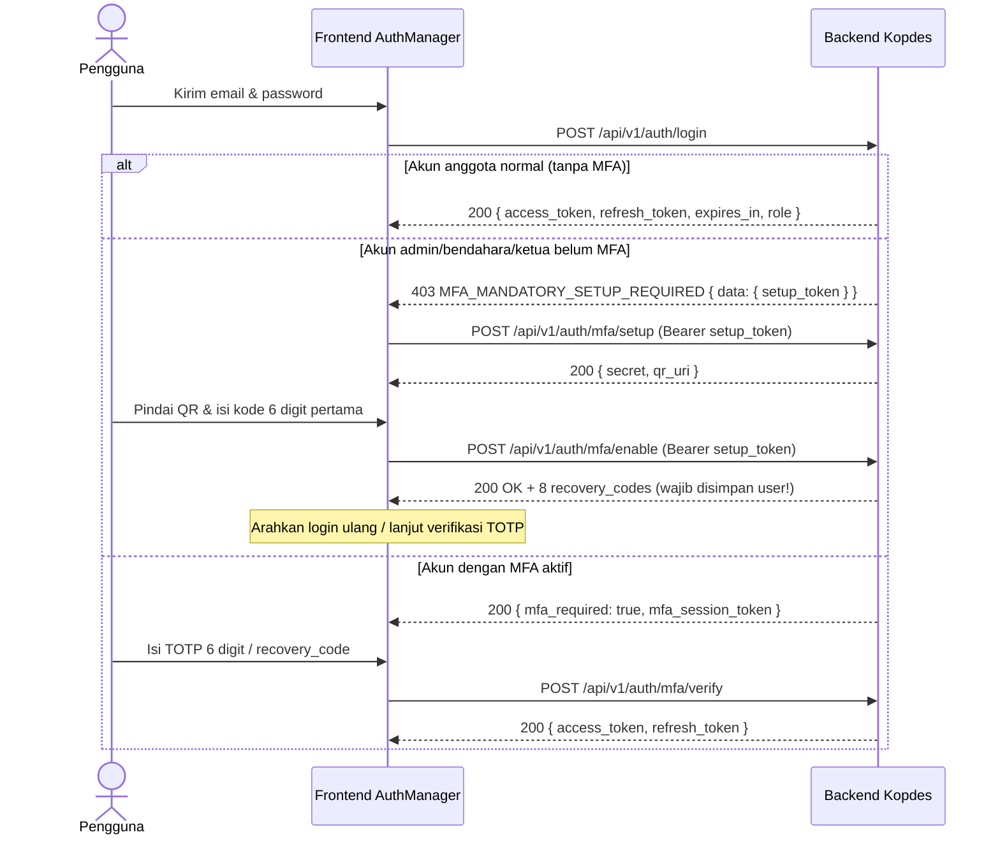
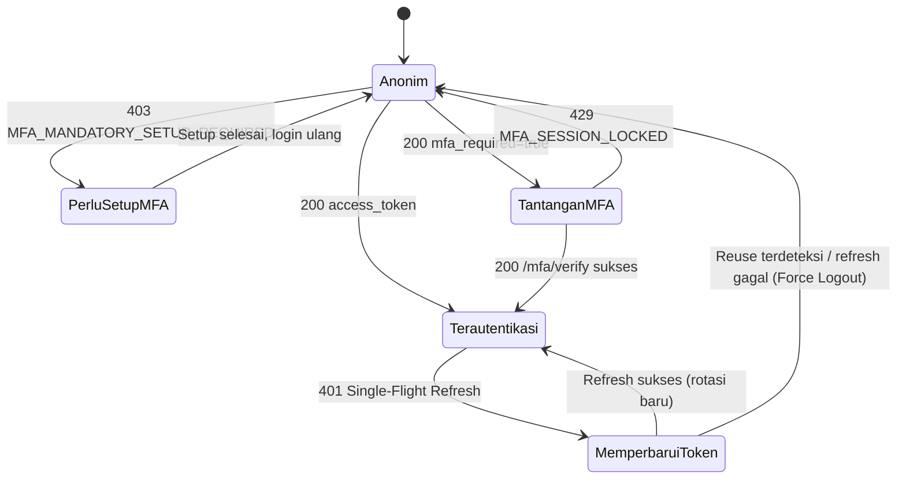

# 02. Autentikasi, MFA Wajib & Manajemen Sesi

Bab ini menjelaskan cara menangani login anggota maupun pengurus, aktivasi wajib Two-Factor Authentication (MFA TOTP) dengan `setup_token`, verifikasi tahap kedua (`mfa_session_token`), pembaruan token serempak (*single-flight refresh*), deteksi *token reuse*, serta sinkronisasi logout antar-tab.

---

## 1. Apa Fungsi Fitur Ini (Bahasa Awam Desa)

Di Koperasi Desa, HP milik satu perangkat desa atau komputer kantor bersama sering dipakai bergantian. Untuk mencegah pembajakan akun atau penyalahgunaan wewenang bendahara/ketua/admin, akses hanya berlaku **15 menit** (diperbarui diam-diam selama sesi sah), akun pimpinan (`admin`, `bendahara`, `ketua`) wajib memakai aplikasi autentikator 6 digit di HP mereka, dan tombol Keluar benar-benar membatalkan kunci sesi di server—bukan sekadar menutup layar.

## 2. Siapa yang Boleh Memakai & Perbedaan Alur Per Peran

| Peran | MFA saat Login Pertama | Hasil `POST /api/v1/auth/login` | Akses Sesudah Masuk |
|---|---|---|---|
| `anggota`, `operator`, `pengawas`, `pengurus` *(bila MFA belum aktif)* | Opsional | Langsung `200 OK` berisi `access_token` + `refresh_token` | Penuh sesuai peran |
| `admin`, `bendahara`, `ketua` *(belum punya MFA)* | **Wajib enrollment** | **`403 MFA_MANDATORY_SETUP_REQUIRED`** berisi `data.setup_token` (token khusus setup!) <!-- claim:CLAIM-AUTH-MFA-MANDATORY-01 --> | Terbatas **hanya** ke `/auth/mfa/setup` & `/auth/mfa/enable` |
| Siapa pun *(MFA sudah aktif)* | Wajib Challenge TOTP | `200 OK` berisi `mfa_required: true` + `mfa_session_token` | Lanjut `POST /api/v1/auth/mfa/verify` <!-- claim:CLAIM-AUTH-MFA-VERIFY-01 --> |

## 3. Endpoint Terkait

| Method | Path | Tujuan |
|---|---|---|
| `POST` | `/api/v1/auth/login` | Langkah 1: verifikasi email + sandi; hasilkan JWT, tantangan MFA, atau `403 setup_token`. |
| `POST` | `/api/v1/auth/mfa/setup` | Membuat rahasia Base32 TOTP + `qr_uri` untuk dipindai Google Authenticator/Authy. |
| `POST` | `/api/v1/auth/mfa/enable` | Mengaktifkan MFA permanen & menerbitkan 8 *recovery code* sekali pakai. |
| `POST` | `/api/v1/auth/mfa/verify` | Langkah 2 MFA memakai `mfa_session_token` + `totp_code` atau `recovery_code`. |
| `POST` | `/api/v1/auth/refresh` | Menukar `refresh_token` lama (sekali pakai) menjadi pasangan token baru. <!-- claim:CLAIM-AUTH-REFRESH-REUSE-01 --> |
| `POST` | `/api/v1/auth/revoke` | Mencabut sesi aktif di DB saat pengguna menekan Keluar (*Logout*). <!-- claim:CLAIM-AUTH-REVOKE-01 --> |

## 4. Diagram Urutan Lengkap 3 Cabang Login & Single-Flight Refresh



## 5. Mesin Status Sesi di Frontend



## 6. Contoh Permintaan & Respons Nyata

Permintaan login anggota:
```json
{
  "email": "anggota@kopdes-contoh.example",
  "password": "<SANDI_UJI_SINTETIS>"
}
```

<!-- doc-test-response: id=RESP-LOGIN-ANGGOTA-200 method=POST path=/api/v1/auth/login auth=login_anggota_a status=200 -->
```json
{
  "success": true,
  "data": {
    "access_token": "eyJhbGciOi...",
    "refresh_token": "8d4a1b...",
    "token_type": "Bearer",
    "expires_in": 900,
    "user_id": "01a1d300-0000-7000-8000-000000000001",
    "koperasi_id": "01a1d300-0000-7000-8000-000000000010",
    "nama_lengkap": "Anggota Kopdes A",
    "role": "anggota"
  }
}
```

## 7. Konfigurasi yang Dibutuhkan

- `mfa_mandatory_roles` dari `GET /api/v1/public/config` (`["admin", "bendahara", "ketua"]`).
- `access_token_ttl_seconds` (`900` detik = 15 menit).
- `features.login_enabled` (jika `false`, login mengembalikan `503 FEATURE_DISABLED`).

## 8. Kode Contoh (`AuthManager` + React)

```typescript
import { createClient, ApiError } from "../../frontend-reference/src/index";

const client = createClient({ baseUrl: import.meta.env.VITE_API_BASE_URL });

async function handleLogin(email: string, password: string) {
  const outcome = await client.auth.login(email, password);
  if (outcome.status === "mfa_setup_required") {
    // Tampilkan Wizard QR setup memakai client.auth.setupMFA() & enableMFA()
    return { next: "setup_mfa", setupToken: outcome.setupToken };
  }
  if (outcome.status === "mfa_challenge") {
    // Tampilkan input 6 digit TOTP -> client.auth.verifyMFA(totpCode)
    return { next: "verify_mfa" };
  }
  return { next: "dashboard", user: outcome.session };
}
```

Atau contoh pemakaian hook di [17. Contoh React, Vue & Vanilla JS](17-contoh-react-vue-vanila.md).

## 9. Penanganan Kode Error Autentikasi

- `401 UNAUTHORIZED` saat login/MFA: jangan retry otomatis; tampilkan "Email, sandi, atau kode OTP salah" (backend sudah menahan enumeration akun lewat dummy bcrypt).
- `401 UNAUTHORIZED` saat memanggil endpoint bisnis: `AuthManager` melakukan *single-flight refresh* (satu panggilan `/api/v1/auth/refresh` dipakai bersama oleh semua request paralel yang kebetulan kadaluwarsa bersamaan). Bila refresh gagal (termasuk indikasi *token reuse*!), paksa logout dan arahkan ke halaman Login!
- `403 MFA_MANDATORY_SETUP_REQUIRED` (`setup_token`): SDK melarang pemakaian `setup_token` ke endpoint selain `/api/v1/auth/mfa/setup` & `/api/v1/auth/mfa/enable`. Bila dicoba ke endpoint lain, backend menolak `403 MFA_ENROLLMENT_REQUIRED`.
- `429 MFA_SESSION_LOCKED`: Terlalu banyak salah ketik TOTP pada sesi login ini -> hapus `mfa_session_token` dan suruh pengguna mengulang login dari awal.
- `429 TOO_MANY_REQUESTS`: Rate limiter IP atau lockout login aktif (`CLAIM-AUTH-BRUTEFORCE-429`). Nonaktifkan tombol kirim dan tampilkan hitung mundur sesuai `Retry-After`. <!-- claim:CLAIM-AUTH-BRUTEFORCE-429 -->

## 10. Kasus Tepi (`Edge Cases`)

- **3 permintaan dashboard (`GET /auth/me`, `GET /iuran/tagihan/saya`, `GET /toko/pesanan`) gagal `401` bersamaan**: Tanpa *single-flight lock*, tab akan mengirim 3 `POST /auth/refresh` dengan `refresh_token` yang sama! Karena `refresh_token` sekali pakai (*rotating*), request kedua dan ketiga memicu **Token Reuse Detection** yang mencabut seluruh sesi user! Solusi: gunakan satu promise `refreshInFlight` di SDK `AuthManager` sehingga ketiganya menunggu hasil 1 kali `/refresh`.
- **Dua tab browser terbuka & user klik Logout di Tab 1**: Gunakan `BroadcastChannel("kopdes_auth_channel")` yang mengirim `{ type: "logout" }` **(dilarang mengirim raw token lewat BroadcastChannel)** agar Tab 2 langsung mengosongkan sesi memori JS-nya.
- **Kode TOTP barusan dipakai**: Backend menolak pemakaian kode TOTP yang sama dalam jendela waktu 30 detik yang sama (`last_totp_step` replay guard). Instruksikan user menunggu angka TOTP berikutnya di HP (maks 30 detik).

## 11. Keamanan & Privasi Klien

- **Simpan token di memori JS saja**, **TIDAK** di `localStorage`, `sessionStorage`, maupun URL query string agar terhindar dari eksfiltrasi XSS! <!-- claim:CLAIM-CLIENT-TOKEN-MEMORY UNVERIFIED: Penegakan larangan localStorage pada aplikasi frontend pihak ketiga diaudit secara statis dan diverifikasi pada Frontend Tester JS, bukan lewat assertion API backend -->
- Bila produksi memakai Backend-for-Frontend (BFF) untuk cookie `HttpOnly + Secure + SameSite=Strict/Lax`, aktifkan proteksi anti-CSRF pada seluruh mutasi (lihat [Bab 19](19-deploy-dan-lingkungan.md)).
- 8 *recovery code* dari `/mfa/enable` hanya pernah dikirim server **satu kali** (disimpan hash di DB). Tampilkan kotak konfirmasi "Saya sudah menyimpan kode pemulihan ini" dengan tombol Unduh/Salin sebelum menutup wizard!

## 12. Cara Menguji di Frontend Tester

1. Di panel **Lab Belajar**, pilih **Bab 02: Autentikasi & MFA** dan coba **Panduan Terpandu Langkah 2**.
2. Jalankan skenario `CLAIM-AUTH-LOGIN-01`, `CLAIM-AUTH-MFA-MANDATORY-01`, `CLAIM-AUTH-MFA-VERIFY-01`, `CLAIM-AUTH-REFRESH-REUSE-01`, dan `CLAIM-AUTH-REVOKE-01`. *(Biarkan `CLAIM-AUTH-BRUTEFORCE-429` tidak tercentang pada mode uji standar agar IP tester Anda tidak terkena lockout 15 menit).*

## 13. Checklist Selesai Autentikasi

- [ ] Token hanya disimpan di memori JS (atau BFF `HttpOnly` dengan proteksi CSRF).
- [ ] Single-flight refresh + antrean request 401 paralel terpasang di HTTP client.
- [ ] Wizard MFA Setup untuk `403 MFA_MANDATORY_SETUP_REQUIRED` & tampilan 8 *recovery code* sekali lihat tersedia.
- [ ] `BroadcastChannel` menyinkronkan logout antar-tab tanpa menyebarkan token mentah.
