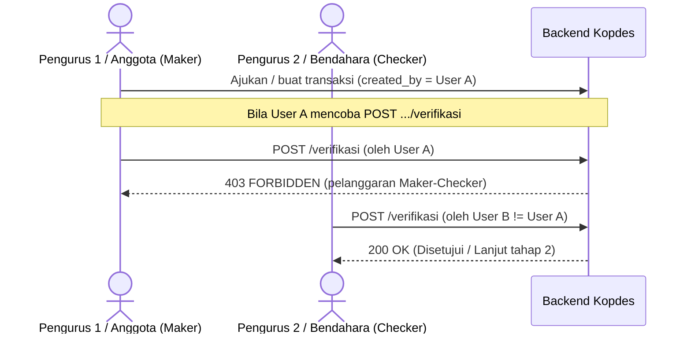

# 03. Peran, Izin & Matriks Otorisasi Lengkap

Dokumen ini menjelaskan 7 peran pengguna Kopdes Merah Putih, aturan pemisahan kewenangan (Maker-Checker & anti-eskalasi), serta daftar otorisasi lengkap per endpoint yang disinkronkan langsung dari [roles_matrix.json](../roles_matrix.json).

---

## 1. Apa Fungsi Bab Ini (Bahasa Awam Desa)

Di koperasi desa ada pembagian tugas yang tegas agar uang kas dan data warga aman: anggota biasa hanya boleh mendaftar dan berbelanja; operator kasir dan pengawas boleh memantau antrean dan audit namun **tidak boleh** mengubah data keuangan; sedangkan penyetujuan pembayaran atau pendaftaran wajib dilakukan dua orang berbeda (*Maker* tidak boleh mengesahkan pekerjaannya sendiri). Frontend menyembunyikan menu yang tidak relevan, **sementara keamanan sesungguhnya dikunci di backend PostgreSQL + Go**.

## 2. Daftar 7 Peran & Peringkat Kewenangan

| Peran | Deskripsi Tugas di Koperasi | Wajib MFA | Cakupan Akses Utama |
|---|---|---|---|
| `anggota` | Warga / anggota koperasi | Opsional | Profil, daftar & upload KYC, tagihan saya, belanja toko, buat & lihat pembayaran miliknya saja. |
| `operator` | Petugas loket / staf baca | Opsional | Hak anggota + read-only daftar anggota, antrean verifikasi, kas, laporan, `expire` pesanan kedaluwarsa. |
| `pengawas` | Badan Pengawas koperasi | Opsional | **Read-only audit** (daftar anggota, antrean, mutasi kas, laporan keuangan/anggota). Ditolak `403` pada seluruh mutasi pengurus. |
| `bendahara` | Pengurus keuangan | **Wajib** | Buat & generate iuran, verifikasi pembayaran, impor mutasi CSV, kelola rekening QRIS *(terikat Maker-Checker)*. |
| `ketua` | Pimpinan koperasi | **Wajib** | Verifikasi pendaftaran, ubah status anggota, verifikasi pembayaran/mutasi (terutama persetujuan ke-2), manajemen user di bawah tingkatnya. |
| `pengurus` | Pengurus harian umum | Opsional | Operasional koperasi menyeluruh (katalog, promo, iuran, verifikasi, rekening QRIS) sesuai batas hierarki. |
| `admin` | Administrator tenant koperasi | **Wajib** | Seluruh kendali dalam 1 koperasi (kecuali menaikkan role dirinya sendiri atau melampaui batas Maker-Checker). <!-- claim:CLAIM-USERS-ESCALATION-01 --> |

## 3. Matriks Tampilan UI Per Menu (Kosmetik) vs Penegakan Server

> **Peringatan Kritis**: Menyembunyikan tombol di React/Vue **BUKAN** kontrol keamanan—hanya untuk UI rapi. Penegakan sesungguhnya berjalan lewat JWT terverifikasi + RLS tenant PostgreSQL 16 + `middleware.RequireRoles` (`CLAIM-TENANT-ISOLATION-01`, `CLAIM-ANGGOTA-RBAC-01`). <!-- claim:CLAIM-ANGGOTA-RBAC-01 --> <!-- claim:CLAIM-TENANT-ISOLATION-01 -->

| Menu UI | `anggota` | `operator` | `pengawas` | `bendahara` | `pengurus` | `ketua` | `admin` |
|---|---|---|---|---|---|---|---|
| Profil & Iuran Saya | Tampil | Tampil | Tampil | Tampil | Tampil | Tampil | Tampil |
| Toko, Keranjang, Checkout & Bayar QRIS | Tampil | Tampil | Tampil | Tampil | Tampil | Tampil | Tampil |
| Pengajuan Pendaftaran & Upload KYC | Tampil | Tampil | Tampil | Tampil | Tampil | Tampil | Tampil |
| Daftar Anggota / Antrean / Kas / Laporan *(Baca)* | Sembunyi | Tampil | Tampil | Tampil | Tampil | Tampil | Tampil |
| Verifikasi Pendaftaran & Ubah Status Anggota | Sembunyi | Sembunyi | Sembunyi | Sembunyi | Tampil* | Tampil* | Tampil* |
| Buat Jenis Iuran & Generate Tagihan | Sembunyi | Sembunyi | Sembunyi | Tampil | Tampil | Sembunyi | Tampil |
| Kelola Produk Katalog & Promo | Sembunyi | Sembunyi | Sembunyi | Sembunyi | Tampil | Sembunyi | Tampil |
| Verifikasi Pembayaran & Impor Mutasi CSV | Sembunyi | Sembunyi | Sembunyi | Tampil* | Tampil* | Tampil* | Tampil* |
| Rekening QRIS Koperasi (`POST`/`DELETE`) | Sembunyi | Sembunyi | Sembunyi | Sembunyi | Tampil | Sembunyi | Tampil |
| Ubah Peran Pengguna (`PATCH /users/{id}/role`) | Sembunyi | Sembunyi | Sembunyi | Sembunyi | Tampil** | Tampil** | Tampil** |

*\*Tunduk pada aturan Maker-Checker: pembuat pendaftaran, pengunggah bukti/pembuat pembayaran, atau pengimpor CSV ditolak `403`/`400` bila mencoba menyetujui transaksinya sendiri.*
*\*\*Anti-Eskalasi: tidak bisa mengubah peran diri sendiri atau menetapkan peran di atas peringkat perannya saat ini.*

## 4. Diagram Urutan Pemisahan Tugas (`Maker-Checker`)



## 5. Matriks Otorisasi Lengkap Endpoint (Disinkronkan Otomatis dari `roles_matrix.json`)

> Tabel di bawah ini diperbarui otomatis oleh skrip `python scripts/generate_api_artifacts.py` dari [roles_matrix.json](../roles_matrix.json) agar tidak pernah usang.

<!-- BEGIN_ROLES_MATRIX -->

| Method | Path | admin | pengurus | bendahara | ketua | pengawas | operator | anggota | Unauth | Cross-Tenant | Catatan |
|---|---|---|---|---|---|---|---|---|---|---|---|
| `GET` | `/healthz` | Ya | Ya | Ya | Ya | Ya | Ya | Ya | 200 | N/A (public) | Liveness probe publik tanpa JWT; dikecualikan dari rate limiter. |
| `GET` | `/readyz` | Ya | Ya | Ya | Ya | Ya | Ya | Ya | 200 | N/A (public) | Readiness probe PostgreSQL tanpa JWT; dikecualikan dari rate limiter. |
| `GET` | `/metrics` | 401 | 401 | 401 | 401 | 401 | 401 | 401 | 401 | N/A (Bearer METRICS_TOKEN) | Wajib Bearer METRICS_TOKEN / METRICS_PREVIOUS_TOKEN (>=32 byte). JWT user/unauth ditolak 401. |
| `GET` | `/api/v1/public/config` | Ya | Ya | Ya | Ya | Ya | Ya | Ya | 200 | N/A (global non-secret) | Konfigurasi publik aman (metadata API, batas unggahan, flag fitur, status CAPTCHA, paginasi); Cache-Control singkat. |
| `POST` | `/api/v1/auth/login` | Ya | Ya | Ya | Ya | Ya | Ya | Ya | [400, 401] | N/A (fn_lookup_user_login) | Publik; email/password wajib. Role admin/bendahara/ketua wajib MFA (403 setup jika belum aktif). |
| `POST` | `/api/v1/auth/mfa/setup` | Ya | Ya | Ya | Ya | Ya | Ya | Ya | 401 | N/A (self JWT) | Diizinkan untuk seluruh user terautentikasi termasuk token terbatas scope mfa_setup. |
| `POST` | `/api/v1/auth/mfa/enable` | Ya | Ya | Ya | Ya | Ya | Ya | Ya | 401 | N/A (self JWT) | Mengaktifkan TOTP + menerbitkan 8 recovery code; probe {} mengembalikan 400 (tidak mengubah DB). |
| `POST` | `/api/v1/auth/mfa/verify` | Ya | Ya | Ya | Ya | Ya | Ya | Ya | [400, 401] | N/A (mfa_session_token) | Publik tahap 2 MFA menggunakan mfa_session_token + totp_code/recovery_code. |
| `POST` | `/api/v1/auth/refresh` | Ya | Ya | Ya | Ya | Ya | Ya | Ya | [400, 401] | N/A (refresh_token) | Publik dengan refresh_token rotasi; token reuse mencabut seluruh sesi user. |
| `POST` | `/api/v1/auth/revoke` | Ya | Ya | Ya | Ya | Ya | Ya | Ya | [400, 200] | N/A (refresh_token) | Logout eksplisit mencabut refresh token. |
| `GET` | `/api/v1/auth/me` | Ya | Ya | Ya | Ya | Ya | Ya | Ya | 401 | N/A (self JWT) | Mengembalikan profil identitas & koperasi_id dari JWT aktif. |
| `POST` | `/api/v1/pendaftaran` | Ya | Ya | Ya | Ya | Ya | Ya | Ya | 401 | Terikat koperasi_id JWT + blind index NIK per tenant | Mengajukan pendaftaran calon anggota baru. |
| `GET` | `/api/v1/pendaftaran/{id}` | Ya | Ya | Ya | Ya | Ya | Ya | Ya | 401 | 404 (RLS + anti-IDOR pemilik pendaftaran) | Privileged lihat tenant aktif; anggota hanya lihat pendaftaran miliknya (404 jika milik orang lain). |
| `POST` | `/api/v1/pendaftaran/{id}/dokumen` | Ya | Ya | Ya | Ya | Ya | Ya | Ya | 401 | 400/404 (RLS + validasi multipart) | Upload berkas KYC JPEG/PNG/PDF maksimal MAX_KYC_UPLOAD_BYTES. |
| `POST` | `/api/v1/pendaftaran/{id}/verifikasi` | Ya | Ya | Tidak (403) | Ya | Tidak (403) | Tidak (403) | Tidak (403) | 401 | 400/404 (RLS koperasi_id) | RequireRoles(admin, pengurus, ketua, sekretaris) + Maker-Checker pengaju != verifikator. |
| `POST` | `/api/v1/pendaftaran/purge-ditolak` | Ya | Ya | Tidak (403) | Ya | Tidak (403) | Tidak (403) | Tidak (403) | 401 | Hanya membersihkan pendaftaran ditolak milik tenant JWT | RequireRoles(admin, pengurus, ketua, sekretaris); menghapus PII & berkas KYC > retensi. |
| `GET` | `/api/v1/anggota` | Ya | Ya | Ya | Ya | Ya | Ya | Tidak (403) | 401 | 200 (RLS hanya anggota tenant aktif) | Daftar anggota tenant untuk peran admin/pengurus/bendahara/ketua/pengawas/operator. |
| `GET` | `/api/v1/anggota/{id}` | Ya | Ya | Ya | Ya | Ya | Ya | Tidak (403) | 401 | 404 (RLS anggota Kop B ditolak) | Detail anggota tenant aktif; anggota biasa dilarang mengakses indeks seluruh anggota. |
| `PATCH` | `/api/v1/anggota/{id}/status` | Ya | Ya | Tidak (403) | Ya | Tidak (403) | Tidak (403) | Tidak (403) | 401 | 400/404 (RLS) | RequireRoles(admin, pengurus, ketua); mencatat perubahan status ke anggota_status_log. |
| `GET` | `/api/v1/users` | Ya | Ya | Tidak (403) | Ya | Tidak (403) | Tidak (403) | Tidak (403) | 401 | 200 (hanya user pada koperasi aktif) | RequireRoles(admin, pengurus, ketua). |
| `GET` | `/api/v1/users/{id}` | Ya | Ya | Tidak (403) | Ya | Tidak (403) | Tidak (403) | Tidak (403) | 401 | 404 (RLS pol_isolasi_users_select) | RequireRoles(admin, pengurus, ketua); detail user Kop B diblokir RLS -> 404. |
| `PATCH` | `/api/v1/users/{id}/role` | Ya | Ya | Tidak (403) | Ya | Tidak (403) | Tidak (403) | Tidak (403) | 401 | 400/404 (DISC-02 fix) | RequireRoles(admin, pengurus, ketua); anti-self-escalation & anti-privilege-escalation. |
| `GET` | `/api/v1/iuran/jenis` | Ya | Ya | Ya | Ya | Ya | Ya | Ya | 401 | 200 (hanya jenis iuran tenant JWT) | Daftar jenis iuran netral + penanda klasifikasi KEPUTUSAN AKUNTAN. |
| `POST` | `/api/v1/iuran/jenis` | Ya | Ya | Ya | Tidak (403) | Tidak (403) | Tidak (403) | Tidak (403) | 401 | Terikat koperasi_id JWT | RequireRoles(admin, pengurus, bendahara). |
| `GET` | `/api/v1/iuran/tagihan/saya` | Ya | Ya | Ya | Ya | Ya | Ya | Ya | 401 | 200 (hanya tagihan user sendiri) | Menampilkan tagihan iuran milik user yang login. |
| `POST` | `/api/v1/iuran/generate` | Ya | Ya | Ya | Tidak (403) | Tidak (403) | Tidak (403) | Tidak (403) | 401 | Terikat koperasi_id JWT | RequireRoles(admin, pengurus, bendahara); generate tagihan idempoten per periode. |
| `GET` | `/api/v1/iuran/menunggak` | Ya | Ya | Ya | Ya | Ya | Ya | Tidak (403) | 401 | 200 (hanya tunggakan tenant aktif) | Read-only admin roles. |
| `GET` | `/api/v1/katalog/stok` | Ya | Ya | Ya | Ya | Ya | Ya | Ya | 401 | 200 (hanya stok gudang tenant aktif) | Saldo stok katalog koperasi aktif. |
| `GET` | `/api/v1/katalog/harga` | Ya | Ya | Ya | Ya | Ya | Ya | Ya | 401 | 404 (produk/anggota Kop B tidak ditemukan via RLS) | Wajib query produk_id dan anggota_id (UUID). |
| `GET` | `/api/v1/katalog/produk` | Ya | Ya | Ya | Ya | Ya | Ya | Ya | 401 | 200 (hanya produk tenant aktif) | Daftar produk koperasi aktif. |
| `POST` | `/api/v1/katalog/produk` | Ya | Ya | Tidak (403) | Tidak (403) | Tidak (403) | Tidak (403) | Tidak (403) | 401 | Terikat koperasi_id JWT | RequireRoles(admin, pengurus). |
| `PUT` | `/api/v1/katalog/produk/{id}` | Ya | Ya | Tidak (403) | Tidak (403) | Tidak (403) | Tidak (403) | Tidak (403) | 401 | 200 (0 baris terupdate karena filter koperasi_id & RLS) | RequireRoles(admin, pengurus). |
| `DELETE` | `/api/v1/katalog/produk/{id}` | Ya | Ya | Tidak (403) | Tidak (403) | Tidak (403) | Tidak (403) | Tidak (403) | 401 | 200 (0 baris terupdate karena RLS) | RequireRoles(admin, pengurus). |
| `GET` | `/api/v1/katalog/promo` | Ya | Ya | Ya | Ya | Ya | Ya | Ya | 401 | 200 (hanya promo tenant aktif) | Daftar promo aktif tenant. |
| `POST` | `/api/v1/katalog/promo` | Ya | Ya | Tidak (403) | Tidak (403) | Tidak (403) | Tidak (403) | Tidak (403) | 401 | Terikat koperasi_id JWT | RequireRoles(admin, pengurus). |
| `GET` | `/api/v1/toko/keranjang` | Ya | Ya | Ya | Ya | Ya | Ya | Ya | 401 | 200 (hanya keranjang user sendiri) | Isi keranjang belanja user aktif. |
| `POST` | `/api/v1/toko/keranjang` | Ya | Ya | Ya | Ya | Ya | Ya | Ya | 401 | FK/RLS menolak produk_id Kop B | Menambahkan/mengubah qty item keranjang user aktif. |
| `DELETE` | `/api/v1/toko/keranjang/{produk_id}` | Ya | Ya | Ya | Ya | Ya | Ya | Ya | 401 | 200 (0 baris dihapus) | Menghapus produk dari keranjang user aktif. |
| `POST` | `/api/v1/toko/checkout` | Ya | Ya | Ya | Ya | Ya | Ya | Ya | 401 | Terikat keranjang & stok koperasi aktif | Checkout dengan kunci stok FOR UPDATE & mutasi append-only stok_mutasi. |
| `GET` | `/api/v1/toko/pesanan` | Ya | Ya | Ya | Ya | Ya | Ya | Ya | 401 | 200 (RLS koperasi aktif) | Anggota melihat pesanannya sendiri; privileged melihat pesanan koperasi. |
| `POST` | `/api/v1/toko/pesanan/{id}/batal` | Ya | Ya | Ya | Ya | Ya | Ya | Ya | 401 | 400 (pesanan Kop B tidak ditemukan via RLS) | Membatalkan pesanan & memulihkan stok + kuota promo; anggota dibatasi pesanannya sendiri. |
| `POST` | `/api/v1/toko/pesanan/{id}/expire` | Ya | Ya | Ya | Ya | Tidak (403) | Ya | Tidak (403) | 401 | 400 (pesanan Kop B tidak ditemukan via RLS) | RequireRoles(admin, pengurus, bendahara, ketua, operator); operator boleh memproses pesanan kedaluwarsa. |
| `POST` | `/api/v1/pembayaran/qris` | Ya | Ya | Ya | Ya | Ya | Ya | Ya | 401 | 400 (tagihan/rekening Kop B tidak ditemukan via RLS) | Wajib terikat tagihan/pesanan + mendukung Idempotency-Key DB + kode unik anti-tabrakan. |
| `GET` | `/api/v1/pembayaran/{id}` | Ya | Ya | Ya | Ya | Ya | Ya | Ya | 401 | 404 (RLS + anti-IDOR anggota) | Anggota biasa hanya dapat mengakses pembayaran miliknya sendiri (404 jika milik pihak lain). |
| `POST` | `/api/v1/pembayaran/{id}/bukti` | Ya | Ya | Ya | Ya | Ya | Ya | Ya | 401 | 404 (fn_klaim_bukti_pembayaran + RLS) | Klaim RRN bukti transfer oleh pembayar -> status menunggu_verifikasi. |
| `GET` | `/api/v1/pembayaran/antrean` | Ya | Ya | Ya | Ya | Ya | Ya | Tidak (403) | 401 | 200 (hanya antrean koperasi aktif) | Read-only admin roles. |
| `POST` | `/api/v1/pembayaran/{id}/verifikasi` | Ya | Ya | Ya | Ya | Tidak (403) | Tidak (403) | Tidak (403) | 401 | 400 (pembayaran Kop B tidak terlihat RLS) | RequireRoles(admin, pengurus, bendahara, ketua); Maker-Checker + dual approval > ambang. |
| `POST` | `/api/v1/pembayaran/mutasi-bank/impor` | Ya | Ya | Ya | Ya | Tidak (403) | Tidak (403) | Tidak (403) | 401 | Hanya mencocokkan pembayaran koperasi JWT aktif | RequireRoles(admin, pengurus, bendahara, ketua); CSV col: tgl,keterangan,tipe(CR),nominal,no_rek. |
| `GET` | `/api/v1/pembayaran/rekonsiliasi/harian` | Ya | Ya | Ya | Ya | Ya | Ya | Tidak (403) | 401 | 200 (agregat khusus koperasi aktif) | Read-only admin roles; batas hari memakai Asia/Jakarta. |
| `GET` | `/api/v1/koperasi/rekening-qris` | Ya | Ya | Tidak (403) | Tidak (403) | Tidak (403) | Tidak (403) | Tidak (403) | 401 | 200 (hanya rekening QRIS tenant aktif) | RequireRoles(admin, pengurus). |
| `POST` | `/api/v1/koperasi/rekening-qris` | Ya | Ya | Tidak (403) | Tidak (403) | Tidak (403) | Tidak (403) | Tidak (403) | 401 | Terikat koperasi_id JWT | RequireRoles(admin, pengurus); validasi EMVCo CRC16 + blokir perorangan kecuali pilot. |
| `DELETE` | `/api/v1/koperasi/rekening-qris/{id}` | Ya | Ya | Tidak (403) | Tidak (403) | Tidak (403) | Tidak (403) | Tidak (403) | 401 | 400 (rekening Kop B tidak ditemukan via RLS) | RequireRoles(admin, pengurus). |
| `GET` | `/api/v1/kas/mutasi` | Ya | Ya | Ya | Ya | Ya | Ya | Tidak (403) | 401 | 200 (hanya ledger kas koperasi aktif) | Read-only admin roles; tabel append-only berantai hash. |
| `GET` | `/api/v1/laporan/keuangan` | Ya | Ya | Ya | Ya | Ya | Ya | Tidak (403) | 401 | 200 (agregat khusus koperasi aktif) | Read-only admin roles. |
| `GET` | `/api/v1/laporan/anggota` | Ya | Ya | Ya | Ya | Ya | Ya | Tidak (403) | 401 | 200 (agregat khusus koperasi aktif) | Read-only admin roles. |

<!-- END_ROLES_MATRIX -->

## 6. Contoh Permintaan & Respons Penolakan Izin (`403 FORBIDDEN`)

Ketika peran `pengawas` mencoba memutasi katalog atau anggota mencoba mengesahkan pendaftaran, API selalu merespons seragam:

```json
{
  "success": false,
  "error": {
    "code": "FORBIDDEN",
    "message": "Peran Anda tidak diizinkan mengakses operasi ini."
  }
}
```

## 7. Konfigurasi Terkait

- Jangan pernah mengirim header `X-Koperasi-ID` dari frontend! `koperasi_id` dibaca murni oleh server dari JWT terverifikasi (`CORS` backend menolak header tersebut).

## 8. Kode Contoh Helper Cek Peran di UI

```typescript
export type KopdesRole = "anggota" | "operator" | "pengawas" | "bendahara" | "ketua" | "pengurus" | "admin";

export function canViewBackofficeReadOnly(role: KopdesRole): boolean {
  return role !== "anggota";
}

export function canMutateIuran(role: KopdesRole): boolean {
  return role === "admin" || role === "pengurus" || role === "bendahara";
}

export function canVerifyPembayaran(role: KopdesRole): boolean {
  return role === "admin" || role === "pengurus" || role === "bendahara" || role === "ketua";
}
```

## 9. Penanganan Error RBAC & Cross-Tenant

- `403 FORBIDDEN`: Tampilkan pesan ramah ("Operasi ini khusus Bendahara/Pengurus yang berbeda dari pembuat").
- `404 NOT_FOUND` saat mengambil detail milik anggota lain atau koperasi lain: tangani sebagai data tidak ditemukan (**anti-enumeration & anti-IDOR**, jangan membocorkan status ada/tidaknya ID di tenant lain).

## 10. Kasus Tepi

- **Peran pengguna diubah admin di tengah sesi**: Access token tetap membawa peran lama hingga maks 15 menit, atau segera perbarui dengan memanggil refresh token setelah notifikasi pembaruan akun.

## 11. Keamanan Klien

- Pastikan `koperasi_id` tidak bisa diedit lewat state form tersembunyi (`<input type="hidden">`); semua aksi mutasi selalu terikat pada tenant dari JWT login aktif.

## 12. Cara Menguji di Frontend Tester

Klik **Jalankan Matriks Peran Lengkap** pada `frontend-tester/index.html` untuk menguji secara live seluruh **55 operasi x 7 peran + unauthenticated + isolasi lintas tenant** terhadap stack tes aktif!

## 13. Checklist Selesai Otorisasi

- [ ] Menu UI tersembunyi sesuai tabel peran di atas.
- [ ] Frontend menangani `403 FORBIDDEN` tanpa crash dan menjelaskan aturan Maker-Checker dengan bahasa ramah.
- [ ] Seluruh operasi tidak mengirim header `X-Koperasi-ID`.
