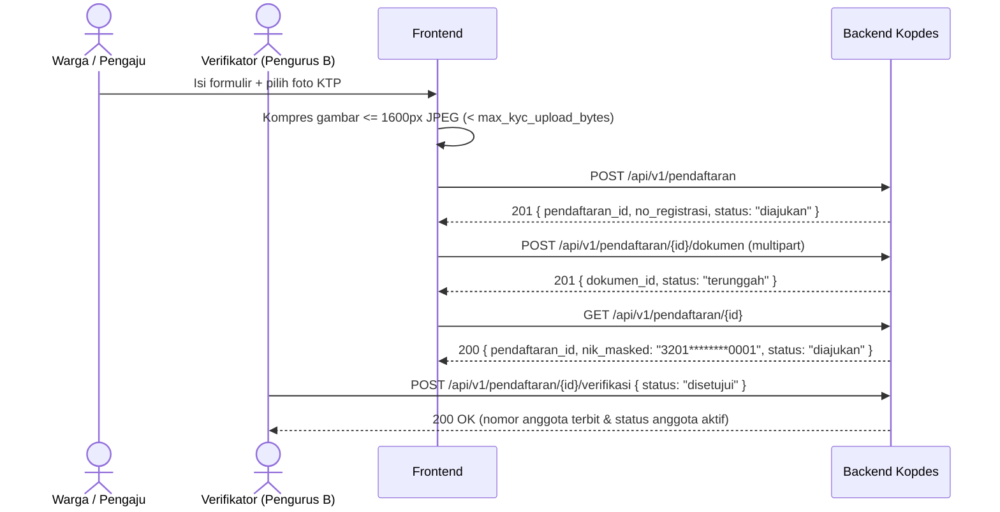
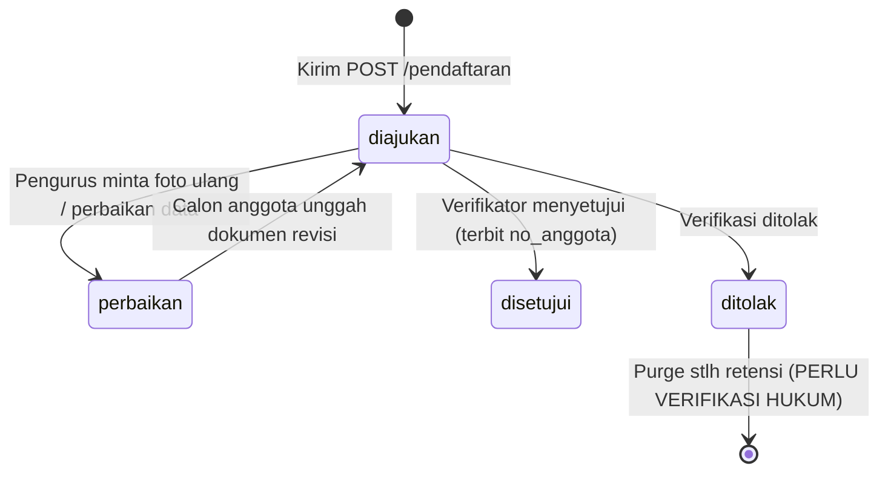

# 04. Pendaftaran Anggota Baru & Unggah Dokumen KYC

Bab ini menjelaskan alur lengkap calon anggota desa mengajukan keanggotaan koperasi, mengunggah foto KTP/KK secara hemat kuota seluler, menampilkan NIK tersamar (`nik_masked`), proses verifikasi Maker-Checker oleh pengurus, hingga penghapusan data ditolak (*purge*).

---

## 1. Apa Fungsi Fitur Ini (Bahasa Awam Desa)

Warga desa yang ingin bergabung sebagai anggota Kopdes Merah Putih mengisi formulir data diri (NIK, nama lengkap, alamat KTP, desa) lalu memotret KTP lewat HP. Server langsung mengenkripsi NIK dan alamat memakai AES-256-GCM sehingga setelah terkirim **NIK mentah tidak pernah ditampilkan lagi di layar** (hanya tampil tersamar `3201********0001`). Kemudian pengurus berbeda akan memeriksa keaslian foto KTP sebelum menerbitkan nomor anggota resmi.

## 2. Siapa yang Boleh Memakai

| Peran | Pengajuan & Unggah KYC | Lihat Detail (`nik_masked`) | Verifikasi (`disetujui`/`perbaikan`/`ditolak`) | Purge Ditolak > Retensi |
|---|---|---|---|---|
| `anggota` / akun pendaftar | Boleh (miliknya sendiri) | Boleh (miliknya sendiri) | Tidak (`403`) | Tidak (`403`) |
| `operator` / `pengawas` | Tidak relevan untuk pihak lain | Boleh lihat dalam koperasi (read-only) | Tidak (`403`) | Tidak (`403`) |
| `pengurus`, `ketua`, `admin` | Boleh ajukan; **Maker-Checker** berlaku | Boleh | **Ya** *(selain pengaju sendiri)* <!-- claim:CLAIM-PENDAFTARAN-CHECKER-01 --> | Ya (`admin`/`ketua`/`pengurus`) <!-- claim:CLAIM-PENDAFTARAN-PURGE-01 --> |

## 3. Endpoint Terkait

| Method | Path | Tujuan |
|---|---|---|
| `POST` | `/api/v1/pendaftaran` | Mengajukan data pendaftaran baru (`nik`, `nama_lengkap`, `alamat_ktp`, `wilayah_desa_id`). |
| `POST` | `/api/v1/pendaftaran/{id}/dokumen` | Unggah multipart berkas KYC (`dokumen`, `jenis_dokumen=ktp\|kk\|foto_diri\|surat_domisili`). |
| `GET` | `/api/v1/pendaftaran/{id}` | Melihat detail status pendaftaran beserta `nik_masked`. <!-- claim:CLAIM-PENDAFTARAN-KYC-01 --> |
| `POST` | `/api/v1/pendaftaran/{id}/verifikasi` | Keputusan pengurus (`disetujui`, `perbaikan`, atau `ditolak`). |
| `POST` | `/api/v1/pendaftaran/purge-ditolak` | Menghapus permanen pendaftaran `ditolak` melewati masa retensi 30 hari *(**PERLU VERIFIKASI HUKUM**)*. |

## 4. Diagram Urutan Pendaftaran & Verifikasi KYC



## 5. Mesin Status Pendaftaran



- **`diajukan`**: Tampilkan badge biru *"Sedang Diperiksa Pengurus"*.
- **`perbaikan`**: Tampilkan kotak kuning berisi `catatan` pengurus + form unggah ulang foto KYC.
- **`disetujui`**: Tampilkan kartu selamat datang dengan nomor anggota koperasi baru.
- **`ditolak`**: Tampilkan alasan penolakan yang sopan; data termasuk file KTP akan dihapus fisik permanen setelah masa retensi (`PERLU VERIFIKASI HUKUM` — belum menggunakan *crypto-shredding*).

## 6. Contoh Permintaan & Respons Nyata

Permintaan `POST /api/v1/pendaftaran`:
```json
{
  "nik": "3201010101900001",
  "nama_lengkap": "Siti Aminah",
  "tempat_lahir": "Bogor",
  "tanggal_lahir": "1990-01-01",
  "jenis_kelamin": "P",
  "pekerjaan": "Petani",
  "alamat_ktp": "Jl. Desa Makmur No. 10",
  "wilayah_desa_id": "<UUID_WILAYAH_DESA>"
}
```

<!-- doc-test-response: id=RESP-PENDAFTARAN-CREATE-201 method=POST path=/api/v1/pendaftaran auth=anggota_new status=201 -->
```json
{
  "success": true,
  "data": {
    "pendaftaran_id": "01a1d300-0000-7000-8000-000000000020",
    "no_registrasi": "REG-2026-0001",
    "status": "diajukan",
    "pesan": "Pendaftaran berhasil diajukan dan sedang menunggu verifikasi pengurus."
  }
}
```

## 7. Konfigurasi yang Dibutuhkan

- `features.registration_enabled`: sembunyikan/nonaktifkan formulir bila `false` (`503 FEATURE_DISABLED`).
- `upload_limits.max_kyc_upload_bytes` (bawaan 5 MB = `5242880` byte) & `upload_limits.allowed_mime_types` (`image/jpeg`, `image/png`, `application/pdf`).
- `kyc_required_document_types` (`["ktp"]`) & `kyc_supported_document_types`.

## 8. Kode Contoh Upload + Kompresi (`SDK TypeScript`)

```typescript
import { createClient, validateUploadFile, compressImageInBrowser } from "../../frontend-reference/src/index";

export async function submitPendaftaranDenganKTP(
  client: ReturnType<typeof createClient>,
  formInput: Record<string, string>,
  rawFile: File,
  limits: { max_kyc_upload_bytes: number; allowed_mime_types: string[] },
  onProgress?: (pct: number) => void
) {
  const valid = validateUploadFile(rawFile, {
    maxBytes: limits.max_kyc_upload_bytes * 2, // Izinkan foto kamera besar sebelum dikompres
    allowedMimeTypes: limits.allowed_mime_types,
  });
  if (!valid.ok) throw new Error(valid.reason);

  const fileReady = rawFile.type.startsWith("image/")
    ? await compressImageInBrowser(rawFile, { maxWidth: 1600, quality: 0.8, maxBytes: limits.max_kyc_upload_bytes })
    : rawFile;

  const created = await client.request<{ pendaftaran_id: string }>("/api/v1/pendaftaran", {
    method: "POST",
    body: formInput,
  });

  const fd = new FormData();
  fd.append("dokumen", fileReady);
  fd.append("jenis_dokumen", "ktp");

  await client.uploadMultipart(`/api/v1/pendaftaran/${created.pendaftaran_id}/dokumen`, fd, { onProgress });
  return client.request(`/api/v1/pendaftaran/${created.pendaftaran_id}`);
}
```

## 9. Penanganan Error Pendaftaran

- `409 CONFLICT`: NIK sudah pernah diajukan sebagai pendaftaran aktif (`NIK_DUPLICATE`) -> instruksikan cek status pendaftaran terdahulu atau hubungi pengurus desa.
- `400 BAD_REQUEST`: NIK tidak tepat 16 digit, format `tanggal_lahir` bukan `YYYY-MM-DD`, `wilayah_desa_id` bukan UUID sah, atau ekstensi/magic byte dokumen tidak cocok (`JPEG`/`PNG`/`PDF`).
- `413 PAYLOAD_TOO_LARGE`: Foto terlalu besar meski telah dikompres -> tampilkan saran mengecilkan resolusi.
- `403 FORBIDDEN`: Verifikator sama dengan pengaju (`Maker-Checker`).

## 10. Kasus Tepi

- **`POST /pendaftaran` berhasil tetapi upload `/dokumen` gagal putus sinyal**: Simpan `pendaftaran_id` hanya di state UI aktif (atau panggil kembali draft bila diizinkan) agar warga dapat menekan tombol **"Kirim Ulang Foto KTP Saja"** tanpa memicu `409 NIK_DUPLICATE` saat mengulangi `POST /pendaftaran`.
- Pastikan setelah menekan tombol kirim, nilai NIK mentah segera dibersihkan dari state React/Vue dan gunakan `nik_masked` dari respons `GET /pendaftaran/{id}`.

## 11. Keamanan & Privasi Klien (UU 27/2022 PDP — PERLU VERIFIKASI HUKUM)

- **Dilarang keras** menyimpan NIK mentah, alamat KTP, maupun `Blob`/`DataURL` foto KTP di `localStorage`, `sessionStorage`, analytics replay, maupun console log produksi!
- Catatan hukum: jangka waktu retensi penghapusan fisik 30 hari pada `/purge-ditolak` berstatus **PERLU VERIFIKASI HUKUM** sesuai UU No. 27 Tahun 2022 PDP oleh kuasa hukum koperasi.

## 12. Cara Menguji di Frontend Tester

Jalankan skenario `CLAIM-PENDAFTARAN-KYC-01`, `CLAIM-PENDAFTARAN-CHECKER-01`, dan `CLAIM-PENDAFTARAN-PURGE-01`, serta coba alur unggah live pada **Lab Belajar -> Bab 04**.

## 13. Checklist Selesai Pendaftaran & KYC

- [ ] Pembacaan `pendaftaran_id` (bukan `id`) saat lanjut upload ke `/dokumen`.
- [ ] Kompresi gambar di browser berjalan otomatis sebelum upload & progress bar tampil jelas.
- [ ] Tampilan detail hanya merender `nik_masked` tanpa menyisakan NIK mentah di DOM/state global.
