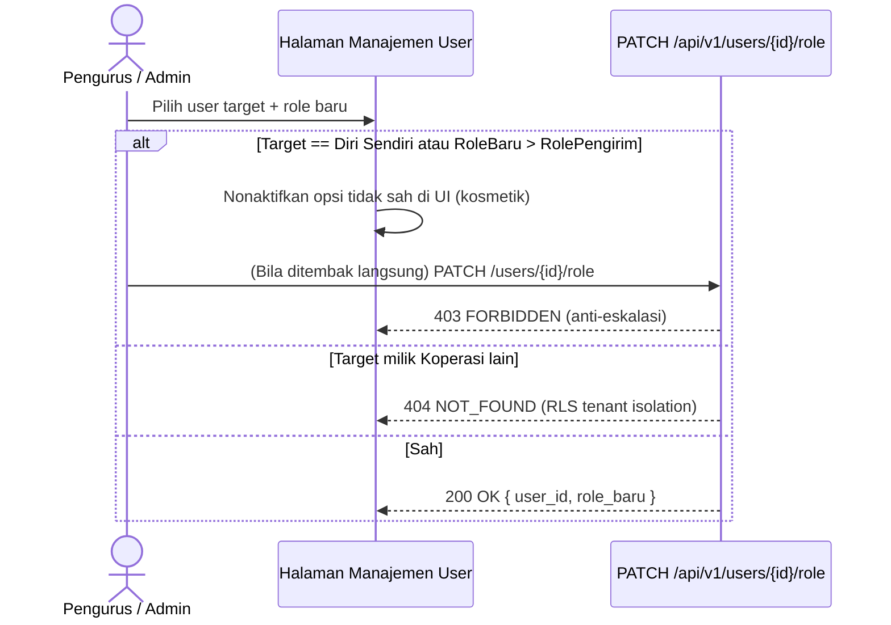
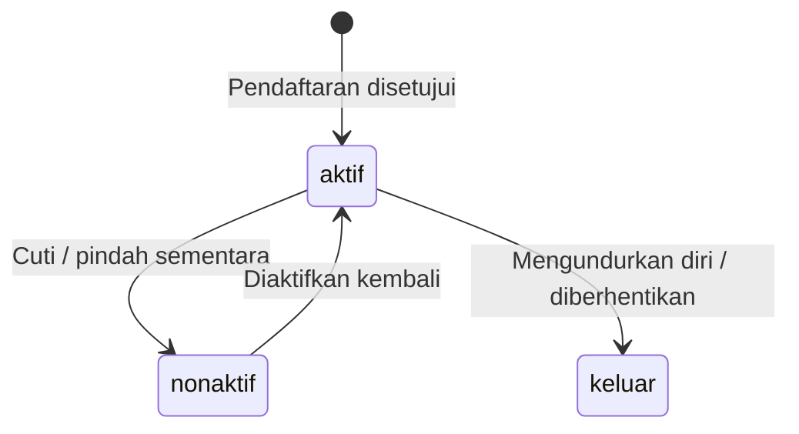

# 05. Profil Saya, Manajemen Anggota & Pengguna

Bab ini membahas cara menampilkan profil pengguna terautentikasi (`GET /api/v1/auth/me`), daftar & detail anggota koperasi, perubahan status keanggotaan (`aktif`, `nonaktif`, `keluar`), serta pengaturan peran pengguna (*anti-eskalasi*).

---

## 1. Apa Fungsi Fitur Ini (Bahasa Awam Desa)

Warga ingin melihat nama, koperasi tempatnya bernaung, dan peran akunnya di pojok aplikasi; sementara sekretaris/ketua perlu menandai jika ada anggota pindah domisili (`nonaktif`) atau mengangkat petugas loket baru (`operator`) **tanpa celah untuk menaikkan hak akses dirinya sendiri menjadi lebih tinggi**.

## 2. Siapa yang Boleh Memakai

| Fitur | `anggota` | `operator` / `pengawas` | `bendahara` | `pengurus` / `ketua` / `admin` |
|---|---|---|---|---|
| `GET /api/v1/auth/me` | Boleh | Boleh | Boleh | Boleh |
| `GET /api/v1/anggota`, `/{id}` | Ditolak `403` | Boleh *(baca)* | Boleh *(baca)* | Boleh |
| `PATCH /api/v1/anggota/{id}/status` | Ditolak `403` | Ditolak `403` | Ditolak `403` | **Boleh** |
| `GET /api/v1/users`, `/{id}` | Ditolak `403` | Boleh *(baca)* | Boleh *(baca)* | Boleh |
| `PATCH /api/v1/users/{id}/role` | Ditolak `403` | Ditolak `403` | Ditolak `403` | **Boleh *(Anti-Eskalasi)*** |

## 3. Endpoint Terkait

| Method | Path | Tujuan |
|---|---|---|
| `GET` | `/api/v1/auth/me` | Profil sesi pengguna saat ini (diambil dari klaim JWT terverifikasi). <!-- claim:CLAIM-AUTH-ME-01 --> |
| `GET` | `/api/v1/anggota` | Daftar anggota di koperasi aktif (dukung filter `status`, `page`, `limit`). |
| `GET` | `/api/v1/anggota/{id}` | Detail anggota tertentu dalam koperasi aktif. |
| `PATCH` | `/api/v1/anggota/{id}/status` | Ubah status keanggotaan + catat alasan wajib (`alasan`) di log append-only. |
| `GET` | `/api/v1/users` | Daftar akun pengguna koperasi aktif. |
| `GET` | `/api/v1/users/{id}` | Detail satu pengguna & perannya. |
| `PATCH` | `/api/v1/users/{id}/role` | Mengubah peran pengguna lain dengan validasi anti-eskalasi. <!-- claim:CLAIM-USERS-ESCALATION-01 --> |

## 4. Diagram Urutan Perubahan Peran & Anti-Eskalasi



## 5. Mesin Status Keanggotaan



- **`aktif`**: Berhak harga anggota toko & menerima tagihan iuran rutin.
- **`nonaktif` / `keluar`**: Histori keanggotaan tetap utuh di `anggota_status_log` (append-only).

## 6. Contoh Permintaan & Respons Nyata

<!-- doc-test-response: id=RESP-AUTH-ME-200 method=GET path=/api/v1/auth/me auth=anggota_a status=200 -->
```json
{
  "success": true,
  "data": {
    "user_id": "01a1d300-0000-7000-8000-000000000001",
    "koperasi_id": "01a1d300-0000-7000-8000-000000000010",
    "nama_lengkap": "Anggota Kopdes A",
    "role": "anggota",
    "is_platform_admin": false,
    "terdaftar_sejak": "2026-11-01T00:00:00Z"
  }
}
```

## 7. Konfigurasi yang Dibutuhkan

- `pagination.default_limit` & `pagination.max_limit` dari `GET /api/v1/public/config` untuk membatasi query `?page=1&limit=...` pada `/api/v1/anggota` dan `/api/v1/users`.

## 8. Kode Contoh Mengambil Daftar Anggota & Profil

```typescript
const profil = await client.request("/api/v1/auth/me");
const anggota = await client.request("/api/v1/anggota", {
  query: { page: 1, limit: config.pagination.default_limit, status: "aktif" },
});
```

## 9. Error Terkait

- `403 FORBIDDEN`: Mencoba mengubah peran diri sendiri, memberi peran di atas peran pemanggil (`operator`/`pengurus` mencoba memberi `admin`), atau `anggota` mengakses `/api/v1/users`.
- `404 NOT_FOUND`: `user_id` atau `anggota_id` milik koperasi lain (tenant isolation).
- `400 BAD_REQUEST`: UUID path tidak valid atau `alasan` kosong saat ubah status anggota.

## 10. Kasus Tepi

- Ketika admin mengubah peran pengguna lain, UI harus menampilkan peringatan bahwa pemegang akun target perlu **Refresh Sesi / Login Ulang** agar peran baru di JWT aktif segera (tanpa menunggu TTL access token 15 menit habis).

## 11. Keamanan & Privasi Klien

- Pastikan kolom pencarian anggota tidak mencetak NIK atau nomor HP mentah ke query URL (`GET /anggota?search=...`) ataupun log browser.

## 12. Cara Menguji di Frontend Tester

Jalankan skenario `CLAIM-AUTH-ME-01`, `CLAIM-ANGGOTA-RBAC-01`, dan `CLAIM-USERS-ESCALATION-01`, atau uji langsung di **Lab Belajar -> Bab 05**.

## 13. Checklist Selesai Profil & Pengguna

- [ ] Dropdown ubah peran otomatis menonaktifkan peran yang lebih tinggi dari pengguna aktif serta mencegah pengubahan akun sendiri.
- [ ] Paginasi daftar memakai `default_limit` & `max_limit` dari `/api/v1/public/config`.
