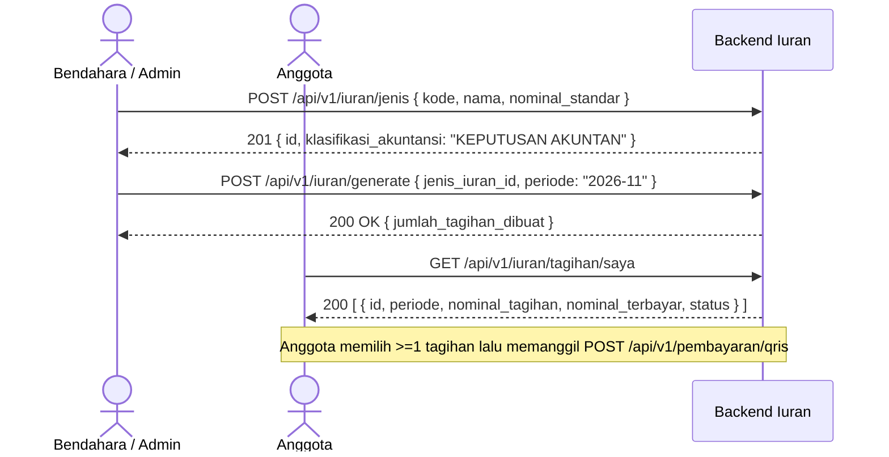
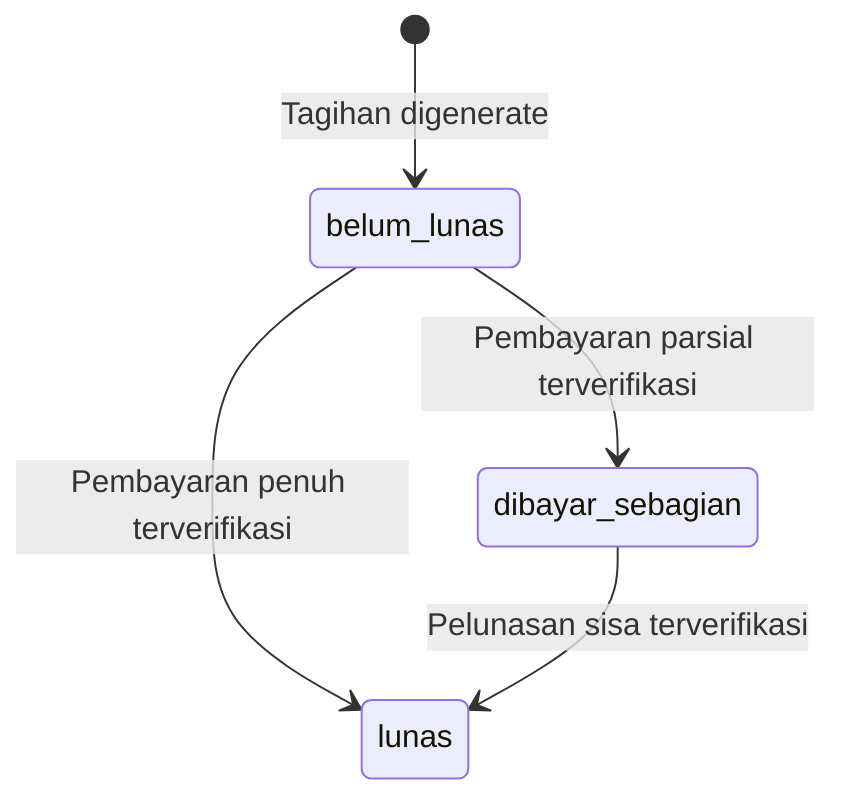

# 06. Iuran & Kontribusi Anggota (`KEPUTUSAN AKUNTAN`)

Bab ini menjelaskan cara menampilkan jenis iuran koperasi yang berlabel netral akuntansi, menyusun daftar tagihan anggota yang belum lunas, membuat jenis iuran baru, men-generate tagihan periode bulanan secara idempoten, serta memantau tunggakan.

---

## 1. Apa Fungsi Fitur Ini (Bahasa Awam Desa)

Setiap bulan anggota koperasi menyetor iuran rutin (atau iuran awal pendaftaran). Bendahara dapat menyiapkan template iuran (misal "Iuran Wajib Bulanan Rp 25.000") lalu men-generate tagihan untuk seluruh anggota aktif pada periode `2026-11`. Label klasifikasi akuntansinya (`ekuitas` vs `kewajiban`) ditandai netral **`KEPUTUSAN AKUNTAN`** karena penetapan pos neraca mengikuti persetujuan akuntan/pengurus koperasi setempat. <!-- claim:CLAIM-IURAN-AKUNTAN-01 -->

## 2. Siapa yang Boleh Memakai

| Fitur | `anggota` | `operator` / `pengawas` | `ketua` | `bendahara` / `pengurus` / `admin` |
|---|---|---|---|---|
| `GET /api/v1/iuran/jenis` | Boleh | Boleh | Boleh | Boleh |
| `GET /api/v1/iuran/tagihan/saya` | Boleh *(miliknya; non-anggota `[]`)* | Boleh | Boleh | Boleh |
| `GET /api/v1/iuran/menunggak` | Ditolak `403` | Boleh *(baca)* | Boleh | Boleh |
| `POST /api/v1/iuran/jenis` & `/generate` | Ditolak `403` | Ditolak `403` | Ditolak `403` | **Boleh** |

## 3. Endpoint Terkait

| Method | Path | Tujuan |
|---|---|---|
| `GET` | `/api/v1/iuran/jenis` | Daftar jenis iuran aktif milik koperasi. |
| `POST` | `/api/v1/iuran/jenis` | Membuat definisi jenis iuran baru (`kode`, `nama`, `nominal_standar`). |
| `POST` | `/api/v1/iuran/generate` | Generate tagihan periode `YYYY-MM` untuk seluruh anggota aktif (idempoten). |
| `GET` | `/api/v1/iuran/tagihan/saya` | Daftar tagihan iuran milik user yang sedang login. |
| `GET` | `/api/v1/iuran/menunggak` | Daftar tagihan belum lunas/kedaluwarsa untuk penagihan pengurus. |

## 4. Diagram Urutan Pembuatan Tagihan & Pembayaran



## 5. Mesin Status Tagihan Iuran



- **`belum_lunas`**: Tampilkan checkbox agar anggota bisa mencentang satu atau beberapa bulan sekaligus untuk dibayar dalam satu kode QRIS.
- **`dibayar_sebagian`**: Tampilkan sisa kurang bayar (`nominal_tagihan - nominal_terbayar`).
- **`lunas`**: Nonaktifkan checkbox dan tampilkan badge hijau *"Lunas"*.

## 6. Contoh Permintaan & Respons Nyata

<!-- doc-test-response: id=RESP-IURAN-SAYA-200 method=GET path=/api/v1/iuran/tagihan/saya auth=anggota_a status=200 -->
```json
{
  "success": true,
  "data": []
}
```

Contoh membuat jenis iuran (`POST /api/v1/iuran/jenis`):
```json
{
  "kode": "IURAN_WAJIB_2026",
  "nama": "Iuran Wajib Bulanan Anggota",
  "nominal_standar": 25000
}
```

## 7. Konfigurasi yang Dibutuhkan

- Zona waktu `timezone` (`Asia/Jakarta`) saat menentukan periode berjalan `YYYY-MM`.
- Format Rupiah `int64` tanpa desimal float (lihat [Bab 12](12-format-data-uang-waktu.md)).

## 8. Kode Contoh React Tagihan Saya + Hitung Total Terpilih

```typescript
const tagihan = await client.request<Array<{ id: string; periode: string; nominal_tagihan: number; status: string }>>(
  "/api/v1/iuran/tagihan/saya"
);
const totalBayar = tagihan
  .filter((t) => selectedIds.includes(t.id) && t.status !== "lunas")
  .reduce((acc, item) => acc + item.nominal_tagihan, 0);
```

## 9. Error Terkait Iuran

- `400 BAD_REQUEST`: Format periode salah (wajib `YYYY-MM`), `nominal_standar <= 0`, atau `jenis_iuran_id` bukan UUID.
- `403 FORBIDDEN`: `ketua`, `pengawas`, atau `operator` mencoba memanggil `POST /iuran/jenis` atau `POST /iuran/generate`.

## 10. Kasus Tepi

- **Pengurus/Admin tidak terdaftar di tabel `anggota`**: Sesuai perbaikan **DISC-09** di [DOC_DISCREPANCIES.md](../DOC_DISCREPANCIES.md), `GET /api/v1/iuran/tagihan/saya` tetap mengembalikan `200 OK` dengan array kosong `[]` (bukan error `500`), sehingga header navigasi dapat memanggilnya aman untuk peran apa pun.
- **`POST /iuran/generate` dipanggil dua kali pada periode sama**: Aman (idempoten); anggota yang sudah punya tagihan di periode itu tidak akan tertagih ganda.

## 11. Keamanan & Privasi Klien

- Pastikan tampilan daftar penunggak (`GET /iuran/menunggak`) hanya dibuka di halaman backoffice pengurus dan tidak pernah dibocorkan ke halaman publik warga.
- Gunakan label netral **`KEPUTUSAN AKUNTAN`** bila menampilkan klasifikasi akun iuran sampai disahkan oleh akuntan koperasi.

## 12. Cara Menguji di Frontend Tester

Jalankan skenario `CLAIM-IURAN-AKUNTAN-01` dan ikuti Live Demo Modul 4 & **Lab Belajar -> Bab 06**.

## 13. Checklist Selesai Iuran

- [ ] Nama field `nominal_standar` dipakai saat membuat jenis iuran (bukan `nominal`).
- [ ] UI menangani respons array kosong `[]` dengan tampilan *"Belum ada tagihan aktif"* yang rapi.
- [ ] Label akuntansi iuran menyertakan keterangan netral `KEPUTUSAN AKUNTAN`.
