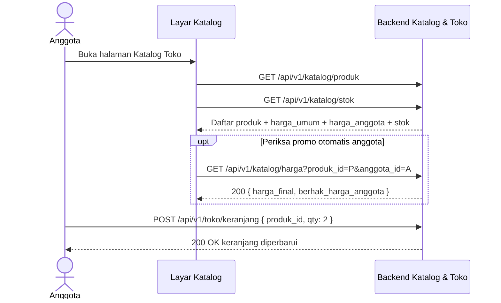
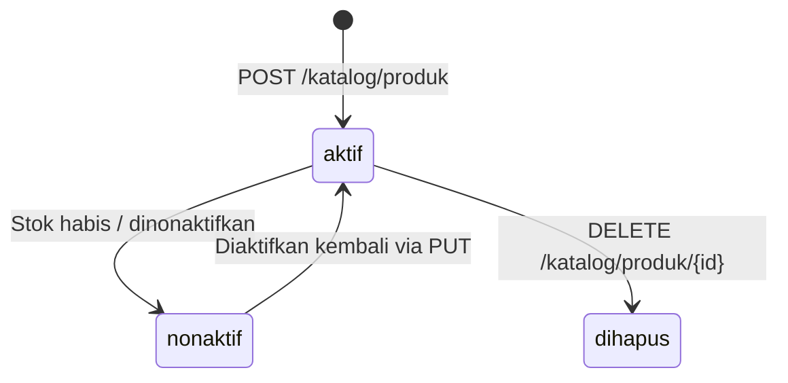

# 07. Katalog Produk, Harga Anggota, Promo & Keranjang

Bab ini memandu pembuatan layar etalase toko desa: daftar barang, penghitungan harga khusus anggota + diskon promo terbaik, manajemen produk oleh pengurus, dan keranjang belanja.

---

## 1. Apa Fungsi Fitur Ini (Bahasa Awam Desa)

Toko koperasi menjual kebutuhan pokok seperti beras atau pupuk dengan **dua tingkat harga**: harga umum untuk pembeli non-anggota dan harga lebih hemat untuk anggota aktif koperasi, plus kode promo musiman (misal potongan Rp 5.000). Frontend selalu bertanya ke server untuk harga final agar warga tidak pernah melihat selisih hitung saat checkout.

## 2. Siapa yang Boleh Memakai

| Fitur | `anggota` | `operator`/`pengawas`/`bendahara`/`ketua` | `pengurus` / `admin` |
|---|---|---|---|
| Lihat katalog, stok, promo, cek harga anggota | Boleh | Boleh | Boleh |
| Kelola keranjang (`POST`/`GET`/`DELETE /toko/keranjang`) | Boleh | Boleh | Boleh |
| Tambah/ubah/hapus produk & buat promo | Ditolak `403` | Ditolak `403` | **Boleh** |

## 3. Endpoint Terkait

| Method | Path | Tujuan |
|---|---|---|
| `GET` | `/api/v1/katalog/produk` | Daftar produk aktif beserta `harga_umum` & `harga_anggota`. |
| `POST` / `PUT` / `DELETE` | `/api/v1/katalog/produk` *(dan `/{id}`)* | Manajemen produk oleh `admin`/`pengurus`. |
| `GET` | `/api/v1/katalog/stok` | Daftar stok tersedia per produk di gudang koperasi. |
| `GET` | `/api/v1/katalog/harga` | Hitung harga akhir (`?produk_id=<UUID>&anggota_id=<UUID>` wajib). <!-- claim:CLAIM-KATALOG-TOKO-01 --> |
| `GET` / `POST` | `/api/v1/katalog/promo` | Daftar promo aktif / membuat kode promo diskon baru. |
| `GET` / `POST` / `DELETE` | `/api/v1/toko/keranjang` *(dan `/{produk_id}`)* | Kelola item belanja di keranjang pengguna saat ini. |

## 4. Diagram Urutan Tambah ke Keranjang & Cek Harga



## 5. Mesin Status Produk Katalog



- Hanya produk berstatus jual aktif dengan stok `> 0` yang boleh menampilkan tombol `+ Keranjang` aktif di UI.

## 6. Contoh Permintaan & Respons Nyata

<!-- doc-test-response: id=RESP-KATALOG-PRODUK-200 method=GET path=/api/v1/katalog/produk auth=anggota_a status=200 -->
```json
{
  "success": true,
  "data": [
    {
      "id": "01a1d300-0000-7000-8000-000000000030",
      "sku": "BRS-5KG",
      "nama": "Beras Premium 5kg",
      "satuan_dasar": "sak",
      "status_jual": "aktif",
      "harga_umum": 72000,
      "harga_anggota": 68000
    }
  ]
}
```

## 7. Konfigurasi yang Dibutuhkan

- Seluruh harga dalam Rupiah bulat (`int64`), format di UI menggunakan `formatRupiah()` dari SDK.

## 8. Kode Contoh Tambah ke Keranjang & Preview Harga

```typescript
const produkList = await client.request("/api/v1/katalog/produk");
await client.request("/api/v1/toko/keranjang", {
  method: "POST",
  body: { produk_id: produkList[0].id, qty: 2 },
});
const keranjang = await client.request("/api/v1/toko/keranjang");
```

## 9. Error Terkait Katalog & Keranjang

- `400 BAD_REQUEST`: `GET /katalog/harga` tidak menyertakan **kedua** query UUID `produk_id` & `anggota_id` (**DISC-07**), atau `qty <= 0` saat tambah ke keranjang.
- `404 NOT_FOUND`: `produk_id` tidak ada atau milik koperasi lain.
- `403 FORBIDDEN`: Peran selain `admin`/`pengurus` mencoba menambah atau menghapus produk/promo.

## 10. Kasus Tepi

- **Cross-tenant pada `/api/v1/katalog/harga` (DISC-11)**: Bila `produk_id` milik Kop B -> `404`. Namun bila `produk_id` milik Kop A dan `anggota_id` milik Kop B -> server menyembunyikan data Kop B dan mengembalikan `200` dengan `berhak_harga_anggota: false` (`harga_umum`), tanpa membocorkan info apa pun dari koperasi tetangga!
- **Klik dua kali tombol `+ Keranjang`**: Tampilkan loading indikator pada kartu barang tersebut hingga `POST /toko/keranjang` selesai.

## 11. Keamanan & Privasi Klien

- Perhitungan diskon akhir hanya bersifat *estimasi pratinjau* di frontend; nominal tagihan final selalu berasal dari server saat `POST /api/v1/toko/checkout`.

## 12. Cara Menguji di Frontend Tester

Jalankan `CLAIM-KATALOG-TOKO-01` dan coba alur tambah produk -> cek harga -> tambah keranjang pada Live Demo Modul 6 & **Lab Belajar -> Bab 07**.

## 13. Checklist Selesai Katalog & Keranjang

- [ ] Selalu kirim kedua parameter `produk_id` dan `anggota_id` saat memanggil `GET /api/v1/katalog/harga`.
- [ ] UI menampilkan perbandingan harga umum vs harga anggota secara jelas.
- [ ] Stok 0 otomatis menonaktifkan tombol masuk keranjang.
