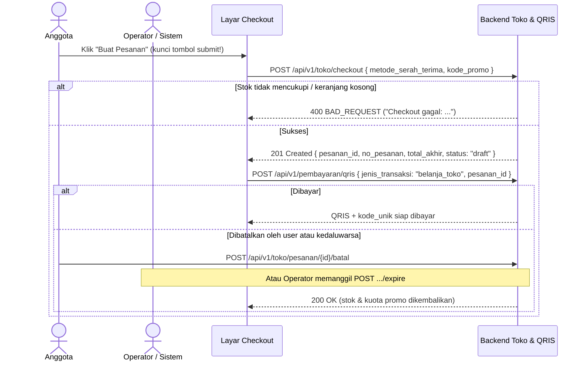
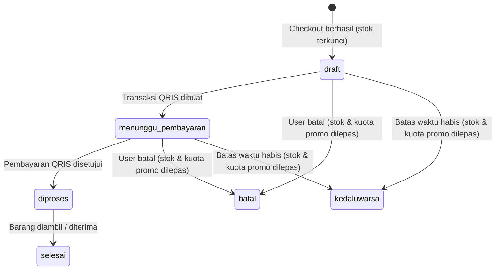

# 08. Toko, Checkout Atomik & Siklus Pesanan

Bab ini menjelaskan proses checkout keranjang menjadi pesanan resmi dalam satu transaksi atomik (mengunci stok agar tidak minus/oversell), pembatalan oleh pembeli, serta kedaluwarsa pesanan untuk melepaskan kembali stok & kuota promo.

---

## 1. Apa Fungsi Fitur Ini (Bahasa Awam Desa)

Ketika beberapa warga berbelanja minyak goreng di waktu bersamaan padahal sisa stok di gudang cuma 2 botol, sistem backend mengunci stok di detik checkout agar tidak terjadi *oversell* (stok minus). Jika warga berubah pikiran (`batal`) atau melewati batas waktu bayar (`kedaluwarsa`), barang otomatis masuk gudang lagi supaya warga lain bisa membelinya.

## 2. Siapa yang Boleh Memakai

| Aksi | `anggota` | `operator` | `pengawas` | `bendahara` / `pengurus` / `ketua` / `admin` |
|---|---|---|---|---|
| `POST /api/v1/toko/checkout` & `GET /api/v1/toko/pesanan` | Boleh | Boleh | Boleh | Boleh |
| `POST /api/v1/toko/pesanan/{id}/batal` | Boleh *(pesanan sendiri)* | Boleh | Boleh | Boleh |
| `POST /api/v1/toko/pesanan/{id}/expire` | Ditolak `403` | **Boleh** | **Ditolak `403`** | **Boleh** <!-- claim:CLAIM-TOKO-EXPIRE-01 --> |

## 3. Endpoint Terkait

| Method | Path | Tujuan |
|---|---|---|
| `POST` | `/api/v1/toko/checkout` | Mengubah isi keranjang menjadi pesanan, memotong stok atomik, & menghitung promo final (`201 Created`). |
| `GET` | `/api/v1/toko/pesanan` | Daftar pesanan (urut terbaru, limit 50). |
| `POST` | `/api/v1/toko/pesanan/{id}/batal` | Pembeli membatalkan pesanan & memulihkan stok + kuota promo. |
| `POST` | `/api/v1/toko/pesanan/{id}/expire` | Menandai pesanan melewati batas bayar & melepas reservasi stok + kuota promo. |

## 4. Diagram Urutan Checkout ke Bayar & Batal/Expire



## 5. Mesin Status Pesanan Toko



- **`draft`**: *(Fakta aktual kode `toko_handler.go:487`!)* Segera lanjutkan atau sediakan tombol "Lanjut ke Pembayaran QRIS".
- **`menunggu_pembayaran`**: Tampilkan timer & instruksi bayar.
- **`diproses` / `selesai`**: Pesanan lunas dan sedang disiapkan/sudah diambil di koperasi.
- **`batal` / `kedaluwarsa`**: Pesanan ditutup; stok telah dikembalikan ke gudang.

## 6. Contoh Permintaan & Respons Nyata

Permintaan `POST /api/v1/toko/checkout`:
```json
{
  "metode_serah_terima": "ambil_di_koperasi",
  "kode_promo": ""
}
```

<!-- doc-test-response: id=RESP-TOKO-LIST-PESANAN-200 method=GET path=/api/v1/toko/pesanan auth=anggota_a status=200 -->
```json
{
  "success": true,
  "data": []
}
```

Contoh respons `POST /api/v1/toko/checkout` (`201 Created` sesuai `toko_handler.go:483` & **DISC-08**):
```json
{
  "success": true,
  "data": {
    "pesanan_id": "01a1d300-0000-7000-8000-000000000040",
    "no_pesanan": "ORD-20261115-0001",
    "total_akhir": 131000,
    "status": "draft",
    "message": "Pesanan berhasil dibuat. Lanjutkan ke pembayaran QRIS."
  }
}
```

## 7. Konfigurasi yang Dibutuhkan

- `features.read_only_mode` (`503 READ_ONLY_MODE` menolak checkout/batal).
- Untuk alur bayar segera sesudah checkout, cek juga `features.payments_enabled`.

## 8. Kode Contoh Checkout Satu-Klik Aman (Kunci Ganda)

```typescript
let submitting = false;
async function checkoutAndPay(metode: "ambil_di_koperasi" | "antar_desa", kodePromo?: string) {
  if (submitting) return;
  submitting = true;
  try {
    const order = await client.request<{ pesanan_id: string; total_akhir: number; status: string }>(
      "/api/v1/toko/checkout",
      { method: "POST", body: { metode_serah_terima: metode, kode_promo: kodePromo || "" } }
    );
    return order;
  } finally {
    submitting = false;
  }
}
```

## 9. Error Terkait Checkout & Pesanan

- `400 BAD_REQUEST`: Keranjang kosong, stok barang habis/kurang, kode promo tidak memenuhi syarat minimal belanja/kuota, atau mencoba membatalkan pesanan yang sudah dibayar.
- `403 FORBIDDEN`: `pengawas` atau `anggota` memanggil `POST /toko/pesanan/{id}/expire`.
- `503 READ_ONLY_MODE`: Mode pemeliharaan aktif.

## 10. Kasus Tepi

- **Klik ganda tombol Checkout**: Karena `POST /toko/checkout` mengosongkan keranjang di transaksi pertama, klik kedua beberapa milidetik sesudahnya akan gagal `400` ("Keranjang kosong") jika tombol tidak segera dikunci (`disabled={isSubmitting}`).
- **Pesanan baru masih berstatus `draft` setelah checkout**: Sesuai **DISC-08**, jangan mengecek `if (order.status === "menunggu_pembayaran")` tepat sesudah checkout — status awal adalah `"draft"` hingga `POST /pembayaran/qris` dipanggil!

## 11. Keamanan & Privasi Klien

- Pastikan `GET /toko/pesanan` milik anggota biasa hanya memfilter pesanannya sendiri (enforced oleh backend).

## 12. Cara Menguji di Frontend Tester

Jalankan `CLAIM-KATALOG-TOKO-01` dan `CLAIM-TOKO-EXPIRE-01`, lalu jalankan alur **Live Demo Modul 6 & 7** atau **Lab Belajar -> Bab 08**.

## 13. Checklist Selesai Toko & Checkout

- [ ] Tombol Checkout dinonaktifkan sejak klik pertama sampai API membalas.
- [ ] UI menangani status awal `"draft"` langsung menuju layar buat QRIS.
- [ ] Alasan kegagalan stok/promo ditampilkan jelas kepada pembeli.
