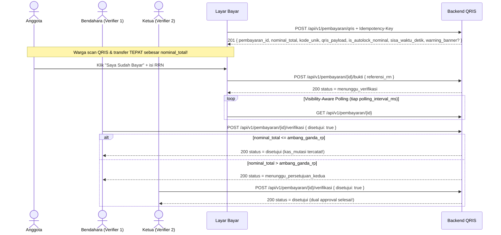
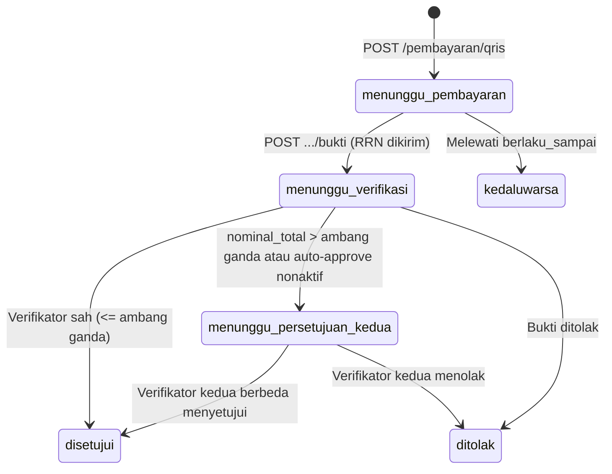

# 09. Pembayaran QRIS Statis + Kode Unik, Polling & Anti-IDOR

Bab terpenting untuk transaksi uang: cara membuat kode pembayaran QRIS beserta `Idempotency-Key`, menampilkan kode unik & warning Pilot Rekening Pribadi, menghitung waktu tersisa akurat, polling hemat baterai/kuota, hingga memverifikasi dengan Maker-Checker dan persetujuan ganda.

---

## 1. Apa Fungsi Fitur Ini (Bahasa Awam Desa)

Ketika warga membayar iuran Rp 25.000 atau belanja toko Rp 131.000, server menerbitkan payload QRIS **ditambah 3–4 digit kode unik** (misal jadi **Rp 25.356** atau **Rp 131.214**) sehingga saat uang masuk ke mutasi rekening koperasi, sistem langsung tahu transaksi mana yang dibayar. Setelah transfer di aplikasi bank/e-wallet, warga mengisikan referensi RRN sebagai bukti, lalu Bendahara/Pengurus berbeda memverifikasinya.

## 2. Siapa yang Boleh Memakai

| Fitur | `anggota` | `operator` / `pengawas` | `bendahara` / `pengurus` / `ketua` / `admin` |
|---|---|---|---|
| Buat QRIS, lihat pembayaran sendiri, klaim bukti | **Boleh** *(miliknya saja)* | Boleh *(lihat semua di kop)* | Boleh *(lihat semua di kop)* |
| Akses pembayaran milik anggota lain | **Ditolak `404` *(Anti-IDOR)*** <!-- claim:CLAIM-PAYMENT-IDOR-01 --> | Boleh *(baca)* | Boleh *(baca)* |
| Lihat antrean verifikasi (`GET /pembayaran/antrean`) | Ditolak `403` | Boleh *(baca)* | Boleh |
| Setujui/tolak pembayaran (`POST /pembayaran/{id}/verifikasi`) | Ditolak `403` | **Ditolak `403`** | **Boleh *(Maker-Checker)*** <!-- claim:CLAIM-QRIS-MAKER-CHECKER-01 --> |

## 3. Endpoint Terkait

| Method | Path | Header Wajib | Tujuan |
|---|---|---|---|
| `POST` | `/api/v1/pembayaran/qris` | `Idempotency-Key: <UUIDv4>` | Membuat tagihan QRIS + kode unik (idempoten 24 jam). <!-- claim:CLAIM-QRIS-IDEMPOTENCY-01 --> |
| `GET` | `/api/v1/pembayaran/{id}` | Bearer JWT | Memeriksa status pembayaran (termasuk `is_anomali` & `warning_banner`). |
| `POST` | `/api/v1/pembayaran/{id}/bukti` | Bearer JWT | Pembayar mengklaim sudah transfer + mengirim `referensi_rrn`. |
| `GET` | `/api/v1/pembayaran/antrean` | Bearer JWT *(backoffice)* | Antrean `menunggu_verifikasi` / `menunggu_persetujuan_kedua`. |
| `POST` | `/api/v1/pembayaran/{id}/verifikasi` | Bearer JWT *(verifikator)* | Mengesahkan (`disetujui: true`) atau menolak pembayaran. |

## 4. Diagram Urutan Lengkap Bayar QRIS & Persetujuan Ganda



## 5. Mesin Status Pembayaran



- **`menunggu_pembayaran`**: Tampilkan QR, Nominal Total **besar** + tombol Salin, plus warning *"Transfer tepat hingga 3 digit terakhir"*.
- **`menunggu_verifikasi`**: Tampilkan status *"Sedang dicek oleh bendahara"*; mulai poller aman baterai (`createPaymentPoller`).
- **`menunggu_persetujuan_kedua`**: Di layar backoffice tampilkan badge oranye **"Butuh Verifikator Ke-2 Berbeda"** (`> ambang ganda`, ketat lebih besar sesuai **DISC-08**).
- **`disetujui`**: Tampilkan tanda terima lunas.
- **`ditolak` / `kedaluwarsa`**: Beri tombol *"Buat Pembayaran Baru"* (wajib `Idempotency-Key` baru!).

## 6. Contoh Permintaan & Respons Nyata

Permintaan `POST /api/v1/pembayaran/qris`:
```json
{
  "jenis_transaksi": "iuran_bulanan",
  "tagihan_iuran_id": ["<UUID_TAGIHAN>"]
}
```

Contoh respons `201 Created`:
```json
{
  "success": true,
  "data": {
    "pembayaran_id": "01a1d313-c3aa-7f9e-80d1-d65742ce42cc",
    "no_pembayaran": "PAY-f6da1059-3727",
    "kode_unik": 356,
    "nominal_dasar": 600000,
    "nominal_total": 600356,
    "qris_payload": "000201010211...630432C2",
    "qris_payload_statis": "000201010211...630432C2",
    "is_autolock_nominal": false,
    "nama_merchant": "Kopdes Makmur",
    "nmid": "ID2650218851083",
    "berlaku_sampai": "2026-11-15T11:15:00Z",
    "sisa_waktu_detik": 900,
    "is_rekening_pribadi": false
  }
}
```

> **Perhatian Perbedaan Tipe JSON**: Pada `POST /api/v1/pembayaran/qris`, `nominal_total` berupa `number` (`600356`), sedangkan pada `GET /api/v1/pembayaran/{id}`, `nominal_total` dikembalikan server sebagai `string` desimal (`"600356.00"`). Helper `formatRupiah()` di SDK otomatis menerima keduanya!

## 7. Konfigurasi yang Dibutuhkan

- `features.payments_enabled`: bila `false` -> `503 FEATURE_DISABLED`.
- `features.qris_dynamic_enabled`: bila `false`, `is_autolock_nominal` bernilai `false` dan warga harus mengetik nominal manual di app bank.
- `polling_interval_ms` (default `3000` ms) & `payment_expiry_seconds` (default `900` detik) + `server_unix_ms` untuk akurasi timer hitung mundur.

## 8. Kode Contoh Buat QRIS + Polling Hemat Kuota

```typescript
import { createClient, createPaymentPoller, formatRupiah } from "../../frontend-reference/src/index";

const idempKey = client.newIdempotencyKey();
const qr = await client.createQRISPayment(
  { jenis_transaksi: "iuran_bulanan", tagihan_iuran_id: [tagihanId] },
  idempKey
);

console.log("Transfer tepat:", formatRupiah(qr.nominal_total));

const poller = createPaymentPoller({
  intervalMs: config.polling_interval_ms,
  fetchStatus: () => client.request(`/api/v1/pembayaran/${qr.pembayaran_id}`),
  onUpdate: (st) => {
    if (st.status === "disetujui" || st.status === "ditolak") poller.stop();
  },
});
poller.start();
```

## 9. Error Terkait Pembayaran

- `422 IDEMPOTENCY_CONFLICT`: Mengirim `Idempotency-Key` yang sama untuk daftar tagihan/pesanan berbeda -> panggil `client.newIdempotencyKey()` untuk transaksi baru.
- `409 CONFLICT`: Seluruh slot kode unik (999/9999) penuh sementara atau tagihan sudah lunas -> tunggu transaksi lain kedaluwarsa.
- `400 BAD_REQUEST`: Tidak ada rekening QRIS aktif, melebihi batas transaksi harian pilot (`Asia/Jakarta`), atau catatan/RRN kosong.
- `403 FORBIDDEN`: Verifikator sama dengan pembuat pembayaran, sama dengan verifikator ke-1, atau pengimpor CSV.
- `404 NOT_FOUND`: Mengakses `pembayaran_id` anggota lain (anti-IDOR) atau koperasi lain.

## 10. Kasus Tepi

- **Warga menutup/meminimalkan layar HP saat polling berjalan**: `createPaymentPoller` otomatis menjeda polling saat `document.visibilityState === "hidden"` agar tidak menguras kuota desa dan tidak memicu rate limit `429`.
- **Mode Pilot Rekening Pribadi aktif**: Jika `warning_banner` ada pada respons QRIS/detail pembayaran, UI wajib menampilkannya sebagai banner kuning/merah yang tidak bisa disembunyikan (*un-dismissible*) di layar kasir/admin.

## 11. Keamanan & Privasi Klien

- Pastikan `GET /api/v1/pembayaran/antrean` hanya menampilkan referensi non-PII sensitif di ringkasan daftar.
- Gunakan `Idempotency-Key` berbeda per keranjang/kombinasi tagihan.

## 12. Cara Menguji di Frontend Tester

Jalankan `CLAIM-QRIS-IDEMPOTENCY-01`, `CLAIM-QRIS-MAKER-CHECKER-01`, `CLAIM-PAYMENT-IDOR-01`, serta uji Live Demo Modul 7/8 dan **Panduan Terpandu Langkah 4–6**.

## 13. Checklist Selesai Pembayaran QRIS

- [ ] `Idempotency-Key` dibuat sekali per sesi bayar & direset jika item berubah.
- [ ] `is_autolock_nominal === false` memicu instruksi menyalin `nominal_total` tepat termasuk `kode_unik`.
- [ ] Polling otomatis berhenti saat status terminal (`disetujui`/`ditolak`/`kedaluwarsa`) atau tab background.
- [ ] `warning_banner` dirender jelas bila transaksi memakai rekening pilot.
