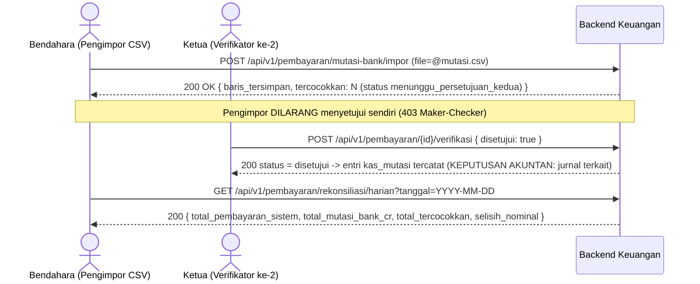
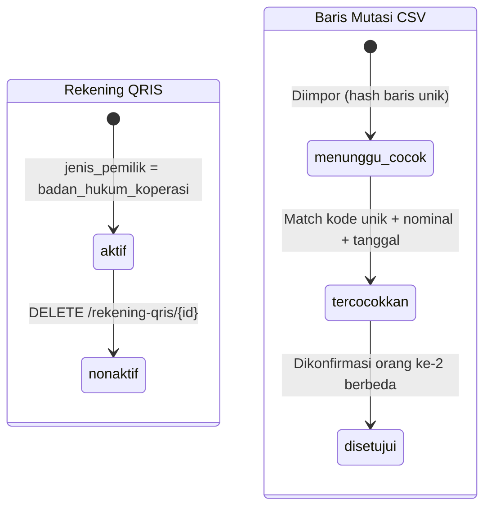

# 10. Rekening QRIS, Impor Mutasi Bank CSV, Rekonsiliasi & Kas

Bab ini membahas halaman backoffice keuangan: pendaftaran rekening merchant badan hukum koperasi (dan penolakan rekening pribadi non-pilot), unggah mutasi rekening koran CSV, alur konfirmasi orang kedua, laporan rekonsiliasi harian `Asia/Jakarta`, dan pembacaan buku kas append-only `kas_mutasi`.

---

## 1. Apa Fungsi Fitur Ini (Bahasa Awam Desa)

Setiap sore Bendahara mengunduh file CSV rekening bank koperasi lalu mengunggahnya ke sistem Kopdes agar pembayaran warga yang sudah transfer otomatis dicocokkan dengan kode uniknya. Untuk keamanan ganda agar bendahara tidak membuat mutasi palsu sendirian, mutasi yang diimpor menunggu konfirmasi orang kedua (`ketua`/`admin` berbeda), lalu hasilnya masuk ke buku kas abadi (`kas_mutasi`, tidak bisa dihapus/edit — hanya koreksi pembalik).

## 2. Siapa yang Boleh Memakai

| Fitur | `anggota` | `operator` / `pengawas` | `bendahara` / `ketua` | `pengurus` / `admin` |
|---|---|---|---|---|
| `GET /api/v1/koperasi/rekening-qris` | Ditolak `403` | Boleh *(baca)* | Boleh *(baca)* | Boleh |
| `POST` / `DELETE /api/v1/koperasi/rekening-qris` | Ditolak `403` | Ditolak `403` | Ditolak `403` | **Boleh** <!-- claim:CLAIM-QRIS-REKENING-01 --> |
| `POST /api/v1/pembayaran/mutasi-bank/impor` | Ditolak `403` | Ditolak `403` | **Boleh *(selain verifikator)* ** | **Boleh** <!-- claim:CLAIM-QRIS-MUTASI-DUAL-01 --> |
| `GET /pembayaran/rekonsiliasi/harian` & `GET /kas/mutasi` | Ditolak `403` | **Boleh *(read-only)*** | Boleh | Boleh <!-- claim:CLAIM-REKONSILIASI-LAPORAN-01 --> |

## 3. Endpoint Terkait

| Method | Path | Tujuan |
|---|---|---|
| `POST` | `/api/v1/koperasi/rekening-qris` | Mendaftarkan rekening QRIS statis badan hukum koperasi (validasi CRC16 & Tag 00 EMVCo). |
| `GET` | `/api/v1/koperasi/rekening-qris` | Daftar rekening QRIS terdaftar di koperasi aktif. |
| `DELETE` | `/api/v1/koperasi/rekening-qris/{id}` | Menonaktifkan rekening merchant QRIS. |
| `POST` | `/api/v1/pembayaran/mutasi-bank/impor` | Upload file CSV mutasi bank (`multipart/form-data`, key `file`). |
| `GET` | `/api/v1/pembayaran/rekonsiliasi/harian` | Ringkasan selisih pembayaran vs mutasi CR (`?tanggal=YYYY-MM-DD`). |
| `GET` | `/api/v1/kas/mutasi` | Daftar catatan kas *append-only* (`pemasukan`/`pengeluaran`). |

## 4. Diagram Urutan Impor Mutasi & Rekonsiliasi Harian



## 5. Mesin Status Rekening & Mutasi Impor



## 6. Contoh Permintaan & Respons Nyata

<!-- doc-test-response: id=RESP-REKONSILIASI-HARIAN-200 method=GET path=/api/v1/pembayaran/rekonsiliasi/harian?tanggal=2026-11-15 auth=admin_a status=200 -->
```json
{
  "success": true,
  "data": {
    "tanggal": "2026-11-15",
    "total_pembayaran_sistem": {
      "jumlah": 0,
      "nominal": 0
    },
    "total_mutasi_bank_cr": {
      "jumlah": 0,
      "nominal": 0
    },
    "total_tercocokkan": {
      "jumlah": 0,
      "nominal": 0
    },
    "selisih_nominal": 0
  }
}
```

## 7. Konfigurasi yang Dibutuhkan

- `upload_limits.allowed_csv_mime_types`: `["text/csv", "application/csv", "text/plain"]` dan `max_body_bytes`.
- `timezone`: `"Asia/Jakarta"` untuk menyusun query `?tanggal=YYYY-MM-DD` (pakai `getJakartaTodayISO()` dari SDK!).
- `features.personal_payment_pilot_enabled`: tampilkan warning bila `jenis_pemilik === "perorangan_pengurus"` diizinkan untuk uji coba pilot.

## 8. Kode Contoh Upload CSV & Ambil Rekonsiliasi Hari Ini

```typescript
import { createClient, getJakartaTodayISO, validateUploadFile } from "../../frontend-reference/src/index";

const check = validateUploadFile(csvFile, {
  maxBytes: config.upload_limits.max_body_bytes,
  allowedMimeTypes: config.upload_limits.allowed_csv_mime_types,
});
if (!check.ok) throw new Error(check.reason);

const fd = new FormData();
fd.append("file", csvFile);
const imporRes = await client.uploadMultipart("/api/v1/pembayaran/mutasi-bank/impor", fd);

const today = getJakartaTodayISO();
const rekon = await client.request("/api/v1/pembayaran/rekonsiliasi/harian", {
  query: { tanggal: today },
});
```

## 9. Error Terkait Rekening & Mutasi

- `403 FORBIDDEN`: Mencoba mendaftarkan rekening pribadi (`jenis_pemilik !== "badan_hukum_koperasi"`) ketika pilot nonaktif, atau pengimpor CSV mencoba langsung memverifikasi pembayaran hasil impornya sendiri.
- `400 BAD_REQUEST`: String EMVCo `qris_payload_statis` memiliki CRC16 Tag 63 salah, Tag 00 bukan `"01"`, atau tag duplikat.
- `409 CONFLICT` / penolakan duplikasi baris CSV saat file mutasi yang sama diunggah ulang (hash baris mutasi unik).

## 10. Kasus Tepi

- **`kas_mutasi` bersifat *append-only***: Jangan pernah membuat tombol "Edit Mutasi" atau "Hapus Mutasi" di frontend; backend tidak menyediakan endpoint mutasi/hapus karena setiap koreksi wajib berupa entri pembalik (*reversal*) **KEPUTUSAN AKUNTAN**.
- **Pengguna berada di zona WITA/WIT saat akhir hari 23:30 WIB**: Gunakan `getJakartaTodayISO()` bukan `new Date().toISOString().slice(0, 10)` (UTC bergeser setelah jam 07:00 WIB!).

## 11. Keamanan & Privasi Klien

- Pastikan template contoh CSV mutasi bank tidak menaruh nomor rekening asli maupun PII anggota ke kode repositori frontend.

## 12. Cara Menguji di Frontend Tester

Jalankan `CLAIM-QRIS-REKENING-01`, `CLAIM-QRIS-MUTASI-DUAL-01`, dan `CLAIM-REKONSILIASI-LAPORAN-01` serta coba **Lab Belajar -> Bab 10**.

## 13. Checklist Selesai Rekonsiliasi & Kas

- [ ] Pendaftaran rekening mewajibkan QRIS EMVCo valid & menolak rekening pribadi di mode standar.
- [ ] Parameter `tanggal` rekonsiliasi selalu dihitung dengan zona waktu `Asia/Jakarta`.
- [ ] Tidak ada tombol Edit/Hapus pada layar `kas_mutasi`.
