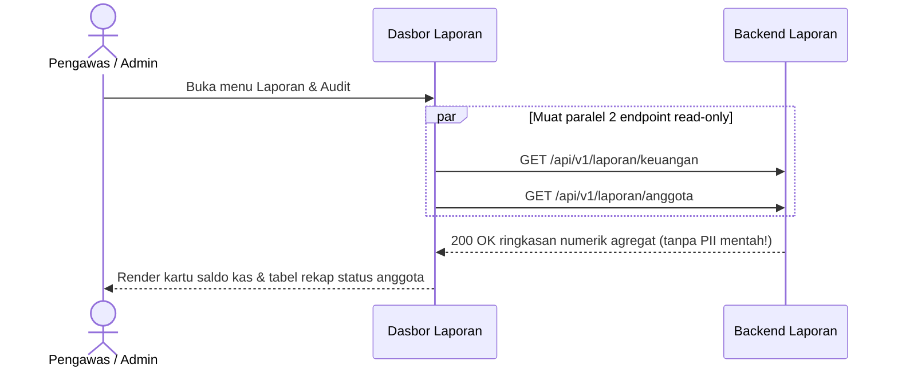

# 11. Laporan Keuangan, Rekap Anggota & Peran Pengawas

Bab ini menjelaskan cara menampilkan laporan keuangan koperasi dan rekap jumlah anggota per status dengan pemisahan hak akses *read-only* untuk peran `pengawas` dan `operator`.

---

## 1. Apa Fungsi Fitur Ini (Bahasa Awam Desa)

Dalam rapat pengurus atau pengawasan bulanan oleh Badan Pengawas koperasi desa, pengurus maupun pengawas ingin melihat total kas masuk, total pengeluaran, saldo kas berjalan, serta berapa banyak anggota aktif hari ini dalam satu dasbor ringkas tanpa berisiko mengubah angka apa pun.

## 2. Siapa yang Boleh Memakai

| Fitur | `anggota` | `operator` | `pengawas` | `bendahara` / `pengurus` / `ketua` / `admin` |
|---|---|---|---|---|
| `GET /api/v1/laporan/keuangan` | Ditolak `403` | **Boleh *(baca)*** | **Boleh *(baca)*** | Boleh |
| `GET /api/v1/laporan/anggota` | Ditolak `403` | **Boleh *(baca)*** | **Boleh *(baca)*** | Boleh |

## 3. Endpoint Terkait

| Method | Path | Tujuan |
|---|---|---|
| `GET` | `/api/v1/laporan/keuangan` | Ringkasan `periode_aktif`, `total_pemasukan`, `total_pengeluaran`, `saldo_kas_aktif`, `surplus_defisit`. |
| `GET` | `/api/v1/laporan/anggota` | Total anggota & rincian hitungan per status (`aktif`, `nonaktif`, `keluar`). |

## 4. Diagram Urutan Dasbor Laporan Pengawas



## 5. Status & Tampilan Penjelasan

Laporan hanya menyajikan data agregat terbaca:
- Jika `saldo_kas_aktif` negatif atau belum ada periode kas berstatus `'buka'`, `periode_aktif` bernilai string kosong `""`; UI tampilkan badge *"Belum ada periode kas aktif"* agar petugas tahu konteks angkanya.
- Klasifikasi komponen laporan akuntansi lebih lanjut mengikuti **KEPUTUSAN AKUNTAN** koperasi setempat.

## 6. Contoh Permintaan & Respons Nyata

<!-- doc-test-response: id=RESP-LAPORAN-KEUANGAN-200 method=GET path=/api/v1/laporan/keuangan auth=admin_a status=200 -->
```json
{
  "success": true,
  "data": {
    "periode_aktif": "2026-11",
    "total_pemasukan": 0,
    "total_pengeluaran": 0,
    "saldo_kas_aktif": 0,
    "surplus_defisit": 0
  }
}
```

<!-- doc-test-response: id=RESP-LAPORAN-ANGGOTA-200 method=GET path=/api/v1/laporan/anggota auth=admin_a status=200 -->
```json
{
  "success": true,
  "data": {
    "total_anggota": 1,
    "rincian_status": {
      "aktif": 1
    }
  }
}
```

## 7. Konfigurasi yang Dibutuhkan

- Seluruh nominal `int64` diformat melalui `formatRupiah()` sesuai `timezone: "Asia/Jakarta"`.

## 8. Kode Contoh Dasbor Laporan Ringkas

```typescript
const [keu, ang] = await Promise.all([
  client.request<{ saldo_kas_aktif: number; total_pemasukan: number; surplus_defisit: number }>("/api/v1/laporan/keuangan"),
  client.request<{ total_anggota: number; rincian_status: Record<string, number> }>("/api/v1/laporan/anggota"),
]);
```

## 9. Error Terkait

- `403 FORBIDDEN`: Peran `anggota` mencoba mengakses endpoint laporan.
- `401 UNAUTHORIZED`: Access token berakhir; SDK memicu single-flight refresh lalu mengulang request `GET` secara aman (ingat: bila dua endpoint di atas gagal `401` paralel lewat `Promise.all`, *single-flight refresh* di `AuthManager` memastikan hanya ada **satu** panggilan `/auth/refresh`!).

## 10. Kasus Tepi

- **`rincian_status` hanya berisi status yang count > 0**: Misalnya jika belum ada anggota berstatus `keluar`, key `"keluar"` tidak muncul di objek JSON -> UI wajib memakai `rincian_status.keluar ?? 0`.
- Peran `pengawas` & `operator` melihat layar audit tanpa tombol mutasi (simpan/approve/hapus).

## 11. Keamanan & Privasi Klien

- Endpoint laporan sama sekali tidak mengembalikan NIK, alamat rumah, maupun nomor telepon anggota, sehingga aman untuk diekspor pengawas menjadi ringkasan rapat internal koperasi.

## 12. Cara Menguji di Frontend Tester

Jalankan skenario `CLAIM-REKONSILIASI-LAPORAN-01` dan Live Demo Modul 10, atau pilih **Bab 11** di **Lab Belajar**.

## 13. Checklist Selesai Laporan

- [ ] Kedua endpoint dipanggil paralel dan aman terhadap single-flight refresh bila token baru kedaluwarsa.
- [ ] Key opsional di `rincian_status` ditangani dengan fallback `?? 0`.
- [ ] Peran `pengawas` tidak melihat tombol mutasi apa pun.
