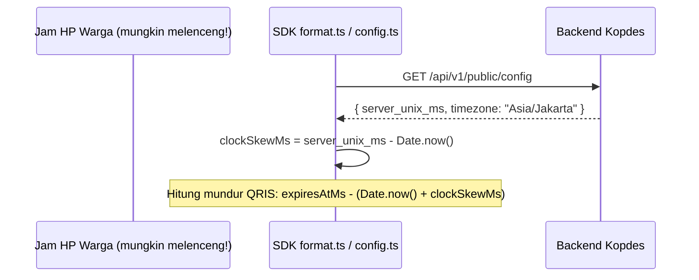

# 12. Format Data, Nominal Rupiah & Zona Waktu `Asia/Jakarta`

Bab teknis ini menyatukan standar pengolahan uang dan tanggal di seluruh aplikasi frontend agar tidak pernah terjadi kesalahan pembulatan angka maupun pergeseran hari pergantian tanggal.

---

## 1. Apa Fungsi Aturan Ini (Bahasa Awam Desa)

Di sistem keuangan, salah hitung Rp 1 atau keliru hari (WIB vs UTC jam 7 pagi) berakibat fatal pada laporan kas dan kecocokan kode unik QRIS. Oleh sebab itu seluruh uang diproses dalam bilangan bulat Rupiah (`int64` / string desimal tanpa float pecahan) dan seluruh batas hari memakai waktu Indonesia Barat (**`Asia/Jakarta`**).

## 2. Siapa yang Memakai

Seluruh pengembang frontend, desainer UI, dan QA saat membangun tampilan harga, invoice QRIS, formulir input nominal, maupun pemilih tanggal laporan rekonsiliasi.

## 3. Referensi Endpoint Terkait

- `GET /api/v1/public/config`: menyediakan `timezone: "Asia/Jakarta"`, `server_time`, dan `server_unix_ms`.
- `POST /api/v1/pembayaran/qris`: mengirim `nominal_dasar`, `kode_unik`, `nominal_total` (integer) dan `berlaku_sampai` (`RFC3339`).
- `GET /api/v1/pembayaran/{id}`: mengirim `nominal_total` sebagai `string` (`"600356.00"`).
- `GET /api/v1/pembayaran/rekonsiliasi/harian?tanggal=YYYY-MM-DD`: memfilter berdasarkan hari operasional `Asia/Jakarta`.

## 4. Alur Konversi Jam Perangkat vs Waktu Server



## 5. Contoh Nyata Perbedaan Tipe Nominal & Tanggal

| Sumber Field | Contoh Nilai Mentah | Tipe JSON | Cara SDK `formatRupiah()` Menampilkan |
|---|---|---|---|
| `POST /pembayaran/qris -> nominal_total` | `600356` | `number` | `"Rp 600.356"` |
| `GET /pembayaran/{id} -> nominal_total` | `"600356.00"` | `string` | `"Rp 600.356"` |
| `POST /toko/checkout -> total_akhir` | `131000` | `number` | `"Rp 131.000"` |
| `berlaku_sampai` | `"2026-11-15T04:15:00Z"` | `string` RFC3339 | `"15 Nov 2026, 11.15 WIB"` |

## 6. Contoh Permintaan & Validasi Konfigurasi Waktu

Lihat `GET /api/v1/public/config` (`RESP-PUBLIC-CONFIG-200` pada [Bab 01](01-konfigurasi-frontend.md)): field `timezone` selalu mengembalikan `"Asia/Jakarta"`.

## 7. Konfigurasi Terkait

- `timezone` (`"Asia/Jakarta"`) & `server_unix_ms` dari `/api/v1/public/config`.

## 8. Kode Contoh Siap Pakai (`format.ts` di SDK)

```typescript
import {
  formatRupiah,
  parseRupiahInput,
  formatJakartaDateTime,
  getJakartaTodayISO,
  maskNIK,
} from "../../frontend-reference/src/index";

formatRupiah(600356); // "Rp 600.356"
formatRupiah("600356.00"); // "Rp 600.356"
parseRupiahInput("Rp 25.000"); // 25000 (int)
formatJakartaDateTime("2026-11-15T04:15:00Z"); // format lokal Indonesia WIB
getJakartaTodayISO(); // "2026-11-15" (mengikuti WIB meski device di UTC/WITA/WIT)
maskNIK("3201010101900001"); // "3201********0001"
```

## 9. Kesalahan Umum yang Harus Dihindari

- **JANGAN** pakai `new Date().toISOString().slice(0, 10)` untuk tanggal rekonsiliasi harian — jam `00:30 WIB` adalah tanggal kemarin jam `17:30 UTC`!
- **JANGAN** pakai `0.1 + 0.2` float untuk menjumlah keranjang; konversi seluruh input harga ke bilangan bulat `Math.trunc` / `BigInt`.
- **JANGAN** mengasumsikan `GET /pembayaran/{id}` selalu mengirim `nominal_total` bertipe `number` (server mengembalikan string desimal dari kolom `NUMERIC(18,2)`).

## 10. Kasus Tepi

- Jam sistem HP Android murah sering tidak sinkron (`auto-time off`); `computeClockSkewMs(config.server_unix_ms)` menjaga hitung mundur `berlaku_sampai` tetap akurat dan konsisten dengan `sisa_waktu_detik` server.

## 11. Keamanan Klien

- Helper `maskNIK()` memastikan jika ada teks NIK terformat di komponen ringkasan sebelum submit, tampilannya tersamar `XXXX********XXXX`.

## 12. Cara Menguji

Jalankan test unit SDK (`npm --prefix frontend-reference test`) yang menguji pemformatan nominal string desimal, pergantian hari UTC jam `17:00Z` vs `00:00 WIB`, dan parsing Rupiah, serta periksa panel **Diagnostik Lingkungan** untuk melihat deteksi selisih jam live.

## 13. Checklist Selesai Format Data

- [ ] Seluruh tampilan Rupiah lewat helper `formatRupiah()`.
- [ ] Seluruh tanggal transaksi dan query harian memakai `Asia/Jakarta`.
- [ ] Selisih jam (`clockSkewMs`) diterapkan pada countdown pembayaran QRIS.
