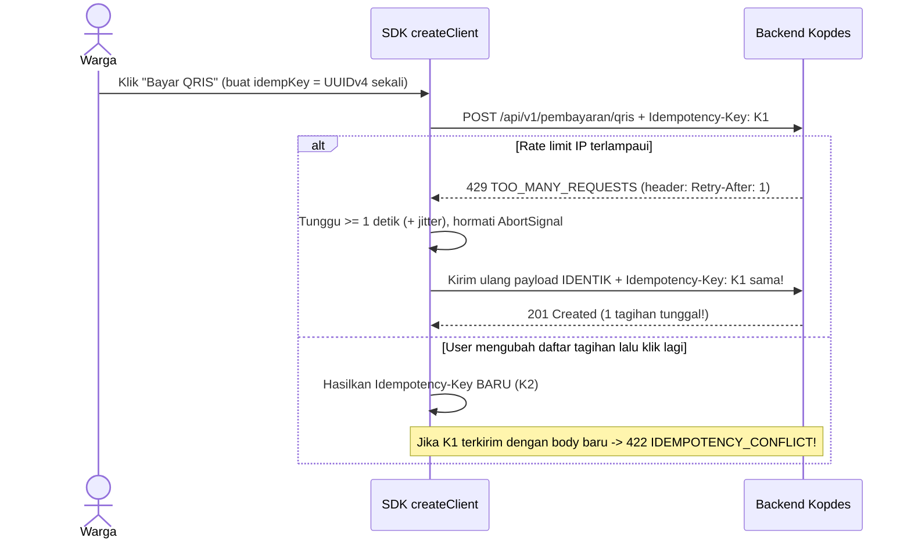

# 13. Penanganan Kesalahan, Retry Backoff & `Idempotency-Key`

Bab ini membahas kontrak lengkap respons error JSON, kamus pesan Bahasa Indonesia [pesan-error-id.json](pesan-error-id.json), strategi retry otomatis vs larangan retry, serta pencegahan transaksi ganda memakai `Idempotency-Key`.

---

## 1. Apa Fungsi Pola Ini (Bahasa Awam Desa)

Koneksi internet di pedesaan sering naik-turun. Bila warga menekan tombol "Bayar Sekarang" lalu sinyalnya putus di tengah jalan dan ia menekan ulang, server tidak boleh membuatkan dua tagihan kode unik yang berbeda! Dan bila kantor desa memakai satu Wi-Fi sehingga terkena batas permintaan `429`, aplikasi harus menunggu sesuai waktu tunggu dari server tanpa terus memukul server membabi buta.

## 2. Siapa yang Memakai

Seluruh modul API di frontend wajib memakai pembungkus error & retry terpusat dari [frontend-reference/](../../frontend-reference/).

## 3. Referensi Endpoint Terkait

- Seluruh endpoint API menggunakan envelope JSON seragam `{ success, data, meta, error }`.
- `POST /api/v1/pembayaran/qris` mendukung penuh header `Idempotency-Key: <UUIDv4>` berbasis tabel PostgreSQL `idempotency_keys`.

## 4. Diagram Urutan Penanganan `429` + `Retry-After` & `Idempotency-Key`



## 5. Katalog Lengkap 15 `error.code` Backend

Seluruh 15 kode resmi tersedia di mesin-terbaca [pesan-error-id.json](pesan-error-id.json):

| HTTP | `error.code` | Retry Otomatis? | Pola Tampilan UI |
|---|---|---|---|
| `400` | `BAD_REQUEST` | **Tidak** | Pesan field inline / alert form |
| `401` | `UNAUTHORIZED` | **1x Refresh Saja** | Single-flight refresh -> bila gagal ke Login |
| `403` | `FORBIDDEN` | **Tidak** | Banner izin ditolak + sembunyikan aksi terlarang |
| `403` | `MFA_MANDATORY_SETUP_REQUIRED` | **Tidak** | Wizard Aktivasi MFA (`setup_token`) |
| `403` | `MFA_ENROLLMENT_REQUIRED` | **Tidak** | Kunci navigasi di Wizard MFA sampai selesai |
| `404` | `NOT_FOUND` | **Tidak** | Empty state ramah (tanpa bocor info tenant/pemilik) |
| `409` | `CONFLICT` | **Tidak** | Peringatan benturan data (NIK duplikat / slot unik penuh) |
| `413` | `PAYLOAD_TOO_LARGE` | **Tidak** | Instruksi kompres ulang foto KYC / kecilkan file |
| `422` | `IDEMPOTENCY_CONFLICT` | **Tidak** | Buat `Idempotency-Key` baru & segarkan ringkasan bayar |
| `429` | `TOO_MANY_REQUESTS` | **Ya** *(bukan login lockout!)* | Hormati `Retry-After` + tampilkan hitung mundur |
| `429` | `MFA_SESSION_LOCKED` | **Tidak** | Bersihkan `mfa_session_token`, kembali ke login tahap 1 |
| `500` | `INTERNAL_SERVER_ERROR` | **Hanya `GET`** | Tampilkan `X-Request-ID` untuk laporan admin + tombol Muat Ulang |
| `503` | `DATABASE_UNAVAILABLE` | **Hanya `GET` / `Retry-After`** | Banner layanan sedang pulih |
| `503` | `READ_ONLY_MODE` | **Tidak** | Refetch `/public/config` + banner mode baca-saja global |
| `503` | `FEATURE_DISABLED` | **Tidak** | Refetch `/public/config` + banner fitur tutup sementara |

## 6. Contoh Respons Error Nyata (`400 BAD_REQUEST`)

<!-- doc-test-response: id=RESP-LOGIN-EMPTY-400 method=POST path=/api/v1/auth/login auth=public body={} status=400 -->
```json
{
  "success": false,
  "error": {
    "code": "BAD_REQUEST",
    "message": "Email dan password wajib diisi"
  }
}
```

## 7. Konfigurasi yang Dibutuhkan

- `CORS` backend mengekspos header `X-Request-ID` dan `Retry-After` pada `Access-Control-Expose-Headers` (**DISC-04** & **DISC-14**).
- `request_timeout_ms` default SDK `15000` ms dengan `AbortController`.

## 8. Kode Contoh Penanganan Error dengan SDK `ApiError`

```typescript
import { ApiError, getErrorPresentation } from "../../frontend-reference/src/index";

try {
  await client.request("/api/v1/toko/checkout", { method: "POST", body: payload });
} catch (err) {
  if (err instanceof ApiError) {
    const ui = getErrorPresentation(err);
    showToast({ title: ui.title, body: err.message || ui.action, requestId: err.requestId });
  }
}
```

## 9. Penjelasan Kapan TIDAK Boleh Retry

- **DILARANG** me-retry otomatis `429 TOO_MANY_REQUESTS` atau `429 MFA_SESSION_LOCKED` pada endpoint `/api/v1/auth/login` & `/api/v1/auth/mfa/verify` — retry otomatis di login memperparah hitung kegagalan dan memperpanjang lockout 15 menit!
- **DILARANG** me-retry mutasi `POST` yang belum tentu idempoten saat menerima `500` kecuali Anda menyertakan `Idempotency-Key` pada `/api/v1/pembayaran/qris`.

## 10. Kasus Tepi

- User berpindah halaman (`unmount` komponen React) saat SDK sedang menunggu jeda `Retry-After` atau loading `15s`: wajib memanggil `abortController.abort()` di `useEffect cleanup` agar permintaan batal rapi dan tidak menumpuk di latar belakang.

## 11. Keamanan Klien

- Sertakan `err.requestId` (`X-Request-ID`) saat menampilkan pesan error internal kepada pengguna; **jangan pernah** menampilkan stack trace mentah atau SQL detail jika suatu saat muncul di mode dev.

## 12. Cara Menguji di Frontend Tester

Buka tab **Simulator Kondisi** di `frontend-tester/index.html` untuk mensimulasikan `401 Refresh`, `429 Retry-After`, `503 READ_ONLY_MODE`, serta `Offline / Timeout Abort`.

## 13. Checklist Selesai Penanganan Error

- [ ] Seluruh 15 `error.code` di [pesan-error-id.json](pesan-error-id.json) tertangani tanpa pesan kosong/Inggris mentah.
- [ ] `429` menghormati header `Retry-After` dengan jeda & abort signal.
- [ ] `Idempotency-Key` direset otomatis hanya bila isi item/nominal pembayaran diubah pengguna.
