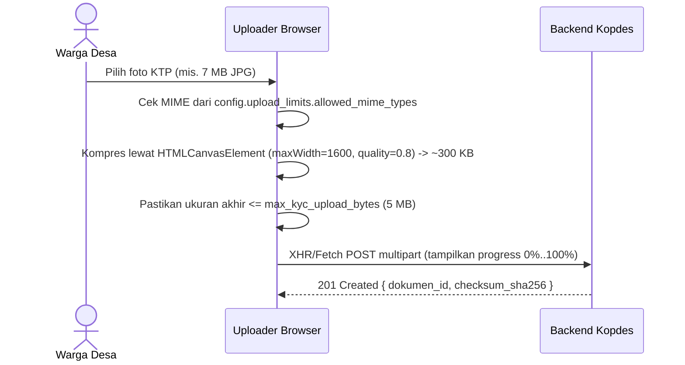

# 14. Unggahan Berkas KYC/CSV & Perlindungan Data Klien (UU 27/2022 PDP)

Bab ini menjelaskan cara menangani unggahan berkas foto KTP dan file CSV mutasi bank secara hemat kuota serta perlindungan ketat data pribadi anggota di sisi browser.

---

## 1. Apa Fungsi Aturan Ini (Bahasa Awam Desa)

Foto KTP dari kamera HP modern sering berukuran 6–12 MB, sedangkan server koperasi membatasi dokumen KYC maksimal 5 MB dan warga di desa memakai kuota seluler terbatas. Dengan mengompres foto di browser sebelum dikirim, ukuran foto turun menjadi sekitar 200–400 KB tanpa menghilangkan keterbacaan tulisan NIK, sementara data KTP mentah tidak pernah tertinggal di penyimpanan browser.

## 2. Siapa yang Memakai

- Calon anggota (`anggota`) saat mengunggah foto KTP/KK/foto diri/surat domisili (`POST /api/v1/pendaftaran/{id}/dokumen`).
- Pengurus/Bendahara (`admin`, `pengurus`, `bendahara`) saat mengunggah mutasi bank CSV (`POST /api/v1/pembayaran/mutasi-bank/impor`).

## 3. Endpoint Terkait

| Method | Path | Field FormData | Batas & Format |
|---|---|---|---|
| `POST` | `/api/v1/pendaftaran/{id}/dokumen` | `dokumen`, `jenis_dokumen` | `image/jpeg`, `image/png`, `application/pdf`; `<= max_kyc_upload_bytes` (bawaan 5 MB). |
| `POST` | `/api/v1/pembayaran/mutasi-bank/impor` | `file` | `text/csv`, `application/csv`, `text/plain`; `<= max_body_bytes` (bawaan 10 MB). |

## 4. Diagram Urutan Pra-Proses & Upload Berkas



## 5. Status UI Selama Unggahan

- **`validating`**: Memeriksa tipe MIME dan ukuran awal.
- **`compressing`**: Merender pratinjau + mengecilkan resolusi gambar (tampilkan indikator *"Mengoptimalkan ukuran foto..."*).
- **`uploading`**: Tampilkan bar progres % bila memakai XHR `upload.onprogress` dari SDK `uploadMultipartWithProgress()`.
- **`uploaded` / `error`**: Sukses atau tampilkan pesan error `413` / `400` dengan tombol Pilih Ulang.

## 6. Contoh Payload Multipart & Batas Publik

Pastikan batas selalu dibaca dinamis dari `GET /api/v1/public/config`:
```json
{
  "max_body_bytes": 10485760,
  "max_kyc_upload_bytes": 5242880,
  "allowed_mime_types": ["image/jpeg", "image/png", "application/pdf"],
  "allowed_csv_mime_types": ["text/csv", "application/csv", "text/plain"]
}
```

## 7. Konfigurasi yang Dibutuhkan

- Jangan menulis header `Content-Type: multipart/form-data` secara manual! Biarkan browser/`fetch`/`XHR` menyisipkan `boundary=...` secara otomatis.

## 8. Kode Contoh Upload Progresif + Abort (`upload.ts`)

```typescript
import { validateUploadFile, compressImageInBrowser, uploadMultipartWithProgress } from "../../frontend-reference/src/index";

const check = validateUploadFile(file, {
  maxBytes: publicConfig.upload_limits.max_kyc_upload_bytes * 2,
  allowedMimeTypes: publicConfig.upload_limits.allowed_mime_types,
});
if (!check.ok) throw new Error(check.reason);

const compressed = file.type.startsWith("image/")
  ? await compressImageInBrowser(file, {
      maxWidth: 1600,
      quality: 0.8,
      maxBytes: publicConfig.upload_limits.max_kyc_upload_bytes,
    })
  : file;

const fd = new FormData();
fd.append("dokumen", compressed);
fd.append("jenis_dokumen", "ktp");

await uploadMultipartWithProgress(`${baseUrl}/api/v1/pendaftaran/${id}/dokumen`, fd, {
  accessToken: session.accessToken,
  onProgress: (pct) => setProgress(pct),
});
```

## 9. Error Terkait Unggahan

- `400 BAD_REQUEST`: Backend membaca **magic bytes** isi file asli (bukan cuma nama ekstensi `.jpg`), sehingga file PHP/HTML yang diganti nama jadi `ktp.jpg` otomatis ditolak.
- `413 PAYLOAD_TOO_LARGE`: Total body request melebihi `max_body_bytes` atau ukuran foto melebihi `max_kyc_upload_bytes`.

## 10. Kasus Tepi

- Browser mobile lama tidak mendukung HEIC: tambahkan keterangan ramah *"Gunakan foto JPG/PNG atau PDF"* di bawah tombol pilih file, dan cabut `URL.createObjectURL()` dengan `URL.revokeObjectURL()` segera sesudah pratinjau/kompresi selesai agar RAM HP warga tidak bocor.

## 11. Keamanan & Privasi Klien (UU No. 27 Tahun 2022 PDP — PERLU VERIFIKASI HUKUM)

- **Dilarang**: Menyimpan NIK, alamat KTP, token JWT, `refresh_token`, atau data foto KTP di `localStorage`, `sessionStorage`, query parameter URL, maupun perekaman sesi *analytics* (Sentry/Hotjar wajib di-mask). <!-- claim:CLAIM-CLIENT-TOKEN-MEMORY UNVERIFIED: Kepatuhan penyimpanan di memori JS frontend pihak ketiga tidak dapat diverifikasi oleh endpoint REST server dan diverifikasi secara statis serta lewat Frontend Tester -->
- **Hukum & Retensi**: Penetapan jangka waktu penghapusan data pendaftar tertolak (`30 hari`) serta dokumen pemberitahuan privasi pengguna akhir ditandai **PERLU VERIFIKASI HUKUM**.

## 12. Cara Menguji

Gunakan **Lab Belajar -> Bab 04/14** pada Frontend Tester untuk menguji validasi MIME dan unggahan berkas KYC uji sintetis.

## 13. Checklist Selesai Unggahan & Privasi

- [ ] Tidak men-set header `Content-Type` secara manual saat mengirim `FormData`.
- [ ] Gambar > `max_kyc_upload_bytes` terkompresi di sisi klien sebelum transfer.
- [ ] Tidak ada token maupun NIK mentah tersimpan di `localStorage`, `sessionStorage`, atau URL.
